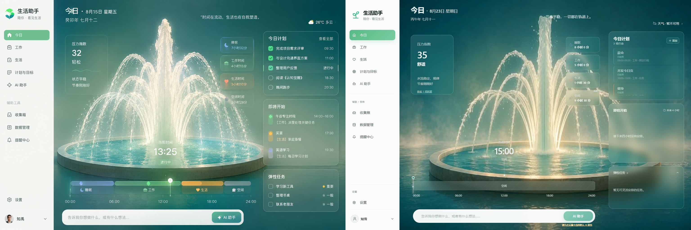

# 知雪的生活助手

> 历史作品归档 · 2026-10-19。此仓库保留开发成果供展示和参考，不作为持续维护或已在当前环境验证的发行版本。

## 作品简介

一个围绕工作、生活、目标、计划与日程构建的单用户、本地优先生活助手。项目探索了多空间界面、随时间与压力变化的沉浸式今日场景，以及带操作审计和撤销机制的可选 AI 助手。



- **前端**：React、TypeScript、Vite、TanStack Router / Query。
- **本地服务**：Fastify、SQLite、Drizzle ORM。
- **桌面入口**：.NET 8 Windows Launcher。
- **工程组织**：pnpm workspace、Turborepo、Vitest 与 Playwright。

### 归档状态

源码快照基于原始提交 `b15ad69`（2026-09-19），已包含 V3.1 时间感知场景状态引擎；发布配置仍停留在 `2.0.0-rc.4`。两者代表不同阶段，不能将当前源码直接视作当时的 RC4 发布包。

本次公开归档使用新的 Git 历史起点，保留源码、素材、设计方案与历史验收文档。原始 Git 历史、个人运行数据库、备份、凭据及本机预览配置不随快照上传，仍保留在原电脑工作区。旧发布 ZIP、依赖目录、缓存与运行日志也不纳入仓库。

迁移后仅完成归档文件检查，未重新安装依赖、启动应用或重跑完整测试。下方环境与开发命令保留自原项目；历史报告中的“通过”仅表示当时的验收记录。GitHub Actions 改为手动触发，便于有需要时自行复验。

### 目录导航

| 路径 | 内容 |
| --- | --- |
| `apps/web` | Web 界面与视觉素材 |
| `apps/server` | 本地 API 与 AI 执行逻辑 |
| `apps/launcher` | Windows 启动器 |
| `packages` | 领域模型、业务逻辑、数据库、契约与调度等共享模块 |
| `docs` | 架构决策、设计过程、验收资料与排查记录 |
| `fixtures` | 测试与视觉基准数据 |
| `scripts` | 开发、验证与打包脚本 |

## 原项目说明

本仓库是“个人生活助手”的单用户、本地优先桌面 Web App，统一管理工作、生活、目标、计划和日程，并提供可选 AI 助手。当前产品候选版本为 `v2.0.0-rc.4`，详见 [V2 RC4 Release Notes](./V2_RC4_RELEASE_NOTES.md)。`v2.0.0-rc.3` 及其 Windows x64 artifact 已因 packaged cold-start blocker 废弃，不得继续分发。

## 环境要求

- Windows 10/11
- Node.js 24 或更高版本
- pnpm 11.21.0
- .NET SDK 8（仅开发 Windows Launcher 时需要）
- 最新版 Chrome 或 Edge

## 本地开发

```bash
pnpm install
pnpm contracts:generate
pnpm dev
```

开发模式下 Web 默认位于 `http://127.0.0.1:5173`，并将 `/api` 与 `/health` 请求代理到 `http://127.0.0.1:43120`。

生产形态的本地预览：

```bash
pnpm build
pnpm --filter @life-assistant/server start:test
```

随后访问 `http://127.0.0.1:43120`。

构建并双击 Windows Launcher：

```bash
pnpm build
pnpm launcher:build
```

可执行文件位于 `apps/launcher/bin/Release/net8.0-windows/LifeAssistant.exe`。重复双击只会唤起已有实例；关闭浏览器不会停止托盘中的本地服务，可从托盘菜单重新打开或退出。

## 质量门禁

```bash
pnpm verify
pnpm test:e2e:isolated
pnpm release:windows
```

`pnpm verify` 会依次检查格式、Lint、类型、单元/集成测试、契约生成物和全仓构建。完整端到端验收使用隔离编排，默认运行已安装的 Google Chrome；设置环境变量 `LIFE_ASSISTANT_BROWSER=msedge` 后运行同一命令可验证 Microsoft Edge。需要安装实际 Chrome/Edge，不能用 Playwright Chromium 替代双浏览器验收。`pnpm release:windows` 只允许从 clean Git worktree 构建，并生成 `release.json` 所声明产品版本的 Windows x64 ZIP。

## 文档入口

- [产品需求与系统架构设计书](./产品需求与系统架构设计书.md)
- [数据库与 API 详细设计书](./数据库与API详细设计书.md)
- [项目工程结构与开发实施计划](./项目工程结构与开发实施计划.md)
- [架构决策记录](./docs/adr/README.md)
- [贡献与开发约定](./CONTRIBUTING.md)
