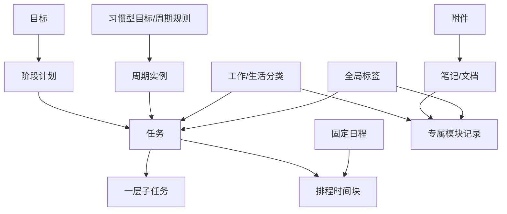
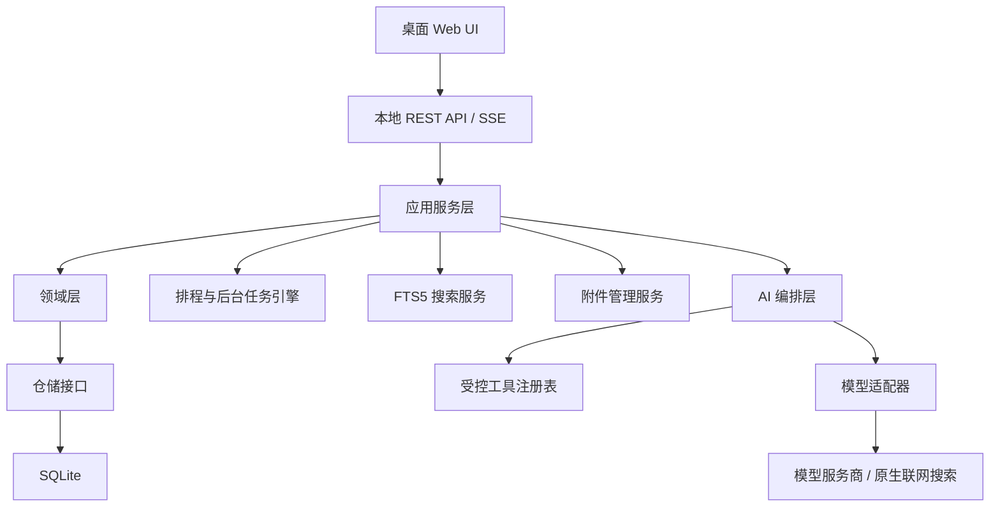

# 个人生活助手——产品需求与系统架构设计书

> 文档状态：V1.0（第一版开发基线）  
> 产品形态：单用户、本地优先、桌面 Web App  
> 正式支持环境：Windows + 最新版 Chrome / Edge  
> 默认语言：简体中文  
> 默认时区：Asia/Shanghai（UTC+8）

---

## 1. 文档目的

本文档用于统一产品目标、第一版范围、业务规则与技术架构，作为后续交互设计、数据库设计、接口设计、开发拆分、测试验收和版本演进的共同基线。

本文档中的“必须”均属于第一版验收要求；标记为“未来”的内容不进入第一版开发范围，但第一版架构不得阻断其实现。

---

## 2. 产品定义

### 2.1 一句话定义

个人生活助手是一套可长期使用的本地个人生活操作系统，用统一的数据与时间体系管理工作、生活、目标、计划和日程，并允许 AI 在明确权限边界内理解、分析和操作这些数据。

### 2.2 第一版核心问题

第一优先级：解决个人事项依赖记忆、缺少统一入口、难以集中管理的问题。

同等重要的后续价值：

- 帮助用户每天明确应该做什么。
- 让计划能够被持续执行和动态调整。
- 让 AI 不止回答问题，还能通过工具真正操作个人数据。

### 2.3 产品目标

1. 建立工作、生活、时间、计划、目标和个人资料的统一数据中心。
2. 提供低摩擦的快速记录与收集箱，降低记录成本。
3. 使用确定性的本地规则引擎完成重复事项、提醒、压力计算、冲突检测和自动排程。
4. 使用可选的 AI 增强自然语言录入、全局分析、生活决策和数据操作。
5. 提供可解释、可撤销、可恢复的数据操作体验。
6. 在没有网络或 API Key 时，仍保持完整的本地管理能力。
7. 从业务 API、数据协议和设计系统上为未来移动端及 Windows 桌面封装预留出口。

### 2.4 第一版非目标

- 不做多人协作、组织、角色和多租户权限。
- 不做手机端 UI，仅保留架构与设计系统出口。
- 不包装成可安装的 Windows 桌面应用。
- 不接入外部日历、邮箱、微信、健康设备或内容平台。
- 不自动读取代码仓库数据，仓库只保存可打开的链接。
- 不解析 PDF、Word、图片等附件正文供 AI 问答。
- 不做语音输入或语音播报。
- 不做语义搜索或向量数据库。
- 不做本地数据库和附件加密。
- 不依赖云端数据库，也不实现电脑离线时的移动端同步。
- 不深度定义最终视觉风格；第一版以清晰、稳定、可扩展为准。

---

## 3. 用户与使用环境

### 3.1 用户模型

- 第一版仅服务产品所有者本人。
- 不需要注册、登录或解锁流程。
- 所有数据默认属于唯一的本地用户。
- 数据表保留 `owner_id` 或等价边界的扩展可能，但第一版不暴露多用户能力。

### 3.2 运行方式

- 用户双击桌面快捷方式启动应用。
- 启动器在后台启动本地服务，并自动打开默认浏览器页面。
- 本地服务默认仅监听 `127.0.0.1`，不得暴露到局域网或公网。
- 关闭浏览器后，本地服务继续运行，负责排程、提醒、备份、回收站清理等后台任务。
- 用户可从托盘图标或明确入口重新打开界面、查看状态和退出后台服务。
- 电脑关机后后台任务暂停；下次启动时必须补跑错过的确定性任务。

### 3.3 离线原则

断网或未配置 AI API Key 时，下列功能仍必须正常工作：

- 任务、日程、计划、目标和七个业务模块的增删改查。
- 今日页与所有总览。
- 本地规则自动排程。
- 重复事项生成。
- 冲突检测、提醒、压力指数和空闲时间计算。
- 笔记、附件、关键词搜索、统计、备份和恢复。

只有以下能力可以因断网或缺少 API Key 而不可用：

- AI 对话与自然语言理解。
- AI 智能拆分、分类和语境化排程建议。
- AI 主动分析与联网检索。

---

## 4. 产品原则

### 4.1 本地优先

业务数据、附件、聊天记录和配置均以本地电脑为唯一权威数据源。除用户主动调用模型时所需的上下文外，应用不得默认上传个人数据。

### 4.2 AI 可选而非依赖

规则明确、可确定计算的能力必须由本地引擎实现。AI 负责自然语言理解、复杂分析、建议和工具选择，不负责维持系统基本运转。

### 4.3 单一事实来源

任务、计划、目标和日程不得在各模块中复制多份。各页面只是同一数据的不同视图和聚合。

### 4.4 明确归属，允许关联

每条业务内容只有一个工作或生活归属，避免重复和进度冲突；可以通过目标、计划、任务、标签和附件建立跨对象关联。

示例：漫画书归娱乐；用于学习技能和知识的书籍归工作区的学习模块，不同时属于两个模块。

### 4.5 所有自动操作可解释

系统或 AI 完成排程、修改或分析时，应展示原因、来源和变更结果。任何关键业务对象都应具备版本记录或操作记录。

### 4.6 风险分级

- 只读查询和联网搜索可直接执行。
- 用户明确要求后的新增和普通更新可直接执行。
- 删除、批量调整、替换长期目标、清空数据等高影响操作必须确认。
- AI 主动发现的问题只能形成建议，不得自行写入任务、计划或目标。

---

## 5. 信息架构

### 5.1 桌面端总体布局

桌面端采用左侧导航栏与右侧内容区：

1. 今日
2. 工作
   - 工作总览
   - 自媒体
   - 开发项目
   - 学习
   - 用户新增的工作分类
3. 生活
   - 生活总览
   - 购物
   - 饮食
   - 健身
   - 娱乐
   - 用户新增的生活分类
4. 计划与目标
5. AI 助手
6. 设置

全局能力不必占据主导航一级位置，但必须随时可访问：

- 全局快速记录
- 收集箱
- 全局搜索
- 应用内提醒中心
- 最近操作与撤销

### 5.2 分类与专属模块的关系

- 七个初始分区使用专属模块模板，拥有独立字段和界面。
- 分类支持新增、重命名、排序和归档。
- 新增分类时，用户可选择一个现有专属模块模板，或使用通用分类模板。
- 归档分类不删除数据，历史记录和关联仍可查询。
- 专属模块类型与显示名称解耦，重命名不会改变底层数据结构。

### 5.3 未来移动端出口

第一版不实现移动端 UI，但必须满足：

- 前端组件不得假设永久存在左侧导航。
- 业务能力通过稳定 API 暴露，桌面端不直接访问数据库。
- API 使用与终端无关的数据协议。
- 领域逻辑放在服务端或共享领域层，不写死在桌面页面组件中。
- 设计令牌、状态、表单规范和操作语义可供未来移动端复用。
- 远程安全访问、离线副本和加密同步属于未来版本。

---

## 6. 核心领域模型

### 6.1 核心关系



### 6.2 目标

目标分为：

- 成果型目标：以明确成果或完成节点为终点。
- 习惯型目标：以持续频率、连续性或指标变化为目标。

目标至少包含：名称、说明、类型、工作/生活归属、起止日期、短期/长期分类、状态、手动进度、自动进度、最终显示进度、关联计划、量化指标、标签和版本历史。

时间规则：

- 今日：当前自然日。
- 本周：按系统设置的周起始日计算，默认周一。
- 短期：持续周期不超过一个月。
- 长期：持续周期超过一个月。

目标进度规则：

- 自动进度由下属计划、任务或指标计算。
- 用户可以手动填写或覆盖显示进度。
- 系统记录进度来源，自动计算不得静默覆盖用户手动判断。

### 6.3 计划

计划是目标和行动之间的阶段性组织单元，至少包含：名称、说明、所属目标、起止日期、状态、优先级、里程碑、关联任务、标签和版本历史。

### 6.4 任务

任务至少包含：

- 标题与说明。
- 唯一所属分类。
- 关联目标与计划。
- 状态：待处理、进行中、已完成、已取消。
- 优先级：低、普通、高、紧急。
- 截止时间：必须存在；缺失时可由 AI 推断。
- 预计时长：必须存在；缺失时由 AI 估算。
- 是否为弹性任务。
- 是否允许拆分排程。
- 一层子任务。
- 前置依赖与后置依赖。
- 标签、提醒、排程记录、重排历史和版本历史。

首版排程决策：任务默认不拆分；用户或 AI 可明确标记“允许拆分”。允许拆分时，单个时间片不得短于 30 分钟，并仍对齐 15 分钟网格。

### 6.5 固定日程

固定日程必须占据明确起止时刻，可属于工作或生活。固定会议、就医等高优先级固定事项默认不可移动。用户可以为任何日程设置“不可移动”。

系统默认禁止时间重叠。用户手动创建冲突时必须提示，只有明确确认后才保留冲突。

### 6.6 重复规则

任务与日程均支持重复：每日、每周、每月、每年、工作日、自定义星期与自定义间隔。

必须支持：

- 修改单次实例。
- 修改本次及以后。
- 修改整个序列。
- 跳过一次。
- 结束重复。
- 保留实例与原规则的关系。

### 6.7 作息模板

支持至少三类默认作息模板：

- 工作日。
- 周末。
- 中国法定节假日。

用户可以建立更多模板，并按具体日期覆盖。当天调整默认只影响当天，除非用户明确选择修改模板。

中国法定节假日和调休由系统联网更新，同时允许手动维护。联网失败不得影响手动数据和既有节假日数据。

### 6.8 笔记、文档和附件

- 笔记编辑同时支持富文本和 Markdown。
- 每份文档可以选择编辑模式，并支持安全转换或保留原格式。
- 上传文件复制到应用管理的数据目录，不只保存原始路径。
- 附件记录文件名、扩展名、大小、校验值、归属、说明和存储路径。
- AI 只可读取附件元数据和用户填写的说明，不读取正文、不做 OCR、不生成基于正文的任务。

### 6.9 全局标签

标签跨工作和生活模块使用，用于关键词检索和筛选。标签不改变记录的唯一归属，也默认不直接改变排程算法；未来可扩展为位置、精力和环境约束。

---

## 7. 今日模块

### 7.1 定位

“今日”是整个产品最重要的页面，是当天计划、时间状态、压力和提醒的统一驾驶舱。

### 7.2 今日计划定义

“今日计划”与“今日时间安排”是同一概念，包含：

- 今日工作安排。
- 今日生活安排。
- 固定日程。
- AI 或本地规则引擎排入空闲时间的弹性任务。

“今日工作安排”只是今日计划中属于工作的筛选子集，不维护第二份计划数据。

### 7.3 必备信息

- 当前日期和东八区实时时刻。
- 24 小时计划时间流。
- 今日计划列表。
- 今日工作安排筛选。
- 睡眠时间、工作时间、生活时间和空闲时间统计。
- 今日压力指数及原因解释。
- 临近提醒、逾期事项、排程冲突和 AI 主动建议。

### 7.4 动态时间流

时间流覆盖 00:00–24:00，只展示计划安排和当前时刻，不展示计划与实际耗时对比，也不是计时器。

视觉语义：

- 空闲时间：流动平缓。
- 普通任务：稳定流动。
- 连续工作：流速随持续时间增加。
- 高优先级或高压任务：水流更粗、更有力量。
- 休息时间：流速明显下降。
- 睡眠：处于最低活动状态。
- 当前时刻：持续可见的实时位置标记。

交互规则：

- 时间流主要用于查看，不在流上直接拖动或缩放日程。
- 点击时间段打开详情面板进行编辑。
- 任务完成后从时间流移除，该计划时段重新计为空闲。
- 完成记录仍保留在任务历史与统计中。
- 任务在计划时段结束后仍未完成，系统立即尝试重排，并保留逾期与重排历史。

### 7.5 压力指数 V1

压力指数固定为 0–100 分，并映射为：

- 0–24：轻松。
- 25–49：舒适。
- 50–74：偏高。
- 75–100：高压。

第一版采用固定、可解释算法，不开放权重设置。建议公式：

`压力分 = 负荷分 + 优先级分 + 截止紧迫分 + 连续工作分 + 缓冲不足分`

- 负荷分（0–35）：清醒可用时间中，工作与生活安排的占用比例。
- 优先级分（0–25）：按预计时长和低/普通/高/紧急权重计算。
- 截止紧迫分（0–20）：当天到期、临近到期、逾期任务的加权结果。
- 连续工作分（0–10）：最长连续工作时段超过 90、120、180 分钟时逐级增加。
- 缓冲不足分（0–10）：清醒时段空闲比例越低，分数越高。

页面必须展示主要贡献因素，例如“紧急任务 2 项”“连续工作 150 分钟”“可用缓冲仅 45 分钟”。

---

## 8. 工作模块

### 8.1 工作总览

工作总览汇总：

- 自媒体内容进展和数据表现。
- 开发项目进度、缺陷和近期里程碑。
- 学习计划、学习时长与资源进度。
- 工作任务完成率、逾期率、时间投入和压力贡献。
- 本周、本月、本季度、本年及自定义范围的趋势。

### 8.2 自媒体

管理内容全生命周期：

- 选题灵感。
- 脚本/文案。
- 素材附件。
- 内容日历。
- 发布时间。
- 制作状态。
- 发布后的数据表现。

建议制作状态：灵感、策划中、创作中、待发布、已发布、已归档。

数据表现由用户手动录入，可包含平台名称、播放/阅读、点赞、评论、收藏、分享、关注增长及自定义指标。第一版不连接内容平台。

### 8.3 开发项目

管理：

- 项目概览。
- 开发任务。
- 功能清单。
- 技术文档。
- 里程碑。
- 缺陷。
- 代码仓库链接。

代码仓库只保存名称、URL 和说明，支持打开链接，不读取提交、Issue、分支或仓库进度。

缺陷建议包含：严重程度、复现步骤、当前状态、关联功能、关联任务、发现版本和解决版本。

### 8.4 学习

管理：

- 学习计划。
- 学习时长。
- 知识笔记。
- 学习资料与附件。
- 课程和书籍。

学习模块属于工作板块，只收纳以技能和知识提升为目的的内容。娱乐阅读归生活区娱乐模块。

第一版不要求测验、记忆曲线和复杂复习算法。

---

## 9. 生活模块

### 9.1 生活总览

生活总览汇总：

- 购物、饮食、健身和娱乐的近期事项。
- 各模块支出及统一消费视图。
- 总预算与分类预算对比。
- 时间投入、习惯完成情况和身体指标趋势。
- 本周、本月、本季度、本年及自定义范围统计。

各模块只管理自己的费用；生活总览负责跨模块汇总，不建立独立财务模块。

### 9.2 购物

管理：

- 待购清单。
- 商品分类。
- 预算。
- 价格与数量。
- 优先级。
- 购买状态。
- 历史消费记录。

购买完成后，应可从待购项生成消费记录，保留计划价格与实际价格差异。

### 9.3 饮食

管理：

- 每日餐食记录。
- 食谱。
- 用餐计划。
- 热量与营养。
- 饮水。
- 饮食偏好与忌口。
- 体重关联。
- 餐饮支出。

饮食计划可以生成固定日程或弹性任务，但不得未经用户明确要求由 AI 主动写入。

### 9.4 健身

管理：

- 训练计划。
- 动作、组数、次数、重量等动作数据。
- 训练记录。
- 运动时长与消耗热量。
- 体重、体脂和围度。
- 个人纪录。
- 恢复状态。

健身计划可与习惯型目标关联，训练安排进入今日计划，身体指标可作为目标进度来源。

### 9.5 娱乐

管理：

- 想看、想玩、想去清单。
- 影视、漫画/休闲书籍、游戏。
- 活动与旅行。
- 当前进度。
- 娱乐时间。
- 娱乐支出。

第一版不接入影视、游戏或旅行平台，信息由用户手动录入或在明确请求后由 AI 写入。

---

## 10. 计划与目标模块

### 10.1 视图

同一份数据提供四种视图：

- 看板：按状态或阶段组织计划与任务。
- 日历：按日、周、月观察时间安排和截止日期。
- 时间轴：展示目标、计划和里程碑的时间跨度。
- 目标树：展示目标、阶段计划、任务和子任务层级。

视图共享筛选条件和底层数据，不复制记录。

### 10.2 范围

支持今日、本周、短期、长期四个快捷范围，并支持完整日期筛选。

### 10.3 依赖与里程碑

- 任务支持前后依赖。
- 自动排程不得将后置任务安排在未完成的前置任务之前。
- 里程碑可关联多个任务或功能。
- 依赖阻塞、里程碑风险和长期无进展应进入主动提醒候选。

---

## 11. 收集箱与快速记录

### 11.1 全局快速记录

任何页面都能通过按钮或键盘快捷键打开快速记录，仅支持键盘输入。

提供两个动作：

- 仅收集：原文进入收集箱，稍后手动处理。
- 交给 AI：AI 拆分、分类并根据权限直接写入相应模块。

设置中可指定默认动作，每次记录时仍可临时切换。

### 11.2 AI 拆分示例

输入：“周五前完成项目首页，今晚买牛奶，下个月减重两公斤。”

AI 应识别为三个对象：

1. 开发项目任务，带截止时间与预计时长。
2. 购物待购项，可按需要生成生活任务或时间安排。
3. 健身/身体指标目标，持续周期一个月。

AI 必须先在内部完成结构化校验，再执行工具；用户界面展示最终操作卡片。低风险写入无需预览确认。

### 11.3 无 AI 模式

未配置 API Key 时，快速记录进入收集箱，用户可以手动拆分、分类和保存。

---

## 12. 自动排程引擎

### 12.1 目标

本地规则引擎在不依赖 AI 的情况下，把弹性任务安排到可用时间，并在冲突、逾期或状态变化后重新计算。

### 12.2 输入

- 作息模板和当天覆盖。
- 睡眠与不可移动时间块。
- 固定日程。
- 任务截止时间。
- 任务优先级。
- 预计时长。
- 是否允许拆分。
- 工作/生活首选时段。
- 任务依赖。
- 已有手动安排和用户锁定结果。

### 12.3 排程顺序

1. 生成当天重复事项实例。
2. 锁定睡眠、固定会议、就医及其他不可移动安排。
3. 排除前置依赖未完成的任务。
4. 按逾期程度、截止紧迫度、优先级和创建时间计算任务顺序。
5. 优先在任务所属的工作或生活时段寻找连续空位。
6. 必要时允许跨时段安排，并生成明确提示。
7. 无可用时间时不制造重叠，任务进入“无法排入”提醒。
8. 保存排程原因、规则版本和变更记录。

### 12.4 时间规则

- 最小时间粒度为 15 分钟。
- 睡眠时间不可占用。
- 不可移动安排不可调整。
- 工作/生活时段是软约束，必要时可以跨区。
- 系统默认禁止重叠。
- 用户手动锁定的排程优先于自动排程。

### 12.5 触发条件

- 新增或修改任务。
- 新增、修改或删除固定日程。
- 任务完成、取消或逾期。
- 作息模板或日期覆盖改变。
- 重复实例生成。
- 用户手动请求重新排程。
- 应用启动后发现错过的后台任务。

### 12.6 稳定性要求

自动排程应尽量减少无必要的时间移动。若当前安排仍满足全部约束，不应仅因重新计算就改变它。

---

## 13. AI 助手

### 13.1 定位

AI 助手是应用的分析与决策层，可读取所有结构化业务数据、选择工具并执行被授权的操作，但不取代本地规则引擎。

### 13.2 模型接入

- 用户使用个人 API Key。
- 使用统一模型适配层支持不同服务商。
- 可切换 OpenAI、Anthropic、Google 或兼容 OpenAI 协议的模型，实际能力取决于适配器实现。
- 适配器必须声明：文本对话、工具调用、流式输出、原生联网搜索等能力。
- 联网搜索只依赖所选模型服务商自身能力，不额外要求搜索服务 API Key。
- 模型不支持联网搜索时，界面明确说明该能力不可用。

#### M7-002 / M7-003 验收实现记录

- 凭据端口为异步接口；Windows 实现仅通过凭据管理器读写，密钥不进入业务数据库、日志、备份或接口响应。
- 首个 Provider 采用 Responses API 的函数工具调用闭环：保留模型返回的推理/函数调用项，以同一 `call_id` 回传 `function_call_output`，直到获得最终文本回答。
- `toolCalling` 与 `nativeWebSearch` 独立声明。当前首个 Provider 对已识别的函数工具模型声明 `toolCalling=true`，但 `nativeWebSearch=false`；原生联网能力留待 M7-019 实现。
- 自动化测试中的本地 Responses mock 只证明 Provider 与本地 Tool Runtime 的协议契约；真实 OpenAI 服务验证仅提供可选手工 smoke test，不以 mock 结果替代。

### 13.3 上下文访问

AI 可读取：

- 任务、日程、计划、目标、提醒和排程。
- 七个专属模块中的结构化字段。
- 统计与趋势结果。
- 笔记正文。
- 附件的名称、类型、归属和用户说明。
- 聊天记录和后台提取的长期偏好。

AI 不可读取：

- 上传附件的正文或图像内容。
- 未在应用中明确存储的数据。
- 电脑上的其他任意文件。

### 13.4 长期记忆

- AI 可从对话中自动提取稳定偏好和约束。
- 第一版不提供逐条查看、编辑和来源追踪界面。
- 设置中保留“清空全部 AI 记忆”的能力。
- 长期记忆不得绕过明确的业务数据和手动设置。

### 13.5 主动分析

AI 可以主动发现并在应用内提示：

- 今日过载或空闲不足。
- 连续工作过久。
- 临近截止、依赖阻塞或目标长期无进展。
- 预算接近上限。
- 饮食、健身、时间和目标之间的冲突。
- 计划明显不可执行或需要重排。

主动分析只能生成建议卡片，不得自动创建或修改任务、计划和目标。

### 13.6 操作权限

| 等级 | 示例 | 默认行为 |
|---|---|---|
| 只读 | 查询、统计、联网搜索 | 直接执行 |
| 低影响写入 | 用户明确要求后新增任务、更新普通字段、添加记录 | 直接执行并展示操作卡片 |
| 高影响写入 | 删除、批量调整、覆盖大量排程、替换长期目标、清空记忆 | 执行前确认 |
| 禁止自主执行 | AI 主动建议转成任务、未明确要求的目标变更 | 仅建议，等待用户指令 |

### 13.7 工具执行协议

每次写操作必须：

1. 校验参数和对象存在性。
2. 生成原子变更集。
3. 记录调用来源、模型、会话、时间和变更前后值。
4. 执行后返回结构化结果。
5. 在聊天中显示“已创建/已更新”等操作卡片。
6. 提供查看详情和撤销入口。

AI 不得只通过文字声称操作成功，必须以真实工具结果为准。

### 13.8 第一版 AI 工具清单

读取工具：

- `search_records`
- `get_today_schedule`
- `get_free_time`
- `get_work_overview`
- `get_life_overview`
- `get_goal_tree`
- `get_plan_detail`
- `get_task_detail`
- `get_domain_record`
- `get_statistics`
- `get_notifications`

写入工具：

- `create_task`
- `update_task`
- `complete_task`
- `create_event`
- `update_event`
- `create_goal`
- `update_goal`
- `create_plan`
- `update_plan`
- `create_note`
- `update_note`
- `create_domain_record`
- `update_domain_record`
- `add_reminder`
- `request_reschedule`
- `restore_change_set`

高风险工具：

- `delete_record`
- `bulk_update_records`
- `replace_long_term_goal`
- `clear_ai_memory`
- `empty_recycle_bin`

### 13.9 对话体验

- 支持多个独立会话。
- 长期保存聊天记录。
- 支持关键词搜索与继续历史会话。
- 支持流式回答。
- 工具操作以卡片呈现，可展开查看具体变更。
- 联网回答附来源链接和检索时间，并区分本地数据与互联网信息。

---

## 14. 搜索、提醒与通知

### 14.1 全局搜索

搜索范围：任务、计划、目标、日程、笔记、附件元数据、聊天记录和七个专属模块。

能力：

- 关键词匹配。
- 标题、正文和结构化字段检索。
- 模块、分类、状态、标签和日期筛选。
- 结果按类型分组并显示归属。

第一版不做语义搜索。

### 14.2 应用内提醒

- 任务和日程支持一个或多个提醒。
- 每个提醒可设置提前 10 分钟、1 小时、1 天或自定义时间。
- 提醒仅显示在应用内，不使用浏览器或手机系统推送。
- 后台服务记录已到期提醒；用户下次打开界面时仍能看到未读提醒。
- 提醒中心支持已读、稍后提醒和跳转到对象详情。

---

## 15. 统计与总览

### 15.1 时间范围

所有历史统计统一支持：

- 本周。
- 本月。
- 本季度。
- 本年。
- 自定义日期范围。

### 15.2 统计原则

- 统计值必须由结构化原始记录计算，不能由页面临时拼接。
- 计算逻辑版本化，便于未来算法升级和历史解释。
- 对缺失数据明确显示“未记录”，不得自动视为零。
- 支持从汇总指标进入构成明细。

### 15.3 第一版核心指标

- 任务完成率、逾期率、取消率。
- 工作、生活、睡眠、空闲时间分布。
- 目标与计划进度。
- 自媒体内容数量与手动录入的表现指标。
- 开发项目功能、缺陷、里程碑和任务进度。
- 学习时长、资源和计划进度。
- 购物、饮食、娱乐支出及预算差异。
- 饮食营养、饮水、体重关联趋势。
- 健身频率、时长、身体指标和个人纪录。
- 娱乐时间与清单进度。

---

## 16. 设置

第一版设置至少包含：

- 数据目录与迁移。
- 工作日、周末、节假日及自定义作息模板。
- 分类新增、重命名、排序和归档。
- 标签管理。
- AI 服务商、模型、API Key 和能力检测。
- 快速记录默认行为。
- 自动备份频率、目录和保留份数。
- 中国法定节假日更新与手动维护。
- 提醒默认值。
- 清空全部 AI 记忆。
- 演示数据一键清空。
- 回收站。
- 应用版本和后台服务状态。

页面卡片和总览布局第一版不支持拖动排序、隐藏或自定义布局。

---

## 17. 数据生命周期

### 17.1 数据目录

首次启动由用户选择数据目录。建议结构：

```text
LifeAssistantData/
├─ database/
│  └─ life-assistant.db
├─ attachments/
├─ backups/
├─ logs/
├─ cache/
└─ metadata.json
```

允许之后迁移数据目录。迁移流程必须：暂停写入、复制、校验数据库和附件、原子切换路径、失败回滚，并保留迁移日志。

### 17.2 版本历史

任务、日程、计划、目标、笔记和主要业务记录保存修改历史，包括：

- 修改时间。
- 修改来源：用户、规则引擎或 AI。
- 变更前后值。
- 关联 AI 会话或规则任务。
- 可恢复版本。

### 17.3 回收站

- 主要业务对象删除后进入回收站。
- 保留 30 天后自动永久删除。
- 支持提前恢复。
- 手动清空回收站必须二次确认。
- 附件只有在所有引用均被永久删除后才清理物理文件。

### 17.4 备份与恢复

- 支持手动完整备份。
- 支持按用户配置的频率、目录和保留份数自动备份。
- 备份包含数据库、附件和非敏感设置。
- 备份不包含任何 AI API Key。
- 恢复后必须重新填写 API Key。
- 恢复前校验备份格式、版本和校验值。
- 恢复失败不得破坏当前数据。
- 第一版不要求 CSV、Markdown 或 JSON 单项导出。

### 17.5 演示数据

- 首次初始化创建七个模块的示例任务、计划和虚构业务数据，帮助理解功能。
- 提供一键清空演示数据。
- 清空后不得残留任何虚构业务记录、聊天记录或统计记录。
- 系统模块能力仍存在，但所有用户内容为空，呈现为完全干净的应用状态。

---

## 18. 技术架构

### 18.1 技术选型

建议第一版采用统一 TypeScript 技术栈：

- 前端：React + TypeScript + Vite。
- 路由：TanStack Router。
- 服务端状态：TanStack Query。
- 本地 UI 状态：轻量状态库，仅保存展示状态。
- 后端：Node.js LTS + Fastify + TypeScript。
- API：REST/JSON + OpenAPI；实时更新使用 Server-Sent Events。
- 数据库：SQLite（WAL 模式）+ Drizzle ORM。
- 搜索：SQLite FTS5。
- 后台任务：基于 SQLite 的持久化任务队列与调度器，不引入 Redis。
- 文件：应用管理的数据目录 + SHA-256 校验。
- AI：独立 Provider Adapter 与 Tool Registry。
- 富文本：基于 ProseMirror/Tiptap；Markdown 使用统一 AST 转换层。
- 测试：Vitest + React Testing Library + Playwright。

选择理由：

- 前后端共享 TypeScript 类型和校验模型，降低单人项目维护成本。
- SQLite 适合本地单用户、可备份、事务可靠且支持全文检索。
- Fastify 足够轻量，适合本地常驻服务和模块化 API。
- 不引入云端必需组件，离线可完整运行。
- 未来可把同一 API 提供给移动端，也可将前端包装进桌面容器。

### 18.2 系统分层



### 18.3 模块边界

建议后端按领域拆分：

- `today`
- `tasks`
- `schedules`
- `goals-plans`
- `work`
- `life`
- `inbox`
- `search`
- `notifications`
- `automation`
- `ai`
- `files`
- `backup`
- `settings`
- `history`

模块之间通过应用服务和领域事件协作，不得直接跨模块修改数据库表。

### 18.4 领域事件

关键事件示例：

- `TaskCreated`
- `TaskCompleted`
- `TaskOverdue`
- `ScheduleChanged`
- `GoalProgressChanged`
- `RecurringOccurrenceDue`
- `RecordSoftDeleted`
- `ReminderDue`
- `BackupDue`

领域事件用于触发排程、统计刷新、提醒和历史记录，避免业务规则散落在页面中。

### 18.5 数据一致性

- 写操作通过事务完成。
- AI 多工具写入使用原子变更集；任一关键步骤失败时整体回滚。
- 排程结果带版本号，避免并发修改覆盖用户最新操作。
- 后台任务具备幂等键，应用重启后重复执行不得产生重复实例。
- SQLite 启用 WAL、外键约束和定期完整性检查。

### 18.6 启动与常驻

- 快捷方式启动一个无命令行窗口的本地启动器。
- 启动器检测端口和已有实例，禁止重复启动。
- 服务就绪后打开浏览器。
- 托盘菜单提供打开、查看状态、重启服务和退出。
- 服务异常退出时记录日志并允许有限次数自动重启。
- 未来可将相同前后端包装为 Windows 桌面应用，第一版不依赖桌面容器专有 API。

---

## 19. 数据模型建议

### 19.1 通用表

| 表/聚合 | 用途 |
|---|---|
| `settings` | 本地设置与功能开关 |
| `categories` | 工作/生活分类与模块模板 |
| `tags` / `tag_links` | 全局标签及关联 |
| `goals` | 成果型与习惯型目标 |
| `plans` | 阶段计划 |
| `tasks` / `subtasks` | 任务与一层子任务 |
| `task_dependencies` | 任务依赖 |
| `events` | 固定日程 |
| `schedule_blocks` | 自动或手动排程结果 |
| `recurrence_rules` / `occurrences` | 重复规则与实例 |
| `routine_templates` | 作息模板 |
| `holiday_calendar` | 法定节假日与调休 |
| `reminders` / `notifications` | 提醒定义与通知实例 |
| `inbox_items` | 收集箱原始输入 |
| `notes` | 富文本或 Markdown 内容 |
| `attachments` / `attachment_links` | 文件及引用关系 |
| `chat_sessions` / `chat_messages` | AI 多会话记录 |
| `ai_memories` | 后台长期偏好 |
| `ai_actions` / `change_sets` | AI 操作与撤销单元 |
| `entity_versions` | 关键对象版本历史 |
| `background_jobs` | 持久化后台任务 |
| `backup_records` | 备份与恢复记录 |

所有主要表应包含稳定 ID、创建时间、更新时间、软删除时间和版本号。

### 19.2 专属模块表

| 模块 | 核心聚合 |
|---|---|
| 自媒体 | 选题、内容项目、素材、发布计划、表现指标 |
| 开发项目 | 项目、功能、里程碑、缺陷、仓库链接、技术文档 |
| 学习 | 学习计划、课程/书籍、学习资料、学习时长记录、知识笔记 |
| 购物 | 待购项、商品分类、预算、购买记录 |
| 饮食 | 餐食、食谱、用餐计划、营养、饮水、饮食偏好、餐饮支出 |
| 健身 | 训练计划、动作、训练记录、身体指标、个人纪录、恢复状态 |
| 娱乐 | 娱乐条目、体验进度、活动/旅行、娱乐时长、娱乐支出 |

统计数据原则上从业务记录计算；只有计算成本高或需要保留历史口径时才保存快照。

---

## 20. API 与未来终端契约

### 20.1 API 原则

- 前端只通过 API 操作业务数据。
- API 使用版本前缀，例如 `/api/v1`。
- 请求和响应使用稳定 ID、ISO 8601 时间和明确时区。
- 列表接口统一分页、排序和筛选协议。
- 写接口支持幂等键。
- 高风险写入要求确认令牌或等价的显式确认字段。
- OpenAPI 文档由代码生成，供未来移动端复用。

### 20.2 未来远程访问

第一版只监听本机。未来若支持外出访问本机数据，需要新增：

- 身份认证和设备授权。
- TLS 加密与安全隧道/中继。
- API 访问令牌与撤销。
- 电脑离线状态识别。
- 可选的端到端加密离线副本或同步节点。
- 冲突解决与同步日志。

这些能力必须作为独立基础设施层加入，不修改核心领域模型。

---

## 21. 安全与隐私

### 21.1 第一版边界

- 无应用登录。
- 数据库和附件不加密。
- 服务仅绑定本机回环地址。
- 所有跨站请求使用严格来源校验。
- 本地 API 使用启动时生成的会话令牌或同源保护，防止其他网页直接调用本地服务。
- 文件访问必须通过受控 API，禁止任意路径读取。
- 附件名和路径必须清洗，防止路径穿越。

### 21.2 API Key

- API Key 不写入业务数据库、日志或备份。
- 使用 Windows 凭据管理器或 DPAPI 等系统能力保存。
- 界面只显示掩码，不支持读取完整明文。
- 发送请求时仅交给对应模型服务商。

### 21.3 AI 数据最小化

- 每次请求只提供完成任务所需的数据。
- 默认不发送整个数据库或无关聊天历史。
- 不发送附件正文。
- 日志不得记录完整 API Key 或不必要的模型请求正文。

---

## 22. 非功能要求

### 22.1 可靠性

- 所有写入具备事务保护。
- 应用意外退出后不得造成数据库损坏。
- 后台任务可恢复且幂等。
- 备份恢复经过完整性校验。
- 版本升级必须先备份并运行可回滚的数据迁移。

### 22.2 性能

基准数据量建议按长期个人使用设计：

- 10 万条任务/记录。
- 5 万条聊天消息。
- 10 GB 附件元数据索引；附件总容量受磁盘空间限制。

验收目标：

- 常规页面首次本地加载不超过 2 秒。
- 常规查询和保存交互反馈不超过 300 毫秒。
- 全局关键词搜索在基准数据量下不超过 1 秒。
- 今日时间流在可见状态保持流畅，并提供低性能降级模式。

### 22.3 可用性

- 所有核心操作支持键盘完成。
- 表单自动保存草稿，意外刷新不丢失未提交长文本。
- 空状态明确告诉用户下一步。
- 错误信息使用简体中文并提供恢复建议。
- 不用颜色作为唯一状态表达。

### 22.4 可观测性

- 本地日志按大小轮换。
- 日志区分启动、数据库、后台任务、AI、备份和错误类别。
- 设置页提供可复制的诊断信息，但默认隐藏个人内容与密钥。

---

## 23. 首次启动流程

1. 欢迎与本地运行说明。
2. 选择数据目录并检查可写空间。
3. 设置工作日、周末和节假日作息模板。
4. 初始化七个专属模块与演示数据。
5. 设置自动备份目录、频率和保留份数。
6. 可选配置 AI 服务商、模型和 API Key。
7. 选择快速记录默认行为。
8. 完成初始化并进入今日页。

用户可跳过 AI 配置，但不得跳过数据目录。演示数据可以在设置中一键清空。

---

## 24. 第一版验收标准

### 24.1 产品完整性

- 六个一级导航均可使用。
- 七个专属模块具有真实数据结构、录入、编辑、详情、筛选和统计，不是占位页面。
- 今日页能准确汇总统一计划并展示 24 小时时间流。
- 计划与目标四种视图读取同一数据。
- 收集箱、快速记录、搜索、提醒和设置形成完整闭环。

### 24.2 本地自动化

- 无 API Key 时，重复事项、15 分钟粒度排程、冲突检测、提醒和压力指数正常运行。
- 任务完成后释放时间；逾期任务自动重排并保留历史。
- 依赖、不可移动时间和睡眠约束被严格遵守。
- 跨工作/生活时段安排时产生提示。

### 24.3 AI

- 至少完成两个不同模型服务商或一个服务商加 OpenAI 兼容协议的适配验证。
- AI 能查询所有结构化业务模块。
- AI 能根据一句话拆分多个对象并通过真实工具写入。
- 普通写入直接执行并可撤销；高风险操作必须确认。
- 主动建议不得未经指令写入数据。
- 不向模型发送附件正文。
- 原生联网搜索回答带来源和检索时间。

### 24.4 数据可靠性

- 数据目录可选择并可迁移。
- 手动和自动备份可用，恢复失败不会破坏当前数据。
- API Key 不进入备份。
- 删除项进入回收站，30 天后清理。
- 关键对象修改历史可查看并恢复。
- 一键清除演示数据后不存在虚构业务记录。

### 24.5 运行体验

- Windows 快捷方式可启动后台服务并打开浏览器。
- 关闭浏览器不终止服务。
- 重复启动不会创建多个后台实例。
- Windows 最新 Chrome 和 Edge 通过完整验收。

---

## 25. 建议开发阶段

### 阶段 A：本地基础设施

- 项目骨架、启动器、本地服务和数据目录。
- SQLite、迁移、版本历史、附件、后台任务和备份。
- 通用 UI 框架、导航、设置和首次启动流程。

### 阶段 B：统一时间与行动模型

- 任务、子任务、依赖、日程、重复规则和提醒。
- 作息模板、节假日、排程引擎和压力指数。
- 今日页、计划与目标四种视图。

### 阶段 C：工作与生活专属模块

- 自媒体、开发项目、学习。
- 购物、饮食、健身、娱乐。
- 两大总览和统一统计层。

### 阶段 D：入口与数据治理

- 快速记录、收集箱、全局搜索。
- 回收站、版本恢复、演示数据与一键清空。
- 性能、可靠性和长期数据量验证。

### 阶段 E：AI 大脑

- 模型适配层、会话、长期记忆和联网能力检测。
- 工具注册表、权限分级、变更集和撤销。
- 主动分析、来源展示和跨模块场景验收。

### 阶段 F：发布验收

- Windows 启动器与后台常驻。
- Chrome/Edge 全流程测试。
- 备份恢复演练、升级迁移演练和故障恢复。
- 演示数据、使用说明和首版发布包。

---

## 26. 未来路线

### 第二版候选

- 按页面定义最终视觉风格和整体品牌语言。
- 调整今日动态时间流的视觉表现和动效细节。
- 增加压力算法模型和用户可选策略。
- 完成手机端专属交互 UI。
- 逐条管理 AI 长期记忆。
- 更丰富的统计和个性化总览。

### 中长期候选

- Windows 桌面应用封装。
- 电脑离线时的加密同步节点或离线副本。
- 安全远程访问与设备授权。
- 可选的第三方日历、健康设备、邮箱和内容平台连接。
- 语义搜索和附件内容理解，但必须另行确认隐私边界。

---

## 27. 已确认的关键决策摘要

1. 第一版只为单用户本人使用。
2. 第一优先解决事项分散、依赖记忆的问题。
3. 所有输入可进入统一收集箱，也可明确交给 AI 处理。
4. AI 普通写入直接执行，高影响操作先确认。
5. 固定日程与弹性任务严格区分。
6. 自动排程即使没有 AI 也必须工作。
7. 数据只保存在本地电脑，未来再解决电脑离线时的移动访问。
8. 第一版只交付桌面 Web 工作台。
9. 七个业务分区均在第一版拥有专属结构与界面。
10. 今日时间流展示完整 24 小时计划和东八区当前时刻。
11. 压力指数为固定算法，等级为轻松、舒适、偏高、高压。
12. AI 可主动建议，但不得擅自把建议写入计划。
13. AI 不读取上传附件正文。
14. 第一版不接入外部个人服务。
15. 完整备份不包含 API Key。
16. 第一版是可长期真实使用的完整产品，不是交互原型。

---

## 28. 文档维护规则

- 新需求必须标明进入第一版、未来版本或明确不做。
- 改动核心数据关系、AI 权限或排程规则时，必须同步更新验收标准。
- 视觉设计阶段可以补充视觉规范，但不得无意改变本文档已确认的业务规则。
- 技术实现可以替换具体库，但不得破坏本地优先、离线可用、API 解耦和数据可恢复原则。
