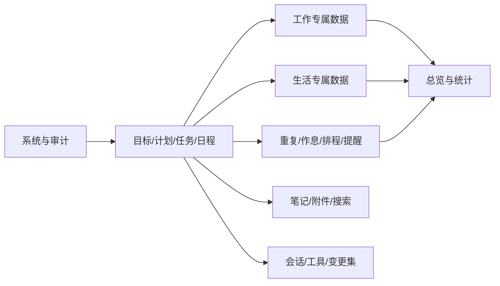

# 个人生活助手——数据库与 API 详细设计书

> 文档状态：V1.0（第一版开发基线）  
> 上游基线：[产品需求与系统架构设计书](./产品需求与系统架构设计书.md)  
> 数据库：SQLite 3（WAL）+ Drizzle ORM  
> 服务端：Node.js LTS + Fastify + TypeScript  
> API：REST/JSON + OpenAPI 3.1 + SSE  
> 默认时区：Asia/Shanghai（UTC+8）

---

## 1. 文档目的与边界

本文档把产品需求落为可直接实施的数据模型和 API 契约，主要解决：

1. 数据以什么结构长期保存。
2. 各领域对象如何建立关系且避免重复。
3. 时间、重复、排程、历史和撤销如何保证一致性。
4. 桌面 Web 前端、未来移动端和 AI 工具如何使用同一套 API。
5. 本地单用户环境下如何兼顾安全、离线、性能与可恢复性。

本文档不定义最终视觉样式，也不替代排程算法实现说明、OpenAPI 生成文件和数据库迁移脚本。后续代码中的 Schema 与 OpenAPI 必须以本设计为基线。

---

## 2. 核心设计决策

### 2.1 单体数据库、模块化领域

第一版使用单个 SQLite 数据库。业务按领域模块组织，但不拆分多个数据库，保证跨任务、目标、排程、消费和统计的事务一致性。

### 2.2 单一事实来源

- 工作/生活页面不复制任务、计划、目标和日程。
- 专属模块通过外键关联共享核心对象。
- 今日页、总览和统计均从结构化原始记录或受控投影读取。
- 生活消费使用共享 `expense_entries` 作为底层记账原语，但不对用户暴露独立财务模块。

### 2.3 聚合根与事务边界

下列对象视为主要聚合根：目标、计划、任务、日程、作息模板、笔记、七个领域中的主要记录、会话、备份任务。

一次 API 写入只能由一个应用服务拥有事务；跨模块副作用通过事务内事件写入 `domain_events`，提交后由后台处理器幂等消费。

### 2.4 通用关联策略

标签、附件、笔记、版本历史等需要关联多种对象。第一版使用：

- `entity_index` 作为所有可关联聚合的轻量登记表。
- 领域表主键同时外键到 `entity_index.id`。
- 通用关联表只引用 `entity_index.id`，从而保留数据库级外键完整性。
- 创建或永久删除聚合时，`entity_index` 与领域表必须在同一事务内处理。

### 2.5 API 与数据库解耦

数据库使用整数时间戳、整数金额和内部枚举；API 使用 RFC 3339 时间、字符串枚举和对象结构。前端与 AI 不直接依赖数据库列名。

### 2.6 本地规则引擎独立运行

重复实例生成、冲突检测、提醒、压力指数、空闲时间和自动排程由本地规则引擎完成，不调用 AI。未配置 API Key、模型服务不可用或断网时，这些能力仍必须正常运行。AI 可以解释语境、估算字段或提出重排建议，但最终排程约束与写入仍由同一套本地领域服务执行。

---

## 3. SQLite 基础规范

### 3.1 启动 PRAGMA

每个连接必须执行：

```sql
PRAGMA foreign_keys = ON;
PRAGMA journal_mode = WAL;
PRAGMA synchronous = NORMAL;
PRAGMA busy_timeout = 5000;
PRAGMA temp_store = MEMORY;
```

备份、恢复和完整性检查使用独占维护流程，不与普通写操作并发。

### 3.2 标识符

- 所有业务主键使用 ULID，数据库类型为 `TEXT`。
- ULID 在服务端生成，长度固定 26，可按创建时间排序。
- 第一版固定 `owner_id = 'local-user'`，但所有一级聚合保留 `owner_id`。
- API 不接受客户端自定义业务 ID；离线移动端出现后再开放客户端 ID 策略。

### 3.3 时间与日期

- 绝对时刻：`INTEGER`，Unix Epoch 毫秒，列名以 `_at` 结尾。
- 纯日期：`TEXT`，格式 `YYYY-MM-DD`，列名以 `_date` 结尾。
- 本地时间：`TEXT`，格式 `HH:mm`，列名以 `_time` 结尾。
- 时区：IANA 名称，第一版默认 `Asia/Shanghai`。
- API 输出绝对时刻使用 RFC 3339 UTC，例如 `2026-08-10T07:30:00.000Z`，同时在需要本地语义的对象上输出 `timeZone`。
- 重复规则保存本地开始时间和时区，避免未来支持其他时区时破坏重复语义。

### 3.4 金额与数值

- 金额使用最小货币单位整数：人民币分，类型 `INTEGER`。
- 货币使用 ISO 4217 代码，第一版默认 `CNY`。
- 营养、体重、体脂等测量值使用 `REAL`，并显式保存单位。
- 百分比在数据库中使用 `REAL`，范围 0–100。

### 3.5 布尔与 JSON

- 布尔使用 `INTEGER NOT NULL CHECK(value IN (0,1))`。
- 扩展字段使用 JSON 文本，并增加 `CHECK(json_valid(column))`。
- 可频繁筛选或统计的数据不得只放入 JSON。
- JSON 只用于低频、自定义或不同类型差异明显的字段。

### 3.6 通用审计字段

所有主要聚合表通过 `entity_index` 获得：

| 字段 | 类型 | 说明 |
|---|---|---|
| `id` | TEXT PK | ULID |
| `entity_type` | TEXT | 稳定的对象类型 |
| `owner_id` | TEXT | 第一版固定 `local-user` |
| `version` | INTEGER | 乐观并发版本，从 1 开始 |
| `created_at` | INTEGER | 创建时间 |
| `updated_at` | INTEGER | 更新时间 |
| `deleted_at` | INTEGER NULL | 软删除时间 |
| `purge_after` | INTEGER NULL | 预计永久删除时间，通常为删除后 30 天 |
| `demo_batch_id` | TEXT NULL | 所属演示数据批次 |

子表和不可独立操作的明细表可只保留 `created_at` / `updated_at`，不单独进入 `entity_index`。

### 3.7 枚举策略

- 生命周期稳定的枚举使用 `TEXT + CHECK`，例如任务状态和优先级。
- 用户可扩展的值使用字典表，例如分类和标签。
- API 枚举只追加不改名；废弃值至少跨一个主版本兼容。
- 数据库存英文稳定码，界面显示简体中文。

---

## 4. 数据库逻辑分区



---

## 5. 系统、审计与一致性表

### 5.1 `app_metadata`

保存应用级元信息。

| 字段 | 类型 | 约束/说明 |
|---|---|---|
| `key` | TEXT PK | 稳定键 |
| `value_json` | TEXT | 合法 JSON |
| `updated_at` | INTEGER | 更新时间 |

关键键：`installation_id`、`initialized_at`、`app_version`、`schema_version`、`data_directory_id`、`demo_batch_id`。

### 5.2 `settings`

| 字段 | 类型 | 约束/说明 |
|---|---|---|
| `key` | TEXT PK | 如 `general.week_starts_on` |
| `scope` | TEXT | `SYSTEM` / `USER` |
| `value_json` | TEXT | 合法 JSON |
| `value_type` | TEXT | `STRING` / `NUMBER` / `BOOLEAN` / `OBJECT` / `ARRAY` |
| `updated_at` | INTEGER | 更新时间 |

敏感凭据不得进入本表。API Key 只保存到 Windows 凭据管理器；数据库最多保存不可反查的 `credential_ref`。

### 5.3 `entity_index`

通用对象注册表，字段见 3.6。关键索引：

- `INDEX(entity_type, deleted_at, updated_at DESC)`
- `INDEX(owner_id, deleted_at)`
- `INDEX(demo_batch_id)`
- `INDEX(purge_after) WHERE deleted_at IS NOT NULL`

### 5.4 `entity_versions`

| 字段 | 类型 | 约束/说明 |
|---|---|---|
| `id` | TEXT PK | ULID |
| `entity_id` | TEXT FK | → `entity_index.id` |
| `entity_version` | INTEGER | 对象版本 |
| `change_set_id` | TEXT FK NULL | → `change_sets.id` |
| `source` | TEXT | `USER` / `RULE_ENGINE` / `AI` / `SYSTEM` |
| `actor_ref` | TEXT NULL | 会话、后台任务等来源 |
| `snapshot_json` | TEXT NULL | 周期性完整快照 |
| `patch_json` | TEXT | JSON Patch |
| `created_at` | INTEGER | 创建时间 |

约束：`UNIQUE(entity_id, entity_version)`。每 20 个版本或大字段变化时保存完整快照，其他版本保存补丁。

### 5.5 `change_sets`

一次可撤销的原子操作。

| 字段 | 类型 | 约束/说明 |
|---|---|---|
| `id` | TEXT PK | ULID |
| `source` | TEXT | `USER` / `RULE_ENGINE` / `AI` / `SYSTEM` |
| `source_ref` | TEXT NULL | AI action、后台任务或请求 ID |
| `summary` | TEXT | 面向用户的简洁摘要 |
| `risk_level` | TEXT | `READ_ONLY` / `LOW_WRITE` / `HIGH_WRITE` |
| `status` | TEXT | `PENDING` / `APPLIED` / `REVERTED` / `FAILED` |
| `reversible_until` | INTEGER NULL | 撤销截止；普通变更默认不设短期限制 |
| `created_at` | INTEGER | 创建时间 |
| `applied_at` | INTEGER NULL | 应用时间 |
| `reverted_at` | INTEGER NULL | 撤销时间 |

### 5.6 `change_operations`

| 字段 | 类型 | 约束/说明 |
|---|---|---|
| `id` | TEXT PK | ULID |
| `change_set_id` | TEXT FK | → `change_sets.id` |
| `sequence` | INTEGER | 操作顺序 |
| `entity_id` | TEXT FK NULL | 被操作对象 |
| `operation` | TEXT | `CREATE` / `UPDATE` / `SOFT_DELETE` / `RESTORE` / `PURGE` |
| `before_json` | TEXT NULL | 变更前 |
| `after_json` | TEXT NULL | 变更后 |

约束：`UNIQUE(change_set_id, sequence)`。撤销按 `sequence DESC` 执行。

### 5.7 `idempotency_records`

| 字段 | 类型 | 说明 |
|---|---|---|
| `key` | TEXT PK | `Idempotency-Key` |
| `request_hash` | TEXT | 方法、路径和请求体哈希 |
| `status_code` | INTEGER NULL | 完成后的响应码 |
| `response_json` | TEXT NULL | 可重放响应 |
| `state` | TEXT | `PROCESSING` / `COMPLETED` / `FAILED` |
| `expires_at` | INTEGER | 默认 24 小时 |
| `created_at` | INTEGER | 创建时间 |

同一键但请求哈希不同返回冲突错误。

### 5.8 `domain_events`

| 字段 | 类型 | 说明 |
|---|---|---|
| `id` | TEXT PK | ULID |
| `event_type` | TEXT | 如 `TaskCompleted` |
| `aggregate_id` | TEXT FK NULL | 来源对象 |
| `aggregate_version` | INTEGER NULL | 来源版本 |
| `payload_json` | TEXT | 事件负载 |
| `status` | TEXT | `PENDING` / `PROCESSING` / `DONE` / `FAILED` |
| `attempt_count` | INTEGER | 重试次数 |
| `next_attempt_at` | INTEGER | 下次处理时间 |
| `created_at` | INTEGER | 创建时间 |
| `processed_at` | INTEGER NULL | 完成时间 |

索引：`INDEX(status, next_attempt_at)`。

### 5.9 `background_jobs`

| 字段 | 类型 | 说明 |
|---|---|---|
| `id` | TEXT PK | ULID |
| `job_type` | TEXT | 重复生成、提醒、备份、清理等 |
| `idempotency_key` | TEXT UNIQUE | 防止重复执行 |
| `payload_json` | TEXT | 参数 |
| `state` | TEXT | `PENDING` / `RUNNING` / `SUCCEEDED` / `FAILED` / `CANCELLED` |
| `run_at` | INTEGER | 计划执行时间 |
| `locked_at` | INTEGER NULL | 租约开始 |
| `lock_expires_at` | INTEGER NULL | 租约到期 |
| `attempt_count` | INTEGER | 已尝试次数 |
| `max_attempts` | INTEGER | 最大次数 |
| `last_error` | TEXT NULL | 脱敏错误 |
| `created_at` | INTEGER | 创建时间 |
| `finished_at` | INTEGER NULL | 完成时间 |

应用启动时回收过期租约并补跑到期任务。

### 5.10 `confirmations`

| 字段 | 类型 | 说明 |
|---|---|---|
| `id` | TEXT PK | ULID |
| `operation_type` | TEXT | 高风险操作类型 |
| `request_hash` | TEXT | 原始操作指纹 |
| `preview_json` | TEXT | 影响范围预览 |
| `token_hash` | TEXT | 确认令牌哈希 |
| `status` | TEXT | `PENDING` / `CONFIRMED` / `EXECUTED` / `EXPIRED` / `CANCELLED` |
| `expires_at` | INTEGER | 默认 10 分钟 |
| `created_at` | INTEGER | 创建时间 |

令牌只显示一次，数据库不保存明文。

---

## 6. 分类、标签与通用关联

### 6.1 `categories`

| 字段 | 类型 | 约束/说明 |
|---|---|---|
| `id` | TEXT PK/FK | → `entity_index.id` |
| `parent_area` | TEXT | `WORK` / `LIFE` |
| `module_type` | TEXT | 七种专属模板或 `GENERIC` |
| `name` | TEXT | 1–80 字符 |
| `description` | TEXT NULL | 说明 |
| `sort_order` | INTEGER | 同区域排序 |
| `is_archived` | INTEGER | 归档标记 |
| `archived_at` | INTEGER NULL | 归档时间 |

模块类型稳定码：`SELF_MEDIA`、`DEVELOPMENT`、`LEARNING`、`SHOPPING`、`DIET`、`FITNESS`、`ENTERTAINMENT`、`GENERIC`。

约束：同一区域未删除分类的名称大小写不敏感唯一。归档后仍可被历史对象引用，但新建记录默认不可选择。

### 6.2 `tags`

| 字段 | 类型 | 说明 |
|---|---|---|
| `id` | TEXT PK/FK | → `entity_index.id` |
| `name` | TEXT | 1–40 字符 |
| `color_token` | TEXT NULL | 设计令牌，不存任意 CSS |
| `description` | TEXT NULL | 说明 |

约束：未删除标签名称大小写不敏感唯一。

### 6.3 `tag_links`

| 字段 | 类型 | 说明 |
|---|---|---|
| `tag_id` | TEXT FK | → `tags.id` |
| `entity_id` | TEXT FK | → `entity_index.id` |
| `created_at` | INTEGER | 创建时间 |

主键：`(tag_id, entity_id)`；索引：`INDEX(entity_id)`。

### 6.4 `entity_links`

保存不属于强业务外键的通用关联，例如笔记“参考”某目标。

| 字段 | 类型 | 说明 |
|---|---|---|
| `source_entity_id` | TEXT FK | 来源 |
| `target_entity_id` | TEXT FK | 目标 |
| `link_type` | TEXT | `RELATED` / `REFERENCE` / `SUPPORTS` |
| `created_at` | INTEGER | 创建时间 |

主键：`(source_entity_id, target_entity_id, link_type)`。任务依赖等强规则不得使用本表。

---

## 7. 目标、计划与任务

### 7.1 `goals`

| 字段 | 类型 | 约束/说明 |
|---|---|---|
| `id` | TEXT PK/FK | → `entity_index.id` |
| `category_id` | TEXT FK | 唯一工作/生活归属 |
| `title` | TEXT | 1–200 字符 |
| `description` | TEXT NULL | 说明 |
| `goal_type` | TEXT | `OUTCOME` / `HABIT` |
| `status` | TEXT | `DRAFT` / `ACTIVE` / `PAUSED` / `COMPLETED` / `CANCELLED` |
| `start_date` | TEXT | `YYYY-MM-DD` |
| `end_date` | TEXT NULL | 习惯型可为空 |
| `horizon` | TEXT | `SHORT_TERM` / `LONG_TERM`，服务端计算 |
| `auto_progress` | REAL | 0–100 |
| `manual_progress` | REAL NULL | 0–100 |
| `progress_mode` | TEXT | `AUTO` / `MANUAL_OVERRIDE` |
| `display_progress` | REAL | 物化值，便于查询 |
| `completed_at` | INTEGER NULL | 完成时间 |

约束：`end_date >= start_date`；有结束日期时，持续不超过一个月为短期，超过一个月为长期。`display_progress` 只能由领域服务更新。

### 7.2 `goal_metrics`

| 字段 | 类型 | 说明 |
|---|---|---|
| `id` | TEXT PK | ULID |
| `goal_id` | TEXT FK | → `goals.id` |
| `name` | TEXT | 指标名 |
| `metric_type` | TEXT | `NUMBER` / `COUNT` / `DURATION` / `PERCENTAGE` / `BOOLEAN` |
| `unit` | TEXT NULL | kg、次、分钟等 |
| `start_value` | REAL NULL | 起点 |
| `target_value` | REAL | 目标 |
| `direction` | TEXT | `INCREASE` / `DECREASE` / `MAINTAIN` |
| `weight` | REAL | 多指标权重 |

### 7.3 `goal_progress_entries`

| 字段 | 类型 | 说明 |
|---|---|---|
| `id` | TEXT PK | ULID |
| `goal_id` | TEXT FK | → `goals.id` |
| `metric_id` | TEXT FK NULL | → `goal_metrics.id` |
| `value` | REAL | 记录值 |
| `recorded_at` | INTEGER | 时间 |
| `source` | TEXT | `USER` / `TASKS` / `HEALTH` / `SYSTEM` / `AI` |
| `source_entity_id` | TEXT FK NULL | 来源记录 |
| `note` | TEXT NULL | 说明 |

索引：`INDEX(goal_id, recorded_at DESC)`。

### 7.4 `plans`

| 字段 | 类型 | 说明 |
|---|---|---|
| `id` | TEXT PK/FK | → `entity_index.id` |
| `goal_id` | TEXT FK NULL | → `goals.id` |
| `category_id` | TEXT FK | 唯一归属 |
| `title` | TEXT | 1–200 字符 |
| `description` | TEXT NULL | 说明 |
| `status` | TEXT | `DRAFT` / `ACTIVE` / `PAUSED` / `COMPLETED` / `CANCELLED` |
| `priority` | TEXT | `LOW` / `NORMAL` / `HIGH` / `URGENT` |
| `start_date` | TEXT | 开始日期 |
| `end_date` | TEXT | 结束日期 |
| `auto_progress` | REAL | 0–100 |
| `manual_progress` | REAL NULL | 可手动覆盖 |
| `progress_mode` | TEXT | `AUTO` / `MANUAL_OVERRIDE` |
| `display_progress` | REAL | 当前展示进度 |

### 7.5 `milestones`

| 字段 | 类型 | 说明 |
|---|---|---|
| `id` | TEXT PK/FK | → `entity_index.id` |
| `plan_id` | TEXT FK NULL | 关联通用计划 |
| `dev_project_id` | TEXT FK NULL | 关联开发项目 |
| `title` | TEXT | 名称 |
| `description` | TEXT NULL | 说明 |
| `due_at` | INTEGER | 截止时刻 |
| `status` | TEXT | `PENDING` / `AT_RISK` / `ACHIEVED` / `MISSED` |
| `achieved_at` | INTEGER NULL | 达成时间 |

约束：`plan_id` 与 `dev_project_id` 至少一个非空；未来若允许跨域里程碑可改为通用关联。

### 7.6 `milestone_links`

| 字段 | 类型 | 说明 |
|---|---|---|
| `milestone_id` | TEXT FK | → `milestones.id` |
| `entity_id` | TEXT FK | 任务或开发功能 |
| `created_at` | INTEGER | 创建时间 |

主键：`(milestone_id, entity_id)`。

### 7.7 `tasks`

| 字段 | 类型 | 约束/说明 |
|---|---|---|
| `id` | TEXT PK/FK | → `entity_index.id` |
| `category_id` | TEXT FK | 唯一归属 |
| `plan_id` | TEXT FK NULL | 所属计划 |
| `goal_id` | TEXT FK NULL | 可直接关联目标 |
| `title` | TEXT | 1–300 字符 |
| `description` | TEXT NULL | 说明 |
| `status` | TEXT | `TODO` / `IN_PROGRESS` / `COMPLETED` / `CANCELLED` |
| `priority` | TEXT | `LOW` / `NORMAL` / `HIGH` / `URGENT` |
| `due_at` | INTEGER | 必填 |
| `estimated_minutes` | INTEGER | 必填，正数且 15 分钟倍数 |
| `is_flexible` | INTEGER | 是否可由排程引擎安排 |
| `is_splittable` | INTEGER | 默认 0 |
| `preferred_area` | TEXT | `WORK` / `LIFE` |
| `completed_at` | INTEGER NULL | 完成时间 |
| `cancelled_at` | INTEGER NULL | 取消时间 |
| `recurrence_rule_id` | TEXT FK NULL | 周期来源 |
| `occurrence_id` | TEXT FK NULL | 周期实例 |

关键索引：

- `INDEX(status, due_at)`
- `INDEX(category_id, status, due_at)`
- `INDEX(plan_id, status)`
- `INDEX(goal_id, status)`
- `INDEX(priority, due_at) WHERE status IN ('TODO','IN_PROGRESS')`

核心约束：

- `due_at IS NOT NULL`。
- `estimated_minutes > 0 AND estimated_minutes % 15 = 0`。
- 完成时必须设置 `completed_at`，取消时必须设置 `cancelled_at`。
- 关联计划与目标时，领域服务校验归属一致。

### 7.8 `subtasks`

| 字段 | 类型 | 说明 |
|---|---|---|
| `id` | TEXT PK | ULID |
| `task_id` | TEXT FK | → `tasks.id` |
| `title` | TEXT | 1–300 字符 |
| `status` | TEXT | `TODO` / `IN_PROGRESS` / `COMPLETED` / `CANCELLED` |
| `sort_order` | INTEGER | 排序 |
| `completed_at` | INTEGER NULL | 完成时间 |
| `created_at` | INTEGER | 创建时间 |
| `updated_at` | INTEGER | 更新时间 |

子任务不允许继续嵌套。删除任务时子任务随聚合软删除语义处理。

### 7.9 `task_dependencies`

| 字段 | 类型 | 说明 |
|---|---|---|
| `predecessor_task_id` | TEXT FK | 前置任务 |
| `successor_task_id` | TEXT FK | 后置任务 |
| `dependency_type` | TEXT | 第一版固定 `FINISH_TO_START` |
| `created_at` | INTEGER | 创建时间 |

主键：`(predecessor_task_id, successor_task_id)`。禁止自依赖和有向环；环检测在事务内由领域服务执行。

---

## 8. 日程、重复、作息与排程

### 8.1 `events`

| 字段 | 类型 | 说明 |
|---|---|---|
| `id` | TEXT PK/FK | → `entity_index.id` |
| `category_id` | TEXT FK | 唯一归属 |
| `title` | TEXT | 名称 |
| `description` | TEXT NULL | 说明 |
| `start_at` | INTEGER | 开始时刻 |
| `end_at` | INTEGER | 结束时刻 |
| `time_zone` | TEXT | 默认 `Asia/Shanghai` |
| `event_type` | TEXT | `GENERAL` / `MEETING` / `MEDICAL` / `TRAVEL` / `REST` |
| `priority` | TEXT | 四级优先级 |
| `is_immovable` | INTEGER | 是否不可移动 |
| `allow_overlap` | INTEGER | 用户明确确认后为 1 |
| `status` | TEXT | `SCHEDULED` / `COMPLETED` / `CANCELLED` |
| `recurrence_rule_id` | TEXT FK NULL | 周期来源 |
| `occurrence_id` | TEXT FK NULL | 周期实例 |

约束：`end_at > start_at`；开始和结束必须对齐 15 分钟网格。会议、就医默认 `is_immovable = 1`。

### 8.2 `recurrence_rules`

| 字段 | 类型 | 说明 |
|---|---|---|
| `id` | TEXT PK/FK | → `entity_index.id` |
| `target_type` | TEXT | `TASK_TEMPLATE` / `EVENT_TEMPLATE` |
| `target_entity_id` | TEXT FK | 原始模板对象 |
| `rrule` | TEXT | RFC 5545 RRULE 子集 |
| `dtstart_local` | TEXT | 本地日期时间 |
| `time_zone` | TEXT | IANA 时区 |
| `until_at` | INTEGER NULL | 结束时刻 |
| `count_limit` | INTEGER NULL | 次数上限 |
| `generation_horizon_days` | INTEGER | 默认向前生成 60 天 |
| `is_active` | INTEGER | 是否启用 |

第一版支持 `DAILY`、`WEEKLY`、`MONTHLY`、`YEARLY`、`BYDAY`、`INTERVAL`、`COUNT`、`UNTIL`。工作日规则由节假日服务参与展开，不只使用周一至周五。

### 8.3 `recurrence_occurrences`

| 字段 | 类型 | 说明 |
|---|---|---|
| `id` | TEXT PK | ULID |
| `rule_id` | TEXT FK | → `recurrence_rules.id` |
| `recurrence_key` | TEXT | 原定本地发生时刻的稳定键 |
| `scheduled_at` | INTEGER | 原定时刻 |
| `generated_entity_id` | TEXT FK NULL | 生成的任务或日程 |
| `status` | TEXT | `GENERATED` / `SKIPPED` / `CANCELLED` |
| `created_at` | INTEGER | 创建时间 |

约束：`UNIQUE(rule_id, recurrence_key)`，保证重启补跑不重复生成。

### 8.4 `recurrence_exceptions`

| 字段 | 类型 | 说明 |
|---|---|---|
| `id` | TEXT PK | ULID |
| `rule_id` | TEXT FK | 周期规则 |
| `recurrence_key` | TEXT | 被覆盖实例 |
| `exception_type` | TEXT | `SKIP` / `OVERRIDE` |
| `override_json` | TEXT NULL | 单次覆盖字段 |
| `created_at` | INTEGER | 创建时间 |

### 8.5 `routine_templates`

| 字段 | 类型 | 说明 |
|---|---|---|
| `id` | TEXT PK/FK | → `entity_index.id` |
| `name` | TEXT | 模板名 |
| `template_type` | TEXT | `WORKDAY` / `WEEKEND` / `HOLIDAY` / `CUSTOM` |
| `is_default` | INTEGER | 同类型最多一个默认 |
| `time_zone` | TEXT | 时区 |

### 8.6 `routine_segments`

| 字段 | 类型 | 说明 |
|---|---|---|
| `id` | TEXT PK | ULID |
| `template_id` | TEXT FK | 作息模板 |
| `name` | TEXT | 睡眠、工作、生活、休息等 |
| `segment_type` | TEXT | `SLEEP` / `WORK` / `LIFE` / `REST` |
| `start_time` | TEXT | `HH:mm` |
| `end_time` | TEXT | `HH:mm`，允许跨午夜 |
| `is_immovable` | INTEGER | 睡眠默认 1 |
| `sort_order` | INTEGER | 排序 |

片段不得在同一模板中产生未经确认的重叠。睡眠可跨午夜。

### 8.7 `date_routine_overrides`

| 字段 | 类型 | 说明 |
|---|---|---|
| `id` | TEXT PK/FK | → `entity_index.id` |
| `local_date` | TEXT | `YYYY-MM-DD` |
| `template_id` | TEXT FK NULL | 选用模板 |
| `segments_json` | TEXT NULL | 当天完全自定义片段 |
| `note` | TEXT NULL | 原因 |

约束：`UNIQUE(local_date)`；`template_id` 和 `segments_json` 至少一个存在。

### 8.8 `holiday_calendar`

| 字段 | 类型 | 说明 |
|---|---|---|
| `local_date` | TEXT PK | 日期 |
| `name` | TEXT | 节假日名 |
| `day_type` | TEXT | `HOLIDAY` / `MAKEUP_WORKDAY` |
| `source` | TEXT | `SYSTEM_UPDATE` / `USER_OVERRIDE` |
| `source_url` | TEXT NULL | 数据来源 |
| `fetched_at` | INTEGER NULL | 获取时间 |
| `updated_at` | INTEGER | 更新时间 |

用户覆盖优先于联网更新；系统更新不得覆盖 `USER_OVERRIDE`。

### 8.9 `schedule_runs`

| 字段 | 类型 | 说明 |
|---|---|---|
| `id` | TEXT PK | ULID |
| `range_start` | INTEGER | 排程范围开始 |
| `range_end` | INTEGER | 排程范围结束 |
| `trigger_type` | TEXT | 任务变化、日程变化、手动请求等 |
| `rule_version` | TEXT | 算法版本 |
| `status` | TEXT | `RUNNING` / `APPLIED` / `FAILED` / `NO_CHANGE` |
| `input_hash` | TEXT | 输入指纹 |
| `summary_json` | TEXT | 排程摘要 |
| `created_at` | INTEGER | 创建时间 |
| `finished_at` | INTEGER NULL | 完成时间 |

### 8.10 `schedule_blocks`

| 字段 | 类型 | 说明 |
|---|---|---|
| `id` | TEXT PK/FK | → `entity_index.id` |
| `target_entity_id` | TEXT FK NULL | 任务或日程；睡眠片段可为空 |
| `block_type` | TEXT | `TASK` / `EVENT` / `SLEEP` / `REST` |
| `area` | TEXT | `WORK` / `LIFE` / `SLEEP` |
| `start_at` | INTEGER | 开始 |
| `end_at` | INTEGER | 结束 |
| `source` | TEXT | `MANUAL` / `RULE_ENGINE` / `AI` / `ROUTINE` |
| `is_locked` | INTEGER | 手动或固定锁定 |
| `schedule_run_id` | TEXT FK NULL | 来源排程批次 |
| `reason_code` | TEXT NULL | 排程原因 |
| `reason_json` | TEXT NULL | 可解释参数 |
| `cross_area_warning` | INTEGER | 是否跨工作/生活首选时段 |

约束：

- `end_at > start_at`。
- 起止对齐 15 分钟网格。
- 同一任务所有有效时间块分钟数合计不得超过 `estimated_minutes`，除非用户显式覆盖。
- 任务完成或取消后，其未来有效时间块软删除。
- 空闲时间不落表，由 24 小时范围减去有效时间块得到。

索引：`INDEX(start_at, end_at, deleted_at)`、`INDEX(target_entity_id, deleted_at)`。

### 8.11 `schedule_warnings`

| 字段 | 类型 | 说明 |
|---|---|---|
| `id` | TEXT PK/FK | → `entity_index.id` |
| `schedule_run_id` | TEXT FK | 排程批次 |
| `entity_id` | TEXT FK NULL | 相关对象 |
| `warning_type` | TEXT | `UNSCHEDULED` / `CROSS_AREA` / `OVERLAP` / `DEPENDENCY_BLOCKED` / `DEADLINE_RISK` |
| `severity` | TEXT | `INFO` / `WARNING` / `CRITICAL` |
| `message` | TEXT | 简体中文说明 |
| `details_json` | TEXT | 可解释详情 |
| `resolved_at` | INTEGER NULL | 解决时间 |

---

## 9. 提醒与应用内通知

### 9.1 `reminders`

| 字段 | 类型 | 说明 |
|---|---|---|
| `id` | TEXT PK/FK | → `entity_index.id` |
| `target_entity_id` | TEXT FK | 任务或日程 |
| `trigger_mode` | TEXT | `ABSOLUTE` / `OFFSET_BEFORE_START` / `OFFSET_BEFORE_DUE` |
| `trigger_at` | INTEGER NULL | 绝对时间 |
| `offset_minutes` | INTEGER NULL | 提前分钟数 |
| `is_enabled` | INTEGER | 是否启用 |

每个任务或日程可有多个提醒。服务端根据目标时间变化重算实际通知时间。

### 9.2 `notifications`

| 字段 | 类型 | 说明 |
|---|---|---|
| `id` | TEXT PK/FK | → `entity_index.id` |
| `notification_type` | TEXT | `REMINDER` / `SYSTEM` / `AI_SUGGESTION` / `SCHEDULE_WARNING` |
| `target_entity_id` | TEXT FK NULL | 跳转目标 |
| `title` | TEXT | 标题 |
| `body` | TEXT | 内容 |
| `severity` | TEXT | `INFO` / `WARNING` / `CRITICAL` |
| `scheduled_at` | INTEGER | 应显示时间 |
| `delivered_at` | INTEGER NULL | 已生成到提醒中心 |
| `read_at` | INTEGER NULL | 已读时间 |
| `snoozed_until` | INTEGER NULL | 稍后提醒 |
| `dedupe_key` | TEXT NULL | 去重键 |

索引：`INDEX(read_at, scheduled_at DESC)`；`dedupe_key` 非空时唯一。

---

## 10. 笔记、附件、收集箱与搜索

### 10.1 `notes`

| 字段 | 类型 | 说明 |
|---|---|---|
| `id` | TEXT PK/FK | → `entity_index.id` |
| `category_id` | TEXT FK | 唯一归属 |
| `title` | TEXT | 标题 |
| `editor_mode` | TEXT | `RICH_TEXT` / `MARKDOWN` |
| `rich_content_json` | TEXT NULL | ProseMirror JSON |
| `markdown_content` | TEXT NULL | Markdown 原文 |
| `plain_text` | TEXT | 搜索与摘要用纯文本 |
| `summary` | TEXT NULL | 用户填写摘要，可供 AI 读取 |

约束：与 `editor_mode` 对应的主内容必须存在。模式转换先生成预览，确认无不可逆结构损失后保存。

### 10.2 `drafts`

| 字段 | 类型 | 说明 |
|---|---|---|
| `id` | TEXT PK | ULID |
| `draft_key` | TEXT UNIQUE | 页面/对象/表单稳定键 |
| `entity_id` | TEXT FK NULL | 编辑已有对象时关联 |
| `form_type` | TEXT | 表单类型 |
| `content_json` | TEXT | 草稿数据 |
| `updated_at` | INTEGER | 更新时间 |
| `expires_at` | INTEGER NULL | 可选过期时间 |

### 10.3 `attachments`

| 字段 | 类型 | 说明 |
|---|---|---|
| `id` | TEXT PK/FK | → `entity_index.id` |
| `original_name` | TEXT | 原文件名 |
| `safe_name` | TEXT | 清洗后的展示名 |
| `extension` | TEXT NULL | 小写扩展名 |
| `mime_type` | TEXT | MIME |
| `size_bytes` | INTEGER | 文件大小 |
| `sha256` | TEXT | 内容校验 |
| `storage_key` | TEXT UNIQUE | 数据目录内相对路径 |
| `description` | TEXT NULL | 用户说明，AI 可读取 |
| `status` | TEXT | `UPLOADING` / `READY` / `MISSING` / `QUARANTINED` |

物理路径只能由存储服务根据 `storage_key` 解析。API 永不返回绝对磁盘路径。

### 10.4 `attachment_links`

| 字段 | 类型 | 说明 |
|---|---|---|
| `attachment_id` | TEXT FK | → `attachments.id` |
| `entity_id` | TEXT FK | 被关联对象 |
| `role` | TEXT | `GENERAL` / `MATERIAL` / `DOCUMENT` / `COVER` |
| `sort_order` | INTEGER | 排序 |
| `created_at` | INTEGER | 创建时间 |

主键：`(attachment_id, entity_id)`。只有最后一个引用永久删除后，后台清理物理文件。

### 10.5 `inbox_items`

| 字段 | 类型 | 说明 |
|---|---|---|
| `id` | TEXT PK/FK | → `entity_index.id` |
| `raw_text` | TEXT | 原始输入 |
| `status` | TEXT | `UNPROCESSED` / `PROCESSING` / `PROCESSED` / `ARCHIVED` |
| `capture_mode` | TEXT | `INBOX_ONLY` / `AI_PROCESS` |
| `processed_change_set_id` | TEXT FK NULL | AI/手动拆分结果 |
| `processed_at` | INTEGER NULL | 处理时间 |

### 10.6 `search_documents`

搜索投影表：

| 字段 | 类型 | 说明 |
|---|---|---|
| `entity_id` | TEXT PK/FK | 来源对象 |
| `entity_type` | TEXT | 类型 |
| `category_id` | TEXT NULL | 归属 |
| `title` | TEXT | 标题 |
| `body` | TEXT | 可搜索正文 |
| `keywords` | TEXT | 标签和结构化关键词 |
| `event_at` | INTEGER NULL | 主要日期 |
| `updated_at` | INTEGER | 更新时间 |

创建外部内容 FTS5 表：

```sql
CREATE VIRTUAL TABLE search_fts USING fts5(
  title,
  body,
  keywords,
  content='search_documents',
  content_rowid='rowid',
  tokenize='unicode61 remove_diacritics 2'
);
```

中文搜索第一版使用 SQLite FTS5 的 Unicode 分词加前缀匹配；若实际中文召回不足，可在不改变 API 的前提下增加服务端二元分词投影。附件正文绝不进入搜索索引。

---

## 11. 工作领域表

### 11.1 自媒体

#### `self_media_contents`

一个内容从灵感开始，贯穿脚本、制作、发布和复盘，避免在各阶段复制记录。

| 字段 | 类型 | 说明 |
|---|---|---|
| `id` | TEXT PK/FK | → `entity_index.id` |
| `category_id` | TEXT FK | `SELF_MEDIA` 模板分类 |
| `title` | TEXT | 选题/内容标题 |
| `idea` | TEXT NULL | 选题灵感 |
| `script_note_id` | TEXT FK NULL | 脚本/文案笔记 |
| `content_type` | TEXT | `VIDEO` / `ARTICLE` / `AUDIO` / `IMAGE` / `OTHER` |
| `platform` | TEXT NULL | 手动填写发布平台 |
| `production_status` | TEXT | `IDEA` / `PLANNING` / `CREATING` / `READY` / `PUBLISHED` / `ARCHIVED` |
| `planned_publish_at` | INTEGER NULL | 计划发布时间 |
| `published_at` | INTEGER NULL | 实际发布时间 |
| `calendar_event_id` | TEXT FK NULL | 可选关联日程 |
| `task_id` | TEXT FK NULL | 可选主制作任务 |

索引：`INDEX(category_id, production_status, planned_publish_at)`。

#### `self_media_metrics`

| 字段 | 类型 | 说明 |
|---|---|---|
| `id` | TEXT PK | ULID |
| `content_id` | TEXT FK | → `self_media_contents.id` |
| `recorded_date` | TEXT | 数据日期 |
| `platform` | TEXT | 平台 |
| `views` | INTEGER NULL | 播放/阅读 |
| `likes` | INTEGER NULL | 点赞 |
| `comments` | INTEGER NULL | 评论 |
| `favorites` | INTEGER NULL | 收藏 |
| `shares` | INTEGER NULL | 分享 |
| `follower_delta` | INTEGER NULL | 关注变化 |
| `custom_metrics_json` | TEXT | 其他手动指标 |
| `created_at` | INTEGER | 创建时间 |

约束：所有计数除 `follower_delta` 外不得为负。索引：`INDEX(content_id, recorded_date DESC)`。

### 11.2 开发项目

#### `dev_projects`

| 字段 | 类型 | 说明 |
|---|---|---|
| `id` | TEXT PK/FK | → `entity_index.id` |
| `category_id` | TEXT FK | `DEVELOPMENT` 模板分类 |
| `name` | TEXT | 项目名 |
| `summary` | TEXT NULL | 项目概览 |
| `status` | TEXT | `PLANNING` / `ACTIVE` / `PAUSED` / `COMPLETED` / `ARCHIVED` |
| `start_date` | TEXT NULL | 开始日期 |
| `target_date` | TEXT NULL | 目标日期 |
| `plan_id` | TEXT FK NULL | 通用计划 |

#### `dev_features`

| 字段 | 类型 | 说明 |
|---|---|---|
| `id` | TEXT PK/FK | → `entity_index.id` |
| `project_id` | TEXT FK | → `dev_projects.id` |
| `title` | TEXT | 功能名 |
| `description` | TEXT NULL | 说明 |
| `status` | TEXT | `BACKLOG` / `PLANNED` / `IN_PROGRESS` / `DONE` / `CANCELLED` |
| `priority` | TEXT | 四级优先级 |
| `task_id` | TEXT FK NULL | 关联主任务 |
| `milestone_id` | TEXT FK NULL | 关联里程碑 |
| `sort_order` | INTEGER | 排序 |

#### `dev_defects`

| 字段 | 类型 | 说明 |
|---|---|---|
| `id` | TEXT PK/FK | → `entity_index.id` |
| `project_id` | TEXT FK | 项目 |
| `feature_id` | TEXT FK NULL | 关联功能 |
| `task_id` | TEXT FK NULL | 修复任务 |
| `title` | TEXT | 缺陷标题 |
| `description` | TEXT NULL | 描述 |
| `reproduction_steps` | TEXT NULL | 复现步骤 |
| `severity` | TEXT | `LOW` / `MEDIUM` / `HIGH` / `CRITICAL` |
| `status` | TEXT | `OPEN` / `CONFIRMED` / `FIXING` / `RESOLVED` / `CLOSED` / `WONT_FIX` |
| `found_version` | TEXT NULL | 发现版本 |
| `resolved_version` | TEXT NULL | 解决版本 |
| `resolved_at` | INTEGER NULL | 解决时间 |

索引：`INDEX(project_id, status, severity)`。

#### `repository_links`

| 字段 | 类型 | 说明 |
|---|---|---|
| `id` | TEXT PK/FK | → `entity_index.id` |
| `project_id` | TEXT FK | 项目 |
| `name` | TEXT | 链接名 |
| `url` | TEXT | HTTP/HTTPS URL |
| `description` | TEXT NULL | 说明 |
| `sort_order` | INTEGER | 排序 |

只保存和打开 URL，不抓取仓库内容。

#### `dev_document_links`

| 字段 | 类型 | 说明 |
|---|---|---|
| `project_id` | TEXT FK | 项目 |
| `note_id` | TEXT FK | 技术文档笔记 |
| `document_type` | TEXT | `OVERVIEW` / `REQUIREMENT` / `TECHNICAL` / `DECISION` / `OTHER` |
| `sort_order` | INTEGER | 排序 |

主键：`(project_id, note_id)`。

### 11.3 学习

#### `learning_resources`

| 字段 | 类型 | 说明 |
|---|---|---|
| `id` | TEXT PK/FK | → `entity_index.id` |
| `category_id` | TEXT FK | `LEARNING` 模板分类 |
| `title` | TEXT | 名称 |
| `resource_type` | TEXT | `COURSE` / `BOOK` / `ARTICLE` / `VIDEO` / `DOCUMENT` / `OTHER` |
| `author` | TEXT NULL | 作者/讲师 |
| `source_url` | TEXT NULL | 来源链接 |
| `status` | TEXT | `PLANNED` / `IN_PROGRESS` / `COMPLETED` / `PAUSED` / `ABANDONED` |
| `progress_current` | REAL NULL | 当前进度 |
| `progress_total` | REAL NULL | 总进度 |
| `progress_unit` | TEXT NULL | 页、章、课时等 |
| `started_at` | INTEGER NULL | 开始时间 |
| `completed_at` | INTEGER NULL | 完成时间 |

#### `learning_plan_resources`

| 字段 | 类型 | 说明 |
|---|---|---|
| `plan_id` | TEXT FK | → `plans.id` |
| `resource_id` | TEXT FK | → `learning_resources.id` |
| `sort_order` | INTEGER | 顺序 |

主键：`(plan_id, resource_id)`。

#### `learning_sessions`

| 字段 | 类型 | 说明 |
|---|---|---|
| `id` | TEXT PK/FK | → `entity_index.id` |
| `resource_id` | TEXT FK NULL | 学习资源 |
| `plan_id` | TEXT FK NULL | 学习计划 |
| `task_id` | TEXT FK NULL | 关联任务 |
| `session_date` | TEXT | 日期 |
| `duration_minutes` | INTEGER | 正数 |
| `progress_delta` | REAL NULL | 本次进度增量 |
| `note_id` | TEXT FK NULL | 知识笔记 |
| `summary` | TEXT NULL | 本次摘要 |

索引：`INDEX(session_date)`、`INDEX(resource_id, session_date DESC)`。

---

## 12. 生活领域表

### 12.1 共享预算与消费原语

#### `budgets`

| 字段 | 类型 | 说明 |
|---|---|---|
| `id` | TEXT PK/FK | → `entity_index.id` |
| `name` | TEXT | 预算名称 |
| `scope` | TEXT | `LIFE_TOTAL` / `MODULE` / `CATEGORY` |
| `module_type` | TEXT NULL | `SHOPPING` / `DIET` / `ENTERTAINMENT` |
| `category_id` | TEXT FK NULL | 分类预算 |
| `period_type` | TEXT | `WEEK` / `MONTH` / `QUARTER` / `YEAR` / `CUSTOM` |
| `start_date` | TEXT | 开始日期 |
| `end_date` | TEXT | 结束日期 |
| `amount_minor` | INTEGER | 预算金额，非负 |
| `currency` | TEXT | 默认 `CNY` |
| `alert_threshold_percent` | REAL | 默认 80 |

#### `expense_entries`

| 字段 | 类型 | 说明 |
|---|---|---|
| `id` | TEXT PK/FK | → `entity_index.id` |
| `module_type` | TEXT | `SHOPPING` / `DIET` / `ENTERTAINMENT` |
| `category_id` | TEXT FK | 唯一归属 |
| `source_entity_id` | TEXT FK | 来源购买、餐食或娱乐记录 |
| `occurred_at` | INTEGER | 支出时间 |
| `amount_minor` | INTEGER | 非负 |
| `currency` | TEXT | 默认 `CNY` |
| `merchant` | TEXT NULL | 商家/渠道 |
| `note` | TEXT NULL | 说明 |

约束：`UNIQUE(source_entity_id)`，避免同一来源重复记账。各模块 API 维护本模块费用；生活总览只读取聚合结果。

### 12.2 购物

#### `shopping_items`

| 字段 | 类型 | 说明 |
|---|---|---|
| `id` | TEXT PK/FK | → `entity_index.id` |
| `category_id` | TEXT FK | `SHOPPING` 分类 |
| `name` | TEXT | 商品名 |
| `product_category` | TEXT NULL | 用户填写商品分类 |
| `quantity` | REAL | 默认 1，必须大于 0 |
| `unit` | TEXT NULL | 件、kg 等 |
| `planned_unit_price_minor` | INTEGER NULL | 计划单价 |
| `budget_amount_minor` | INTEGER NULL | 本项预算 |
| `priority` | TEXT | 四级优先级 |
| `status` | TEXT | `WANTED` / `RESEARCHING` / `READY` / `PURCHASED` / `CANCELLED` |
| `purchase_channel` | TEXT NULL | 渠道 |
| `task_id` | TEXT FK NULL | 可选购买任务 |

#### `purchase_records`

| 字段 | 类型 | 说明 |
|---|---|---|
| `id` | TEXT PK/FK | → `entity_index.id` |
| `shopping_item_id` | TEXT FK NULL | 来源待购项 |
| `category_id` | TEXT FK | 归属 |
| `product_name` | TEXT | 购买时名称快照 |
| `quantity` | REAL | 实际数量 |
| `unit_price_minor` | INTEGER | 实际单价 |
| `total_amount_minor` | INTEGER | 实际总价 |
| `planned_total_minor` | INTEGER NULL | 计划总价快照 |
| `purchased_at` | INTEGER | 购买时间 |
| `channel` | TEXT NULL | 渠道 |
| `expense_entry_id` | TEXT FK | 对应消费记录 |

从待购项完成购买必须在单一事务中：创建购买记录、创建消费记录、更新待购状态。

### 12.3 饮食

#### `recipes`

| 字段 | 类型 | 说明 |
|---|---|---|
| `id` | TEXT PK/FK | → `entity_index.id` |
| `category_id` | TEXT FK | `DIET` 分类 |
| `name` | TEXT | 食谱名 |
| `description` | TEXT NULL | 说明 |
| `servings` | REAL | 份数 |
| `prep_minutes` | INTEGER NULL | 准备时长 |
| `cook_minutes` | INTEGER NULL | 烹饪时长 |
| `instructions_note_id` | TEXT FK NULL | 做法笔记 |
| `nutrition_json` | TEXT | 每份扩展营养 |

#### `recipe_ingredients`

| 字段 | 类型 | 说明 |
|---|---|---|
| `id` | TEXT PK | ULID |
| `recipe_id` | TEXT FK | 食谱 |
| `name` | TEXT | 食材 |
| `amount` | REAL NULL | 数量 |
| `unit` | TEXT NULL | 单位 |
| `sort_order` | INTEGER | 顺序 |

#### `meal_plans`

| 字段 | 类型 | 说明 |
|---|---|---|
| `id` | TEXT PK/FK | → `entity_index.id` |
| `category_id` | TEXT FK | 归属 |
| `meal_date` | TEXT | 日期 |
| `meal_type` | TEXT | `BREAKFAST` / `LUNCH` / `DINNER` / `SNACK` |
| `planned_at` | INTEGER NULL | 计划时刻 |
| `recipe_id` | TEXT FK NULL | 食谱 |
| `title` | TEXT | 计划内容 |
| `event_id` | TEXT FK NULL | 固定日程 |
| `task_id` | TEXT FK NULL | 弹性任务 |
| `status` | TEXT | `PLANNED` / `COMPLETED` / `SKIPPED` |

#### `meal_records`

| 字段 | 类型 | 说明 |
|---|---|---|
| `id` | TEXT PK/FK | → `entity_index.id` |
| `category_id` | TEXT FK | 归属 |
| `meal_plan_id` | TEXT FK NULL | 来源计划 |
| `meal_type` | TEXT | 餐次 |
| `title` | TEXT | 餐食描述 |
| `eaten_at` | INTEGER | 用餐时间 |
| `calories_kcal` | REAL NULL | 热量 |
| `protein_g` | REAL NULL | 蛋白质 |
| `carbs_g` | REAL NULL | 碳水 |
| `fat_g` | REAL NULL | 脂肪 |
| `fiber_g` | REAL NULL | 纤维 |
| `sodium_mg` | REAL NULL | 钠 |
| `other_nutrition_json` | TEXT | 其他营养 |
| `expense_entry_id` | TEXT FK NULL | 餐饮支出 |

缺失营养值保持 `NULL`，统计时不得当作 0。

#### `hydration_records`

| 字段 | 类型 | 说明 |
|---|---|---|
| `id` | TEXT PK/FK | → `entity_index.id` |
| `recorded_at` | INTEGER | 时间 |
| `amount_ml` | INTEGER | 大于 0 |
| `note` | TEXT NULL | 说明 |

#### `dietary_preferences`

| 字段 | 类型 | 说明 |
|---|---|---|
| `id` | TEXT PK/FK | → `entity_index.id` |
| `preference_type` | TEXT | `LIKE` / `DISLIKE` / `ALLERGY` / `INTOLERANCE` / `RESTRICTION` |
| `name` | TEXT | 食物/规则 |
| `severity` | TEXT NULL | 适用于过敏/不耐受 |
| `note` | TEXT NULL | 说明 |
| `is_active` | INTEGER | 是否生效 |

### 12.4 健身与身体指标

#### `exercise_catalog`

| 字段 | 类型 | 说明 |
|---|---|---|
| `id` | TEXT PK/FK | → `entity_index.id` |
| `name` | TEXT | 动作名 |
| `exercise_type` | TEXT | `STRENGTH` / `CARDIO` / `MOBILITY` / `SPORT` / `OTHER` |
| `muscle_groups_json` | TEXT | 肌群 |
| `default_unit` | TEXT NULL | kg、km、秒等 |
| `instructions` | TEXT NULL | 动作说明 |

#### `workout_plans`

| 字段 | 类型 | 说明 |
|---|---|---|
| `id` | TEXT PK/FK | → `entity_index.id` |
| `category_id` | TEXT FK | `FITNESS` 分类 |
| `name` | TEXT | 计划名 |
| `description` | TEXT NULL | 说明 |
| `goal_id` | TEXT FK NULL | 习惯或成果目标 |
| `status` | TEXT | `DRAFT` / `ACTIVE` / `PAUSED` / `COMPLETED` |

#### `workout_plan_items`

| 字段 | 类型 | 说明 |
|---|---|---|
| `id` | TEXT PK | ULID |
| `workout_plan_id` | TEXT FK | 训练计划 |
| `exercise_id` | TEXT FK | 动作 |
| `sets_target` | INTEGER NULL | 组数 |
| `reps_target` | TEXT NULL | 次数，可为范围 |
| `weight_target` | REAL NULL | 重量 |
| `duration_seconds_target` | INTEGER NULL | 时长 |
| `distance_target` | REAL NULL | 距离 |
| `sort_order` | INTEGER | 顺序 |

#### `workout_sessions`

| 字段 | 类型 | 说明 |
|---|---|---|
| `id` | TEXT PK/FK | → `entity_index.id` |
| `category_id` | TEXT FK | 归属 |
| `workout_plan_id` | TEXT FK NULL | 来源计划 |
| `task_id` | TEXT FK NULL | 关联任务 |
| `started_at` | INTEGER | 开始 |
| `ended_at` | INTEGER | 结束 |
| `duration_minutes` | INTEGER | 实际时长 |
| `calories_burned` | REAL NULL | 消耗热量 |
| `perceived_effort` | INTEGER NULL | 1–10 |
| `note` | TEXT NULL | 说明 |

#### `workout_sets`

| 字段 | 类型 | 说明 |
|---|---|---|
| `id` | TEXT PK | ULID |
| `session_id` | TEXT FK | 训练记录 |
| `exercise_id` | TEXT FK | 动作 |
| `set_number` | INTEGER | 第几组 |
| `reps` | INTEGER NULL | 次数 |
| `weight` | REAL NULL | 重量 |
| `duration_seconds` | INTEGER NULL | 时长 |
| `distance` | REAL NULL | 距离 |
| `completed` | INTEGER | 是否完成 |

#### `body_measurements`

饮食和健身共享身体指标来源。

| 字段 | 类型 | 说明 |
|---|---|---|
| `id` | TEXT PK/FK | → `entity_index.id` |
| `measured_at` | INTEGER | 时间 |
| `weight_kg` | REAL NULL | 体重 |
| `body_fat_percent` | REAL NULL | 体脂 |
| `waist_cm` | REAL NULL | 腰围 |
| `chest_cm` | REAL NULL | 胸围 |
| `hip_cm` | REAL NULL | 臀围 |
| `other_measurements_json` | TEXT | 其他围度 |
| `note` | TEXT NULL | 说明 |

#### `personal_records`

| 字段 | 类型 | 说明 |
|---|---|---|
| `id` | TEXT PK/FK | → `entity_index.id` |
| `exercise_id` | TEXT FK NULL | 动作 |
| `record_type` | TEXT | `WEIGHT` / `REPS` / `DURATION` / `DISTANCE` / `SPEED` / `OTHER` |
| `value` | REAL | 数值 |
| `unit` | TEXT | 单位 |
| `achieved_at` | INTEGER | 达成时间 |
| `workout_session_id` | TEXT FK NULL | 来源训练 |

#### `recovery_records`

| 字段 | 类型 | 说明 |
|---|---|---|
| `id` | TEXT PK/FK | → `entity_index.id` |
| `recorded_date` | TEXT | 日期 |
| `recovery_level` | INTEGER | 1–5 |
| `soreness_level` | INTEGER NULL | 1–5 |
| `energy_level` | INTEGER NULL | 1–5 |
| `note` | TEXT NULL | 说明 |

### 12.5 娱乐

#### `entertainment_items`

| 字段 | 类型 | 说明 |
|---|---|---|
| `id` | TEXT PK/FK | → `entity_index.id` |
| `category_id` | TEXT FK | `ENTERTAINMENT` 分类 |
| `title` | TEXT | 名称 |
| `item_type` | TEXT | `MOVIE` / `SERIES` / `BOOK` / `COMIC` / `GAME` / `ACTIVITY` / `TRIP` / `OTHER` |
| `list_type` | TEXT | `WANT_TO_WATCH` / `WANT_TO_PLAY` / `WANT_TO_GO` / `OTHER` |
| `status` | TEXT | `WISHLIST` / `PLANNED` / `IN_PROGRESS` / `COMPLETED` / `DROPPED` |
| `progress_current` | REAL NULL | 当前进度 |
| `progress_total` | REAL NULL | 总进度 |
| `progress_unit` | TEXT NULL | 集、小时、章节等 |
| `started_at` | INTEGER NULL | 开始时间 |
| `completed_at` | INTEGER NULL | 完成时间 |
| `rating` | REAL NULL | 0–10 |
| `note` | TEXT NULL | 感想 |

#### `entertainment_sessions`

| 字段 | 类型 | 说明 |
|---|---|---|
| `id` | TEXT PK/FK | → `entity_index.id` |
| `item_id` | TEXT FK | 娱乐条目 |
| `session_date` | TEXT | 日期 |
| `duration_minutes` | INTEGER | 娱乐时长 |
| `progress_delta` | REAL NULL | 进度变化 |
| `note` | TEXT NULL | 说明 |

#### `activity_trip_details`

| 字段 | 类型 | 说明 |
|---|---|---|
| `entertainment_item_id` | TEXT PK/FK | 活动/旅行条目 |
| `start_at` | INTEGER NULL | 开始 |
| `end_at` | INTEGER NULL | 结束 |
| `location` | TEXT NULL | 地点 |
| `event_id` | TEXT FK NULL | 关联固定日程 |
| `task_id` | TEXT FK NULL | 关联准备任务 |
| `details_json` | TEXT | 行程扩展信息 |

娱乐支出通过 `expense_entries.source_entity_id` 关联条目或娱乐记录。

---

## 13. AI、会话与来源表

### 13.1 `ai_provider_configs`

| 字段 | 类型 | 说明 |
|---|---|---|
| `id` | TEXT PK/FK | → `entity_index.id` |
| `provider_type` | TEXT | `OPENAI` / `ANTHROPIC` / `GOOGLE` / `OPENAI_COMPATIBLE` |
| `display_name` | TEXT | 配置名 |
| `base_url` | TEXT NULL | 兼容协议地址 |
| `model_id` | TEXT | 模型标识 |
| `credential_ref` | TEXT | Windows 凭据引用，不是密钥 |
| `capabilities_json` | TEXT | 对话、工具、流式、联网能力 |
| `is_default` | INTEGER | 默认配置 |
| `last_verified_at` | INTEGER NULL | 最近验证 |
| `last_error` | TEXT NULL | 脱敏错误 |

### 13.2 `chat_sessions`

| 字段 | 类型 | 说明 |
|---|---|---|
| `id` | TEXT PK/FK | → `entity_index.id` |
| `title` | TEXT | 会话标题 |
| `provider_config_id` | TEXT FK | 模型配置 |
| `status` | TEXT | `ACTIVE` / `ARCHIVED` |
| `last_message_at` | INTEGER NULL | 最近消息 |

### 13.3 `chat_messages`

| 字段 | 类型 | 说明 |
|---|---|---|
| `id` | TEXT PK/FK | → `entity_index.id` |
| `session_id` | TEXT FK | 会话 |
| `role` | TEXT | `USER` / `ASSISTANT` / `TOOL` / `SYSTEM` |
| `content_json` | TEXT | 分段内容结构 |
| `plain_text` | TEXT | 搜索用纯文本 |
| `model_id` | TEXT NULL | 模型 |
| `status` | TEXT | `PENDING` / `STREAMING` / `COMPLETED` / `FAILED` / `CANCELLED` |
| `input_tokens` | INTEGER NULL | 用量 |
| `output_tokens` | INTEGER NULL | 用量 |
| `created_at` | INTEGER | 创建时间 |
| `completed_at` | INTEGER NULL | 完成时间 |

### 13.4 `ai_runs`

每次用户消息触发一个模型运行，用于流式恢复、取消和故障诊断。

| 字段 | 类型 | 说明 |
|---|---|---|
| `id` | TEXT PK/FK | → `entity_index.id` |
| `session_id` | TEXT FK | 会话 |
| `user_message_id` | TEXT FK | 用户消息 |
| `assistant_message_id` | TEXT FK | 助手占位消息 |
| `provider_config_id` | TEXT FK | 实际模型配置 |
| `status` | TEXT | `QUEUED` / `RUNNING` / `AWAITING_TOOL` / `AWAITING_CONFIRMATION` / `COMPLETED` / `FAILED` / `CANCELLED` |
| `web_search_used` | INTEGER | 是否使用原生联网搜索 |
| `created_at` | INTEGER | 创建时间 |
| `started_at` | INTEGER NULL | 开始时间 |
| `finished_at` | INTEGER NULL | 完成时间 |
| `error_code` | TEXT NULL | 脱敏错误码 |

索引：`INDEX(session_id, created_at DESC)`、`INDEX(status, created_at)`。

### 13.5 `ai_tool_calls`

| 字段 | 类型 | 说明 |
|---|---|---|
| `id` | TEXT PK/FK | → `entity_index.id` |
| `session_id` | TEXT FK | 会话 |
| `message_id` | TEXT FK | 发起工具的消息 |
| `tool_name` | TEXT | 工具名 |
| `arguments_json` | TEXT | 已校验参数 |
| `risk_level` | TEXT | 风险等级 |
| `status` | TEXT | `PROPOSED` / `AWAITING_CONFIRMATION` / `RUNNING` / `SUCCEEDED` / `FAILED` / `CANCELLED` |
| `change_set_id` | TEXT FK NULL | 写操作变更集 |
| `result_json` | TEXT NULL | 结构化结果 |
| `error_code` | TEXT NULL | 失败码 |
| `created_at` | INTEGER | 创建时间 |
| `finished_at` | INTEGER NULL | 完成时间 |

### 13.6 `ai_memories`

| 字段 | 类型 | 说明 |
|---|---|---|
| `id` | TEXT PK/FK | → `entity_index.id` |
| `memory_type` | TEXT | `PREFERENCE` / `CONSTRAINT` / `ROUTINE_HINT` / `DECISION_STYLE` |
| `content` | TEXT | 稳定记忆 |
| `confidence` | REAL | 0–1 |
| `source_session_id` | TEXT FK NULL | 内部来源，不在首版 UI 逐条展示 |
| `last_used_at` | INTEGER NULL | 最近使用 |
| `is_active` | INTEGER | 是否有效 |

### 13.7 `ai_web_sources`

| 字段 | 类型 | 说明 |
|---|---|---|
| `id` | TEXT PK | ULID |
| `message_id` | TEXT FK | 回答消息 |
| `title` | TEXT | 来源标题 |
| `url` | TEXT | 来源 URL |
| `publisher` | TEXT NULL | 发布者 |
| `published_at` | INTEGER NULL | 发布时间 |
| `retrieved_at` | INTEGER | 检索时间 |
| `citation_order` | INTEGER | 展示顺序 |

只保存模型返回并实际用于回答的来源，不保存搜索结果页面全文。

---

## 14. 备份、恢复与维护表

### 14.1 `backup_policies`

| 字段 | 类型 | 说明 |
|---|---|---|
| `id` | TEXT PK/FK | → `entity_index.id` |
| `name` | TEXT | 策略名 |
| `schedule_type` | TEXT | `DAILY` / `WEEKLY` / `CUSTOM_CRON` |
| `schedule_value` | TEXT | 受限表达式 |
| `destination_path_ref` | TEXT | 经许可的目标目录引用 |
| `retention_count` | INTEGER | 保留份数 |
| `is_enabled` | INTEGER | 是否启用 |
| `last_run_at` | INTEGER NULL | 最近执行 |

### 14.2 `backup_records`

| 字段 | 类型 | 说明 |
|---|---|---|
| `id` | TEXT PK/FK | → `entity_index.id` |
| `policy_id` | TEXT FK NULL | 自动策略，手动备份为空 |
| `backup_type` | TEXT | `MANUAL` / `SCHEDULED` / `PRE_MIGRATION` / `PRE_RESTORE` |
| `status` | TEXT | `RUNNING` / `SUCCEEDED` / `FAILED` / `DELETED` |
| `file_path_ref` | TEXT | 受控路径引用 |
| `size_bytes` | INTEGER NULL | 包大小 |
| `sha256` | TEXT NULL | 校验值 |
| `manifest_json` | TEXT NULL | 版本、文件数量、数据库校验 |
| `started_at` | INTEGER | 开始时间 |
| `finished_at` | INTEGER NULL | 结束时间 |
| `error_message` | TEXT NULL | 脱敏错误 |

### 14.3 `maintenance_records`

记录完整性检查、目录迁移、恢复、回收站清理和节假日更新。

| 字段 | 类型 | 说明 |
|---|---|---|
| `id` | TEXT PK | ULID |
| `operation_type` | TEXT | 维护类型 |
| `status` | TEXT | `RUNNING` / `SUCCEEDED` / `FAILED` / `ROLLED_BACK` |
| `details_json` | TEXT | 摘要与校验结果 |
| `started_at` | INTEGER | 开始 |
| `finished_at` | INTEGER NULL | 完成 |

---

## 15. 软删除、永久删除与恢复

### 15.1 软删除

`DELETE` 业务 API 默认执行软删除：

1. 校验当前版本。
2. 生成高风险确认预览。
3. 确认后更新 `entity_index.deleted_at` 与 `purge_after`。
4. 保存 `entity_versions` 与 `change_set`。
5. 发布 `RecordSoftDeleted`。
6. 从默认查询、排程和搜索投影中移除。

### 15.2 恢复

恢复前检查：父对象是否存在、分类是否归档、唯一键是否冲突、关联附件是否仍在。可恢复但父对象已删除时，API 返回可选处理方案，不静默改归属。

### 15.3 永久删除

- 后台任务每天清理 `purge_after <= now` 的记录。
- 按依赖顺序删除明细、领域表、通用关联、版本和 `entity_index`。
- 附件只有无任何有效引用时才删除物理文件。
- 永久删除完成后不再支持撤销，只保留不含个人正文的维护摘要。

---

## 16. 迁移、备份与数据库恢复策略

### 16.1 Schema 迁移

- 迁移文件使用单调递增编号，例如 `0001_initial.sql`。
- 使用 `schema_migrations(version, checksum, applied_at, app_version)` 记录。
- 启动时比较迁移文件校验值，已应用迁移不得被修改。
- 迁移前自动创建 `PRE_MIGRATION` 备份。
- SQLite 可事务化的迁移在单一事务中执行。
- 复杂表重建使用“新表 → 拷贝校验 → 切换 → 完整性检查”。
- 不维护通用向下迁移；失败恢复到迁移前备份。

### 16.2 备份格式

建议扩展名 `.lifeassistant-backup`，实质为带清单的压缩包：

```text
manifest.json
database/life-assistant.db
attachments/...
settings/non-sensitive.json
checksums.sha256
```

`manifest.json` 包含备份格式版本、应用版本、Schema 版本、生成时间、文件数量和安装 ID。不得包含 API Key 或可恢复密钥的值。

### 16.3 恢复流程

1. 校验扩展名、清单、Schema 兼容性和全部 SHA-256。
2. 暂停写 API 和后台任务。
3. 生成当前数据的 `PRE_RESTORE` 备份。
4. 解压到临时目录并运行 SQLite `quick_check` / `foreign_key_check`。
5. 原子切换数据目录内容。
6. 执行必要的前向迁移。
7. 重建搜索索引和可重算投影。
8. 恢复服务；失败则回滚原数据。

---

## 17. API 总体契约

### 17.1 基础路径与媒体类型

- 基础路径：`http://127.0.0.1:{port}/api/v1`
- JSON：`application/json; charset=utf-8`
- 错误：`application/problem+json`
- 文件上传：`multipart/form-data`
- 实时事件：`text/event-stream`
- OpenAPI：`/api/openapi.json`

### 17.2 命名与字段

- URL 资源使用复数 kebab-case，例如 `/schedule-blocks`。
- JSON 字段使用 camelCase。
- ID 使用字符串 ULID。
- 时间使用 RFC 3339 UTC；本地日期使用 `YYYY-MM-DD`。
- 枚举使用大写英文稳定码。
- 未提供字段与显式 `null` 含义不同；PATCH 中未提供表示不修改。

### 17.3 成功响应

单资源：

```json
{
  "data": {
    "id": "01J5...",
    "version": 3
  },
  "meta": {
    "requestId": "01J6..."
  }
}
```

列表：

```json
{
  "data": [],
  "page": {
    "nextCursor": null,
    "hasMore": false,
    "limit": 50
  },
  "meta": {
    "requestId": "01J6..."
  }
}
```

### 17.4 分页、排序与筛选

- 默认游标分页，`limit` 默认 50，最大 200。
- `cursor` 为服务端不透明 Base64URL 字符串。
- 排序参数：`sort=dueAt,-priority`。
- 多值筛选重复传参：`status=TODO&status=IN_PROGRESS`。
- 日期范围使用 `from`、`to`，均为包含边界。
- 只有数据量很小且自然全量加载的字典接口可以不分页。

### 17.5 乐观并发

- 单资源响应返回 `ETag: "v{version}"`。
- 更新、删除和恢复必须提供 `If-Match: "v{version}"`。
- 缺失返回 `428 PRECONDITION_REQUIRED`。
- 版本不匹配返回 `412 VERSION_CONFLICT`，并附当前版本摘要。
- 创建不需要 `If-Match`。

### 17.6 幂等

- 所有可能创建资源或触发副作用的 `POST` 要求 `Idempotency-Key`。
- 同一键、同一请求返回第一次的结果。
- 同一键、不同请求返回 `409 IDEMPOTENCY_KEY_REUSED`。
- 前端和 AI 工具分别生成 ULID 作为幂等键。

### 17.7 错误模型

采用 Problem Details：

```json
{
  "type": "https://local.life-assistant/errors/validation",
  "title": "请求参数不正确",
  "status": 422,
  "detail": "预计时长必须是 15 分钟的倍数。",
  "code": "VALIDATION_ERROR",
  "instance": "/api/v1/tasks",
  "requestId": "01J6...",
  "errors": [
    {"path": "estimatedMinutes", "code": "MULTIPLE_OF", "message": "必须是 15 的倍数"}
  ]
}
```

核心错误码：

| HTTP | code | 含义 |
|---|---|---|
| 400 | `BAD_REQUEST` | 无法解析请求 |
| 401 | `LOCAL_SESSION_REQUIRED` | 缺少本地会话 |
| 403 | `ORIGIN_NOT_ALLOWED` | 非应用来源 |
| 404 | `NOT_FOUND` | 对象不存在或已删除 |
| 409 | `SCHEDULE_CONFLICT` | 时间冲突 |
| 409 | `DEPENDENCY_CYCLE` | 任务依赖成环 |
| 409 | `IDEMPOTENCY_KEY_REUSED` | 幂等键误用 |
| 409 | `RESTORE_CONFLICT` | 恢复冲突 |
| 412 | `VERSION_CONFLICT` | 乐观锁冲突 |
| 422 | `VALIDATION_ERROR` | 字段或业务校验失败 |
| 428 | `PRECONDITION_REQUIRED` | 缺少 If-Match |
| 429 | `AI_RATE_LIMITED` | 模型限流 |
| 503 | `AI_UNAVAILABLE` | AI 未配置、断网或服务不可用 |
| 503 | `MAINTENANCE_MODE` | 数据维护期间暂停写入 |

### 17.8 本地会话与 CSRF

虽然第一版无登录，但不能让任意网页调用本地 API：

1. 启动器生成一次性 `launchToken`，有效期 60 秒。
2. 浏览器打开 `/launch?token=...`。
3. 服务端交换为 `HttpOnly; SameSite=Strict` 的本地会话 Cookie，并重定向到无令牌 URL。
4. 写请求额外要求 `X-CSRF-Token`，由受同源保护的启动接口提供。
5. 服务端校验 `Origin` 和 `Host`，CORS 默认关闭。
6. SSE 使用同一会话 Cookie。

API Key 与本地会话令牌不得出现在 URL、日志或 OpenAPI 示例中。

### 17.9 高风险确认协议

高风险操作采用统一两阶段协议。后续资源目录中的 `DELETE` 表示“发起删除意图”，不是立即删除：

1. 客户端调用对应 `:preview` 动作，或调用资源 `DELETE` 但不携带确认令牌。
2. 服务端不得修改数据，返回 `202 Accepted`、影响范围和一次性 `confirmationId` / `confirmationToken`。
3. 用户确认后调用 `/confirmations/{id}:execute`。
4. 服务端校验请求指纹、令牌、对象版本和 10 分钟有效期。
5. 执行产生原子 `change_set`。

普通关系解除、草稿清理、凭据移除等不删除主要业务聚合的操作可使用直接 `DELETE`，但仍需版本或明确操作目标。

预览响应：

```json
{
  "data": {
    "confirmationId": "01J7...",
    "confirmationToken": "once-only-token",
    "expiresAt": "2026-08-10T08:10:00.000Z",
    "impact": {
      "entities": 12,
      "attachments": 2,
      "summary": "将删除 1 个计划及其 11 个未完成任务，内容进入回收站。"
    }
  }
}
```

---

## 18. 通用资源表示

### 18.1 任务表示

```json
{
  "id": "01J5TASK...",
  "version": 4,
  "categoryId": "01J5CAT...",
  "planId": "01J5PLAN...",
  "goalId": "01J5GOAL...",
  "title": "完成项目首页",
  "description": null,
  "status": "TODO",
  "priority": "HIGH",
  "dueAt": "2026-08-14T15:59:59.000Z",
  "estimatedMinutes": 120,
  "isFlexible": true,
  "isSplittable": false,
  "preferredArea": "WORK",
  "tags": [],
  "subtasks": [],
  "createdAt": "2026-08-10T07:30:00.000Z",
  "updatedAt": "2026-08-10T07:30:00.000Z"
}
```

### 18.2 创建任务

```http
POST /api/v1/tasks
Idempotency-Key: 01J7REQUEST...
Content-Type: application/json
```

```json
{
  "categoryId": "01J5CAT...",
  "planId": "01J5PLAN...",
  "title": "完成项目首页",
  "priority": "HIGH",
  "dueAt": "2026-08-14T15:59:59.000Z",
  "estimatedMinutes": 120,
  "isFlexible": true,
  "isSplittable": false,
  "reminders": [
    {"triggerMode": "OFFSET_BEFORE_DUE", "offsetMinutes": 60}
  ]
}
```

创建成功返回 `201`。若自动排程异步执行，响应 `meta` 包含 `scheduleJobId`。

### 18.3 日程表示

```json
{
  "id": "01J5EVENT...",
  "version": 2,
  "categoryId": "01J5WORK...",
  "title": "固定会议",
  "startAt": "2026-08-11T07:00:00.000Z",
  "endAt": "2026-08-11T08:00:00.000Z",
  "timeZone": "Asia/Shanghai",
  "eventType": "MEETING",
  "priority": "HIGH",
  "isImmovable": true,
  "allowOverlap": false,
  "status": "SCHEDULED"
}
```

### 18.4 删除表示

默认 GET 不返回软删除对象。回收站接口返回：

```json
{
  "id": "01J5TASK...",
  "entityType": "TASK",
  "title": "完成项目首页",
  "deletedAt": "2026-08-10T08:00:00.000Z",
  "purgeAt": "2026-09-09T08:00:00.000Z",
  "canRestore": true,
  "restoreWarnings": []
}
```

---

## 19. 系统、设置与分类 API

### 19.1 系统与启动

| 方法 | 路径 | 说明 |
|---|---|---|
| GET | `/system/status` | 服务、数据库、后台任务、磁盘空间和 AI 配置摘要 |
| GET | `/bootstrap` | 首屏所需用户设置、分类、未读数和能力开关 |
| GET | `/events` | 全局 SSE 事件流 |
| POST | `/system/restart` | 请求后台服务安全重启 |
| POST | `/system/shutdown:preview` | 退出后台服务预览 |
| POST | `/confirmations/{id}:execute` | 执行已确认高风险操作 |
| POST | `/confirmations/{id}:cancel` | 取消高风险操作 |

`/bootstrap` 不返回大列表，只返回界面壳所需信息。业务数据由各页面并行加载。

### 19.2 设置

| 方法 | 路径 | 说明 |
|---|---|---|
| GET | `/settings` | 获取非敏感设置 |
| PATCH | `/settings` | 批量更新普通设置 |
| GET | `/settings/schema` | 设置项类型、默认值与校验范围 |
| POST | `/settings/data-directory:migration-preview` | 数据目录迁移预检 |
| POST | `/settings/data-directory:migrate` | 执行已确认的数据目录迁移 |
| POST | `/settings/demo-data:clear-preview` | 演示数据清空预览 |
| POST | `/settings/ai-memory:clear-preview` | AI 记忆清空预览 |

更新设置采用对象补丁：

```json
{
  "general.weekStartsOn": 1,
  "quickCapture.defaultMode": "INBOX_ONLY",
  "reminder.defaultOffsets": [10, 60]
}
```

服务端拒绝未知键，防止拼写错误静默写入。

### 19.3 分类与标签

| 方法 | 路径 | 说明 |
|---|---|---|
| GET | `/categories` | 分类列表，可含归档 |
| POST | `/categories` | 新增分类 |
| GET | `/categories/{id}` | 分类详情 |
| PATCH | `/categories/{id}` | 重命名、说明等 |
| POST | `/categories:reorder` | 同区域原子排序 |
| POST | `/categories/{id}:archive` | 归档 |
| POST | `/categories/{id}:unarchive` | 恢复归档 |
| GET | `/tags` | 标签列表 |
| POST | `/tags` | 新增标签 |
| PATCH | `/tags/{id}` | 修改标签 |
| DELETE | `/tags/{id}` | 高风险预览后软删除 |

分类排序请求必须提交完整目标区域顺序和 `expectedOrderVersion`，避免部分排序造成重复序号。

---

## 20. 今日、目标、计划、任务与日程 API

### 20.1 今日

| 方法 | 路径 | 说明 |
|---|---|---|
| GET | `/today?date=YYYY-MM-DD` | 今日完整驾驶舱聚合 |
| GET | `/today/timeline?date=...` | 24 小时时间流 |
| GET | `/today/free-time?date=...` | 空闲时间段 |
| GET | `/today/pressure?date=...` | 压力指数与解释 |
| GET | `/today/plan?date=...&area=WORK` | 今日计划，可按区域筛选 |

`GET /today` 建议响应：

```json
{
  "data": {
    "date": "2026-08-10",
    "timeZone": "Asia/Shanghai",
    "serverNow": "2026-08-10T08:00:00.000Z",
    "timelineVersion": 18,
    "blocks": [],
    "totals": {
      "sleepMinutes": 480,
      "workMinutes": 420,
      "lifeMinutes": 180,
      "freeMinutes": 360
    },
    "pressure": {
      "score": 52,
      "level": "ELEVATED",
      "algorithmVersion": "pressure-v1",
      "factors": [
        {"code": "URGENT_TASKS", "points": 12, "message": "今日有 2 项紧急任务"}
      ]
    },
    "notifications": [],
    "suggestions": []
  }
}
```

压力等级稳定码：`RELAXED`、`COMFORTABLE`、`ELEVATED`、`HIGH_PRESSURE`。

### 20.2 目标

| 方法 | 路径 | 说明 |
|---|---|---|
| GET | `/goals` | 按状态、范围、分类筛选 |
| POST | `/goals` | 创建目标 |
| GET | `/goals/{id}` | 目标详情 |
| PATCH | `/goals/{id}` | 普通更新 |
| POST | `/goals/{id}:set-progress` | 手动进度或恢复自动模式 |
| POST | `/goals/{id}:complete` | 完成目标 |
| POST | `/goals/{id}:pause` | 暂停目标 |
| GET | `/goals/{id}/tree` | 目标、计划、任务树 |
| GET | `/goals/{id}/progress-history` | 进度历史 |
| POST | `/goals/{id}:replace-preview` | 替换长期目标预览 |
| DELETE | `/goals/{id}` | 转为确认预览，不直接删除 |

### 20.3 计划与里程碑

| 方法 | 路径 | 说明 |
|---|---|---|
| GET | `/plans` | 计划列表 |
| POST | `/plans` | 创建计划 |
| GET | `/plans/{id}` | 计划详情 |
| PATCH | `/plans/{id}` | 更新计划 |
| POST | `/plans/{id}:set-progress` | 手动/自动进度模式 |
| POST | `/plans/{id}:complete` | 完成计划 |
| DELETE | `/plans/{id}` | 删除预览/确认流程 |
| GET | `/plans/views/kanban` | 看板投影 |
| GET | `/plans/views/calendar` | 日历投影 |
| GET | `/plans/views/timeline` | 时间轴投影 |
| GET | `/plans/views/goal-tree` | 目标树投影 |
| POST | `/milestones` | 创建里程碑 |
| PATCH | `/milestones/{id}` | 更新里程碑 |
| POST | `/milestones/{id}:achieve` | 达成里程碑 |

四种视图接口只返回为展示优化的投影，不允许通过投影接口写入。

### 20.4 任务

| 方法 | 路径 | 说明 |
|---|---|---|
| GET | `/tasks` | 任务列表 |
| POST | `/tasks` | 创建任务 |
| GET | `/tasks/{id}` | 任务详情 |
| PATCH | `/tasks/{id}` | 普通更新 |
| POST | `/tasks/{id}:start` | 状态改为进行中 |
| POST | `/tasks/{id}:complete` | 完成并释放排程块 |
| POST | `/tasks/{id}:cancel` | 取消并释放排程块 |
| POST | `/tasks/{id}:reopen` | 重新打开 |
| DELETE | `/tasks/{id}` | 删除预览/确认流程 |
| POST | `/tasks/{id}/subtasks` | 新增一层子任务 |
| PATCH | `/tasks/{id}/subtasks/{subtaskId}` | 更新子任务 |
| DELETE | `/tasks/{id}/subtasks/{subtaskId}` | 删除子任务 |
| POST | `/tasks/{id}/dependencies` | 添加前置依赖 |
| DELETE | `/tasks/{id}/dependencies/{predecessorId}` | 移除依赖 |
| GET | `/tasks/{id}/schedule-history` | 排程与逾期历史 |

完成任务事务必须：更新状态、写版本历史、软删除未来排程块、生成重排事件、刷新目标/计划进度。

### 20.5 日程与冲突

| 方法 | 路径 | 说明 |
|---|---|---|
| GET | `/events` | 日程列表 |
| POST | `/events` | 创建日程 |
| GET | `/events/{id}` | 日程详情 |
| PATCH | `/events/{id}` | 更新日程 |
| POST | `/events/{id}:complete` | 完成日程 |
| POST | `/events/{id}:cancel` | 取消日程 |
| DELETE | `/events/{id}` | 删除预览/确认流程 |
| POST | `/events/conflicts:check` | 创建/修改前冲突检测 |

发生冲突时返回 `409 SCHEDULE_CONFLICT` 与冲突对象。用户确认保留冲突后，请求增加 `allowOverlap: true` 和有效确认令牌。

### 20.6 重复规则

| 方法 | 路径 | 说明 |
|---|---|---|
| POST | `/recurrence-rules` | 为任务/日程建立重复规则 |
| GET | `/recurrence-rules/{id}` | 规则与未来实例 |
| PATCH | `/recurrence-rules/{id}` | 修改整个序列 |
| POST | `/recurrence-rules/{id}:split` | “本次及以后”切分规则 |
| POST | `/recurrence-rules/{id}/exceptions` | 跳过或覆盖单次 |
| POST | `/recurrence-rules/{id}:end` | 结束重复 |

修改单次只写例外和实例；“本次及以后”结束旧规则并创建新规则；整个序列更新原规则并重建未发生实例。

### 20.7 作息、节假日与排程

| 方法 | 路径 | 说明 |
|---|---|---|
| GET | `/routine-templates` | 作息模板 |
| POST | `/routine-templates` | 创建模板 |
| GET | `/routine-templates/{id}` | 模板详情 |
| PATCH | `/routine-templates/{id}` | 更新模板和片段 |
| POST | `/routine-templates/{id}:set-default` | 设为某类型默认 |
| GET | `/routine-overrides` | 日期覆盖 |
| PUT | `/routine-overrides/{date}` | 设置当天覆盖 |
| DELETE | `/routine-overrides/{date}` | 取消覆盖 |
| GET | `/holidays?year=2026` | 节假日和调休 |
| POST | `/holidays:update` | 联网更新 |
| PUT | `/holidays/{date}` | 用户覆盖 |
| DELETE | `/holidays/{date}/override` | 移除用户覆盖 |
| GET | `/schedules?from=...&to=...` | 排程块 |
| POST | `/schedules:reschedule` | 手动请求重排 |
| GET | `/schedules/runs/{id}` | 排程批次与解释 |
| GET | `/schedules/warnings` | 排程警告 |
| POST | `/schedules/blocks/{id}:lock` | 锁定时间块 |
| POST | `/schedules/blocks/{id}:unlock` | 解锁时间块 |

`POST /schedules:reschedule` 可传日期范围和原因；若影响大量已排任务，转入高风险确认流程。

---

## 21. 工作模块 API

### 21.1 工作总览

| 方法 | 路径 | 说明 |
|---|---|---|
| GET | `/work/overview` | 工作综合驾驶舱 |
| GET | `/work/statistics` | 工作趋势与明细 |

通用统计参数：`range=WEEK|MONTH|QUARTER|YEAR|CUSTOM`，自定义时使用 `from` / `to`。

### 21.2 自媒体

| 方法 | 路径 | 说明 |
|---|---|---|
| GET/POST | `/work/self-media/contents` | 内容列表/创建 |
| GET/PATCH/DELETE | `/work/self-media/contents/{id}` | 详情/更新/删除流程 |
| POST | `/work/self-media/contents/{id}:transition` | 制作状态流转 |
| GET | `/work/self-media/calendar` | 内容日历 |
| GET/POST | `/work/self-media/contents/{id}/metrics` | 表现指标列表/录入 |
| PATCH/DELETE | `/work/self-media/metrics/{metricId}` | 修改/删除指标 |

状态流转必须校验：`PUBLISHED` 需要 `publishedAt`；回退状态保留历史。

### 21.3 开发项目

| 方法 | 路径 | 说明 |
|---|---|---|
| GET/POST | `/work/dev-projects` | 项目列表/创建 |
| GET/PATCH/DELETE | `/work/dev-projects/{id}` | 项目详情/更新/删除 |
| GET/POST | `/work/dev-projects/{id}/features` | 功能清单 |
| PATCH/DELETE | `/work/dev-features/{featureId}` | 功能更新/删除 |
| GET/POST | `/work/dev-projects/{id}/defects` | 缺陷列表/创建 |
| PATCH/DELETE | `/work/dev-defects/{defectId}` | 缺陷更新/删除 |
| GET/POST | `/work/dev-projects/{id}/repositories` | 仓库链接 |
| PATCH/DELETE | `/work/repositories/{linkId}` | 链接更新/删除 |
| GET/POST | `/work/dev-projects/{id}/documents` | 技术文档关联 |

仓库链接接口不得触发网络抓取。

### 21.4 学习

| 方法 | 路径 | 说明 |
|---|---|---|
| GET/POST | `/work/learning/resources` | 课程/书籍/资料 |
| GET/PATCH/DELETE | `/work/learning/resources/{id}` | 详情/更新/删除 |
| POST | `/work/learning/resources/{id}:set-progress` | 更新进度 |
| GET/POST | `/work/learning/sessions` | 学习时长记录 |
| PATCH/DELETE | `/work/learning/sessions/{id}` | 修改/删除记录 |
| POST | `/plans/{id}/learning-resources` | 关联学习资源 |
| DELETE | `/plans/{id}/learning-resources/{resourceId}` | 解除关联 |

---

## 22. 生活模块 API

### 22.1 生活总览与预算

| 方法 | 路径 | 说明 |
|---|---|---|
| GET | `/life/overview` | 生活综合驾驶舱 |
| GET | `/life/statistics` | 趋势统计 |
| GET | `/life/expenses` | 汇总消费视图，只读聚合 |
| GET/POST | `/life/budgets` | 预算列表/创建 |
| PATCH/DELETE | `/life/budgets/{id}` | 更新/删除预算 |

`/life/expenses` 支持 `moduleType`、`categoryId`、日期范围筛选，但写入必须走各自模块 API。

### 22.2 购物

| 方法 | 路径 | 说明 |
|---|---|---|
| GET/POST | `/life/shopping/items` | 待购清单 |
| GET/PATCH/DELETE | `/life/shopping/items/{id}` | 详情/更新/删除 |
| POST | `/life/shopping/items/{id}:purchase` | 完成购买并记账 |
| GET | `/life/shopping/purchases` | 历史消费 |
| GET/PATCH/DELETE | `/life/shopping/purchases/{id}` | 购买记录 |

### 22.3 饮食

| 方法 | 路径 | 说明 |
|---|---|---|
| GET/POST | `/life/diet/recipes` | 食谱 |
| GET/PATCH/DELETE | `/life/diet/recipes/{id}` | 食谱详情 |
| GET/POST | `/life/diet/meal-plans` | 用餐计划 |
| PATCH/DELETE | `/life/diet/meal-plans/{id}` | 更新/删除计划 |
| POST | `/life/diet/meal-plans/{id}:complete` | 从计划生成餐食记录 |
| GET/POST | `/life/diet/meals` | 餐食记录 |
| GET/PATCH/DELETE | `/life/diet/meals/{id}` | 餐食详情 |
| GET/POST | `/life/diet/hydration` | 饮水记录 |
| PATCH/DELETE | `/life/diet/hydration/{id}` | 修改/删除饮水 |
| GET/POST | `/life/diet/preferences` | 偏好与忌口 |
| PATCH/DELETE | `/life/diet/preferences/{id}` | 修改/删除偏好 |
| GET | `/life/diet/nutrition-summary` | 营养趋势，缺失值单独统计 |

### 22.4 健身

| 方法 | 路径 | 说明 |
|---|---|---|
| GET/POST | `/life/fitness/exercises` | 动作库 |
| PATCH/DELETE | `/life/fitness/exercises/{id}` | 动作更新/删除 |
| GET/POST | `/life/fitness/plans` | 训练计划 |
| GET/PATCH/DELETE | `/life/fitness/plans/{id}` | 训练计划详情 |
| GET/POST | `/life/fitness/sessions` | 训练记录 |
| GET/PATCH/DELETE | `/life/fitness/sessions/{id}` | 训练详情 |
| GET/POST | `/life/fitness/body-measurements` | 身体指标 |
| PATCH/DELETE | `/life/fitness/body-measurements/{id}` | 修改/删除指标 |
| GET/POST | `/life/fitness/personal-records` | 个人纪录 |
| PATCH/DELETE | `/life/fitness/personal-records/{id}` | 修改/删除纪录 |
| GET/POST | `/life/fitness/recovery` | 恢复状态 |
| PATCH/DELETE | `/life/fitness/recovery/{id}` | 修改/删除恢复记录 |

### 22.5 娱乐

| 方法 | 路径 | 说明 |
|---|---|---|
| GET/POST | `/life/entertainment/items` | 想看/想玩/想去及进行中条目 |
| GET/PATCH/DELETE | `/life/entertainment/items/{id}` | 详情/更新/删除 |
| POST | `/life/entertainment/items/{id}:set-progress` | 更新进度 |
| GET/POST | `/life/entertainment/sessions` | 娱乐时长记录 |
| PATCH/DELETE | `/life/entertainment/sessions/{id}` | 修改/删除记录 |
| PUT | `/life/entertainment/items/{id}/trip-details` | 活动/旅行详情 |
| POST | `/life/entertainment/items/{id}/expense` | 记录娱乐支出 |

---

## 23. 收集箱、搜索、笔记、附件与提醒 API

### 23.1 快速记录与收集箱

| 方法 | 路径 | 说明 |
|---|---|---|
| POST | `/quick-capture` | 按 `INBOX_ONLY` 或 `AI_PROCESS` 处理 |
| GET | `/inbox` | 收集箱列表 |
| GET | `/inbox/{id}` | 原始内容与处理结果 |
| PATCH | `/inbox/{id}` | 修改原文或状态 |
| POST | `/inbox/{id}:process-manually` | 手动拆分完成 |
| POST | `/inbox/{id}:process-with-ai` | 明确交给 AI |
| POST | `/inbox/{id}:archive` | 归档 |

`POST /quick-capture` 请求：

```json
{
  "text": "周五前完成项目首页，今晚买牛奶",
  "mode": "AI_PROCESS"
}
```

AI 不可用且 `mode=AI_PROCESS` 时，返回 `503 AI_UNAVAILABLE`，同时提供客户端是否改存收集箱的明确选项；服务端不得悄悄改变模式。

### 23.2 搜索

| 方法 | 路径 | 说明 |
|---|---|---|
| GET | `/search?q=...` | 全局关键词搜索 |
| GET | `/search/suggestions?q=...` | 标题和标签前缀建议 |

筛选参数：`entityType`、`categoryId`、`tagId`、`status`、`from`、`to`。结果包含高亮片段，但不得返回附件正文。

### 23.3 笔记与草稿

| 方法 | 路径 | 说明 |
|---|---|---|
| GET/POST | `/notes` | 笔记列表/创建 |
| GET/PATCH/DELETE | `/notes/{id}` | 详情/更新/删除 |
| POST | `/notes/{id}:convert-preview` | 富文本/Markdown 转换预览 |
| POST | `/notes/{id}:convert` | 确认转换 |
| GET | `/drafts/{draftKey}` | 读取草稿 |
| PUT | `/drafts/{draftKey}` | 自动保存草稿 |
| DELETE | `/drafts/{draftKey}` | 清除草稿 |

草稿接口不生成业务版本历史；正式保存后清除对应草稿。

### 23.4 附件

| 方法 | 路径 | 说明 |
|---|---|---|
| POST | `/attachments` | 上传并复制到数据目录 |
| GET | `/attachments/{id}` | 元数据 |
| PATCH | `/attachments/{id}` | 修改名称/说明 |
| GET | `/attachments/{id}/content` | 受控下载/打开 |
| POST | `/attachments/{id}/links` | 关联对象 |
| DELETE | `/attachments/{id}/links/{entityId}` | 解除关联 |
| DELETE | `/attachments/{id}` | 软删除附件对象 |

上传规则：

- 流式写入临时文件并计算 SHA-256。
- 成功后原子移动到 `attachments/{sha256-prefix}/{id}.{ext}`。
- 文件名只作元数据，不参与路径拼接。
- 默认单文件上限由设置控制，首版建议 2 GB。
- AI API 只获取元数据 DTO，不存在读取文件内容的工具。

### 23.5 提醒中心

| 方法 | 路径 | 说明 |
|---|---|---|
| GET/POST | `/reminders` | 提醒定义列表/创建 |
| PATCH/DELETE | `/reminders/{id}` | 更新/删除提醒 |
| GET | `/notifications` | 通知列表 |
| POST | `/notifications/{id}:read` | 标记已读 |
| POST | `/notifications:read-all` | 全部已读 |
| POST | `/notifications/{id}:snooze` | 稍后提醒 |

---

## 24. AI API 与工具映射

### 24.1 模型配置

| 方法 | 路径 | 说明 |
|---|---|---|
| GET/POST | `/ai/providers` | 模型配置列表/创建，永不返回密钥 |
| PATCH | `/ai/providers/{id}` | 更新非敏感配置 |
| PUT | `/ai/providers/{id}/credential` | 写入 Windows 凭据管理器 |
| DELETE | `/ai/providers/{id}/credential` | 删除凭据 |
| POST | `/ai/providers/{id}:verify` | 能力与连通性检测 |
| POST | `/ai/providers/{id}:set-default` | 设为默认 |

能力检测响应必须分别报告：`chat`、`streaming`、`toolCalling`、`nativeWebSearch`。

#### M7-002 / M7-003 验收约束

- `PUT /ai/providers/{id}/credential` 与 `DELETE /ai/providers/{id}/credential` 异步执行；Windows 凭据读取、写入、存在性检查和删除均不持久化密钥值。
- Provider 运行时将工具定义作为 Responses `tools` 发送；收到 `function_call` 后，本地 Tool Runtime 以对应 `call_id` 产生 `function_call_output` 并发起下一轮请求。
- AI 错误统一映射为 Problem Details：认证失败为 401、限流为 429、超时为 504、能力不可用或服务/凭据存储不可用为 503、凭据超过 Windows 限制为 422；响应不得包含密钥。
- OpenAPI 已登记模型配置、凭据写删和验证端点。真实 OpenAI 手工 smoke test 为可选验证，不是本地 mock 契约测试的结论。

### 24.2 会话与消息

| 方法 | 路径 | 说明 |
|---|---|---|
| GET/POST | `/ai/chats` | 会话列表/创建 |
| GET/PATCH/DELETE | `/ai/chats/{id}` | 详情/重命名/删除流程 |
| GET | `/ai/chats/{id}/messages` | 消息分页 |
| POST | `/ai/chats/{id}/messages` | 发送消息并创建运行 |
| POST | `/ai/runs/{id}:cancel` | 取消生成 |
| GET | `/ai/runs/{id}` | 运行状态 |
| GET | `/ai/actions/{id}` | 工具调用和变更详情 |
| POST | `/ai/actions/{id}:confirm` | 确认高风险工具 |
| POST | `/ai/actions/{id}:cancel` | 取消工具 |
| POST | `/ai/actions/{id}:undo` | 撤销成功写操作 |

发送消息请求的 `content` 为用户原始输入；从“今日”界面发起时，可附加经过契约校验的最小只读上下文：

```json
{
  "content": "帮我安排接下来的时间",
  "context": {
    "source": "TODAY",
    "date": "2026-08-20",
    "timeZone": "Asia/Shanghai",
    "currentTime": "2026-08-20T08:00:00.000Z",
    "pressure": { "score": 72, "level": "ELEVATED" },
    "totals": {
      "sleepMinutes": 480,
      "workMinutes": 360,
      "lifeMinutes": 120,
      "freeMinutes": 90
    },
    "currentBlock": null,
    "upcoming": []
  }
}
```

`context` 不进入用户可见正文，而是在当前 Run 的模型上下文中作为只读 system 消息注入；历史 Today 上下文不会自动带入后续 Run。该对象不得包含 Provider 凭据、配置 ID、实体 ID、绝对路径或未列入 Schema 的数据库内容，`upcoming` 最多 5 项。

发送消息返回 `202 Accepted`：

```json
{
  "data": {
    "userMessageId": "01J8USER...",
    "assistantMessageId": "01J8ASSIST...",
    "runId": "01J8RUN...",
    "status": "QUEUED"
  }
}
```

正文和工具事件通过 SSE 推送。

### 24.3 AI 工具到应用服务映射

AI 工具不得直接调用数据库或拼接 HTTP；工具注册表调用与 REST API 相同的应用服务和校验 Schema。

| AI 工具 | 风险 | 应用服务/API 等价能力 |
|---|---|---|
| `search_records` | 只读 | `GET /search` |
| `get_today_schedule` | 只读 | `GET /today` |
| `get_free_time` | 只读 | `GET /today/free-time` |
| `get_work_overview` | 只读 | `GET /work/overview` |
| `get_life_overview` | 只读 | `GET /life/overview` |
| `get_goal_tree` | 只读 | `GET /goals/{id}/tree` |
| `get_plan_detail` | 只读 | `GET /plans/{id}` |
| `get_task_detail` | 只读 | `GET /tasks/{id}` |
| `get_domain_record` | 只读 | 对应领域 GET |
| `get_statistics` | 只读 | 工作/生活统计服务 |
| `get_notifications` | 只读 | `GET /notifications` |
| `create_task` | 低写 | 任务创建服务 |
| `update_task` | 低写 | 任务更新服务 |
| `complete_task` | 低写 | 任务完成服务 |
| `create_event` | 低写 | 日程创建服务；冲突时暂停 |
| `update_event` | 低写 | 日程更新服务 |
| `create_goal` | 低写 | 目标创建服务 |
| `update_goal` | 低/高 | 普通字段低写；长期目标实质替换为高写 |
| `create_plan` | 低写 | 计划创建服务 |
| `update_plan` | 低写 | 计划更新服务 |
| `create_note` | 低写 | 笔记创建服务 |
| `update_note` | 低写 | 笔记更新服务 |
| `create_domain_record` | 低写 | 按 `recordType` 路由领域服务 |
| `update_domain_record` | 低写 | 按 `recordType` 路由领域服务 |
| `add_reminder` | 低写 | 提醒创建服务 |
| `request_reschedule` | 低/高 | 小范围低写；大量覆盖高写 |
| `restore_change_set` | 高写 | 变更集撤销服务 |
| `delete_record` | 高写 | 软删除确认流程 |
| `bulk_update_records` | 高写 | 批量变更确认流程 |
| `replace_long_term_goal` | 高写 | 目标替换确认流程 |
| `clear_ai_memory` | 高写 | 记忆清空确认流程 |
| `empty_recycle_bin` | 高写 | 永久删除确认流程 |

### 24.4 工具参数规则

- 每个工具使用独立 JSON Schema，`additionalProperties: false`。
- 写工具必须包含 `userIntentReference`，指向明确要求该操作的用户消息。
- 更新工具必须携带 `entityId` 和 `expectedVersion`。
- 截止时间和预计时长缺失时，AI 可估算，但工具参数中必须显式提交最终值和 `inferenceReason`。
- 创建多个对象时，先生成一个变更计划，再用单个原子变更集执行。
- 工具结果只返回必要字段，不把完整数据库作为结果传回模型。

示例 `create_task` Schema 摘要：

```json
{
  "type": "object",
  "additionalProperties": false,
  "required": ["title", "categoryId", "priority", "dueAt", "estimatedMinutes", "userIntentReference"],
  "properties": {
    "title": {"type": "string", "minLength": 1, "maxLength": 300},
    "categoryId": {"type": "string", "minLength": 26, "maxLength": 26},
    "priority": {"enum": ["LOW", "NORMAL", "HIGH", "URGENT"]},
    "dueAt": {"type": "string", "format": "date-time"},
    "estimatedMinutes": {"type": "integer", "minimum": 15, "multipleOf": 15},
    "isFlexible": {"type": "boolean", "default": true},
    "isSplittable": {"type": "boolean", "default": false},
    "inferenceReason": {"type": ["string", "null"]},
    "userIntentReference": {"type": "string"}
  }
}
```

### 24.5 AI 上下文 DTO

AI 使用专门的最小化 DTO，不复用完整 API 详情：

- 任务：标题、状态、优先级、截止、预计时长、排程和必要关联。
- 目标/计划：标题、状态、时间范围、进度和子项摘要。
- 领域记录：完成当前请求所需的结构化字段。
- 笔记：仅在请求相关时提供正文。
- 附件：仅文件名、MIME、大小、归属和用户说明。
- API Key、绝对路径、内部日志、版本快照不得进入上下文。

### 24.6 AI 主动分析写入边界

主动分析只允许创建 `AI_SUGGESTION` 通知或建议卡片。建议卡片包含建议内容、依据对象 ID 和生成时间，不得调用任何创建任务、更新计划或替换目标工具。用户明确点击“执行”或发送指令后，才建立新的 `userIntentReference`。

---

## 25. 历史、撤销、回收站与备份 API

### 25.1 历史与变更集

| 方法 | 路径 | 说明 |
|---|---|---|
| GET | `/entities/{id}/versions` | 对象版本列表 |
| GET | `/entities/{id}/versions/{version}` | 指定版本 |
| POST | `/entities/{id}/versions/{version}:restore-preview` | 恢复预览 |
| GET | `/change-sets` | 最近操作 |
| GET | `/change-sets/{id}` | 变更详情 |
| POST | `/change-sets/{id}:undo-preview` | 撤销预览 |
| POST | `/change-sets/{id}:redo-preview` | 可行时重做预览 |

版本恢复本身生成新版本，不回写版本号或删除后续历史。

### 25.2 回收站

| 方法 | 路径 | 说明 |
|---|---|---|
| GET | `/recycle-bin` | 已删除对象列表 |
| GET | `/recycle-bin/{id}` | 恢复可行性和关联影响 |
| POST | `/recycle-bin/{id}:restore` | 恢复软删除对象 |
| POST | `/recycle-bin:empty-preview` | 清空预览 |

### 25.3 备份与维护

| 方法 | 路径 | 说明 |
|---|---|---|
| GET/POST | `/backup-policies` | 自动备份策略 |
| PATCH/DELETE | `/backup-policies/{id}` | 更新/删除策略 |
| GET | `/backups` | 备份记录 |
| POST | `/backups` | 手动备份 |
| GET | `/backups/{id}` | 状态与清单摘要 |
| POST | `/backups/{id}:verify` | 校验备份 |
| POST | `/restore:preview` | 选择备份并预检 |
| POST | `/restore:execute` | 高风险确认后恢复 |
| GET | `/maintenance` | 维护记录 |
| POST | `/maintenance/database:check` | 数据库完整性检查 |

恢复期间除状态查询和 SSE 外，其他写 API 返回 `503 MAINTENANCE_MODE`。

---

## 26. SSE 实时事件契约

### 26.1 连接

```http
GET /api/v1/events
Accept: text/event-stream
Last-Event-ID: 01J9...
```

服务端每 20 秒发送心跳。客户端断线后使用 `Last-Event-ID` 补取保留窗口内事件；窗口默认 24 小时。超出窗口时发送 `sync.required`，客户端重新请求相关资源。

### 26.2 事件格式

```text
id: 01J9EVENT...
event: task.updated
data: {"entityId":"01J5TASK...","version":5,"changeSetId":"01J9CHANGE..."}
```

第一版事件：

- `task.created|updated|completed|deleted`
- `event.created|updated|deleted`
- `schedule.updated`
- `notification.created|updated`
- `goal.progress.updated`
- `backup.updated`
- `maintenance.updated`
- `ai.run.started|delta|completed|failed`
- `ai.tool.proposed|awaiting_confirmation|completed|failed`
- `system.status.updated`
- `sync.required`

SSE 只传变化提示和流式增量，不把大对象完整广播；客户端在需要时重新 GET。

---

## 27. 关键事务与不变量

### 27.1 创建任务

同一事务：

1. `entity_index` 登记。
2. 写入 `tasks`、子任务、标签和提醒。
3. 创建首个 `entity_version` 与 `change_set`。
4. 写入 `TaskCreated` 领域事件。
5. 提交后排程处理器运行。

### 27.2 完成任务

同一事务：

1. 校验版本和状态转换。
2. 更新 `tasks.status/completed_at`。
3. 移除未开始或未来的任务排程块。
4. 写版本与变更集。
5. 写 `TaskCompleted`、`ScheduleChanged`、`GoalProgressChanged` 事件。

完成任务不写实际耗时；今日时间流按需求将释放时段重新视为空闲。

### 27.3 购物完成

同一事务创建 `purchase_record`、`expense_entry`，更新 `shopping_item` 为 `PURCHASED`，并生成版本和统计刷新事件。

### 27.4 AI 多对象写入

AI 对一句话拆分出的多个对象使用一个 `change_set`。任何对象校验失败时全部回滚，工具结果必须返回失败对象和原因，不允许部分成功后用自然语言掩盖。

### 27.5 排程不变量

- 15 分钟网格。
- 睡眠和不可移动块不被覆盖。
- 默认不重叠。
- 依赖未满足的任务不排入。
- 不可拆分任务只有一个排程块。
- 可拆分任务每块至少 30 分钟。
- 已完成/取消/删除任务没有未来有效排程块。
- 现有合法安排优先保留，减少无必要移动。

### 27.6 数据归属不变量

- 每个主要业务对象恰好一个 `category_id`。
- 分类区域决定工作/生活归属。
- 学习资源只能进入 `LEARNING` 模板分类；漫画/休闲书籍进入 `ENTERTAINMENT`。
- 同一内容不复制到多个模块；需要联系时使用关联或标签。

---

## 28. 查询、索引与性能策略

### 28.1 通用索引原则

- 外键列默认建索引。
- 高频列表使用组合索引覆盖“归属 + 状态 + 日期”。
- 软删除过滤频繁的表使用部分索引 `WHERE deleted_at IS NULL`。
- 不为低选择性布尔字段单独建索引。
- 索引变更通过真实基准数据和 `EXPLAIN QUERY PLAN` 验证。

### 28.2 关键查询

今日页：

- `schedule_blocks(start_at, end_at)` 范围查询。
- 当日未完成且到期任务查询。
- 未读通知查询。
- 作息模板与日期覆盖查询。
- 压力指数在服务层一次计算，可缓存至当天输入版本变化。

总览：

- 日期范围聚合由服务端 SQL 完成。
- 本周/月等边界由统一 `DateRangeService` 计算。
- 缺失值使用 `COUNT(value)` 与总记录数同时返回。
- 大范围图表按日/周分桶，禁止把全部明细交给前端聚合。

### 28.3 投影与缓存

第一版允许的可重建投影：搜索文档、FTS 索引、每日压力缓存、统计分桶缓存。投影不得成为权威数据，必须提供重建命令和版本号。

### 28.4 连接与写入

- 单进程维护有限连接池；SQLite 写事务串行化。
- 普通事务尽量小于 100 毫秒。
- 文件复制、模型调用和网络请求不得放在数据库事务内。
- 长时间维护进入维护模式。

---

## 29. Schema、OpenAPI 与代码组织

### 29.1 单一 Schema 来源

建议使用 Zod 定义 API 输入输出，并生成 OpenAPI JSON Schema；Drizzle Schema 负责数据库定义。领域枚举与基础验证放在共享包，避免前后端、AI 工具重复手写。

推荐目录：

```text
packages/
├─ contracts/        # Zod、DTO、OpenAPI、事件契约
├─ domain/           # 实体、值对象、领域规则
├─ database/         # Drizzle schema、迁移、仓储
├─ application/      # 用例、事务、变更集、工具服务
├─ ai-adapters/      # 模型适配器
└─ ui-system/        # 未来桌面/移动共享设计系统
apps/
├─ server/           # Fastify、本地后台、SSE
├─ web/              # React 桌面端
└─ launcher/         # Windows 启动与托盘
```

### 29.2 OpenAPI 要求

- CI 中生成并比较 `openapi.json`，意外契约变化使构建失败。
- 所有字段包含中文说明、示例和空值语义。
- 高风险、幂等、If-Match、SSE 和文件接口有独立说明。
- OpenAPI 不包含 API Key 示例。
- 未来移动端只依赖公开契约，不依赖桌面前端内部类型。

### 29.3 版本兼容

- `/api/v1` 内允许新增可选字段和新枚举值。
- 删除字段、修改语义或改变必填性需要新 API 大版本。
- 数据库 Schema 版本与 API 版本独立。
- SSE 客户端忽略未知事件和未知字段。

---

## 30. 测试设计

### 30.1 数据库测试

- 每个迁移从空库和上一稳定版本执行。
- 外键、唯一、CHECK、软删除和部分索引测试。
- 10 万任务、5 万消息基准数据测试。
- WAL 崩溃恢复和进程被终止测试。
- 备份校验、损坏备份拒绝、恢复失败回滚测试。
- 演示数据一键清空后零虚构记录测试。

### 30.2 领域不变量测试

- 截止与预计时长必填，15 分钟对齐。
- 子任务仅一层。
- 依赖环拒绝。
- 睡眠和不可移动安排不可覆盖。
- 默认冲突拒绝、显式确认后允许。
- 完成任务释放时间块。
- 逾期任务触发重排历史。
- 目标手动进度不被自动计算覆盖。
- 用户节假日覆盖不被联网更新覆盖。

### 30.3 API 契约测试

- OpenAPI 与实际响应一致。
- 所有更新要求 `If-Match`。
- POST 幂等重放和幂等键冲突。
- Problem Details 错误结构一致。
- 高风险操作无确认令牌不可执行。
- CORS、Origin、CSRF 和会话保护。
- 游标分页无重复、无遗漏。
- SSE 断线续传和 `sync.required`。

### 30.4 AI 安全测试

- 无明确用户意图时写工具被拒绝。
- 主动建议不能调用写工具。
- 高风险工具进入等待确认。
- 工具参数拒绝额外字段和无效 ID。
- 多对象写入失败时整体回滚。
- 附件内容没有任何 AI 读取路径。
- API Key 不出现在数据库、日志、备份和响应。
- 不支持原生联网的模型不会伪装已检索。

---

## 31. 实施顺序

### 阶段 1：数据库内核

1. SQLite 连接、PRAGMA、迁移和 `entity_index`。
2. 设置、分类、标签、版本、变更集和领域事件。
3. 数据目录、附件、备份和维护模式。

### 阶段 2：核心时间系统

1. 目标、计划、任务、子任务和依赖。
2. 日程、重复规则、作息、节假日。
3. 排程块、警告、提醒和今日聚合。

### 阶段 3：专属领域

1. 工作三模块。
2. 生活四模块。
3. 共享预算、消费和统计查询。

### 阶段 4：通用体验 API

1. 快速记录、收集箱和草稿。
2. 搜索投影与 FTS。
3. 回收站、历史、撤销和 SSE。

### 阶段 5：AI

1. Provider 配置与 Windows 凭据。
2. 会话、消息、流式运行。
3. 工具注册表、风险分级和确认。
4. 主动建议、联网来源和长期记忆。

---

## 32. 第一版数据库与 API 验收清单

### 数据库

- [ ] 所有主要对象使用 ULID、版本号、软删除和 30 天清理策略。
- [ ] 任务、计划、目标和日程只有一个权威数据来源。
- [ ] 七个专属模块均有结构化表，不以单一 JSON 大字段代替。
- [ ] 标签、附件和历史通过受约束的通用关联工作。
- [ ] 任务依赖无环，子任务只有一层。
- [ ] 排程满足 15 分钟、不重叠、睡眠/锁定不可覆盖等不变量。
- [ ] 重复实例生成幂等并支持单次、本次以后和整个序列修改。
- [ ] 消费可按模块维护并在生活总览统一聚合。
- [ ] 附件只保存在管理目录且正文不进入 AI 或搜索索引。
- [ ] API Key 不进入数据库和备份。
- [ ] 备份、迁移、恢复和回收站流程有失败回滚。

### API

- [ ] `/api/v1` 覆盖六个一级导航和所有全局能力。
- [ ] 列表统一游标分页、排序和筛选。
- [ ] 更新统一使用 ETag / If-Match。
- [ ] 副作用 POST 统一使用 Idempotency-Key。
- [ ] 错误统一使用 Problem Details 与稳定错误码。
- [ ] 高风险操作统一预览、一次性确认、原子执行。
- [ ] SSE 支持 UI 更新、提醒和 AI 流式输出。
- [ ] AI 工具复用应用服务，不直接访问数据库。
- [ ] 主动建议与明确写入意图在 API 层可区分。
- [ ] OpenAPI 可生成客户端并为未来移动端复用。

---

## 33. 与上游 PRD 的追踪矩阵

| PRD 能力 | 数据库设计 | API 设计 |
|---|---|---|
| 今日 24 小时时间流 | `schedule_blocks`、作息与压力投影 | `/today`、`/today/timeline` |
| 无 AI 自动排程 | `schedule_runs`、`schedule_warnings` | `/schedules:reschedule` |
| 目标—计划—任务 | `goals`、`plans`、`tasks` | 对应资源与树视图 API |
| 固定日程与弹性任务 | `events`、`tasks.is_flexible` | `/events`、`/tasks` |
| 重复规则 | recurrence 三表 | `/recurrence-rules` |
| 七个专属模块 | 第 11、12 章领域表 | 第 21、22 章领域 API |
| 快速记录与收集箱 | `inbox_items` | `/quick-capture`、`/inbox` |
| 关键词搜索 | `search_documents`、FTS5 | `/search` |
| AI 多会话与工具操作 | AI 会话、工具、来源表 | `/ai/*` 与工具映射 |
| 普通写入可撤销 | `change_sets`、版本历史 | `/ai/actions/:undo`、历史 API |
| 高影响操作确认 | `confirmations` | `:preview` + `:execute` |
| 应用内提醒 | `reminders`、`notifications` | `/reminders`、`/notifications` |
| 本地附件 | `attachments`、关联表 | `/attachments` |
| 完整备份恢复 | 备份与维护表 | `/backups`、`/restore` |
| 回收站 30 天 | `entity_index.purge_after` | `/recycle-bin` |
| 未来移动端 | 稳定 ID、时区、版本字段 | OpenAPI、无终端依赖的 `/api/v1` |

---

## 34. 文档维护规则

- 数据库字段变化必须同步更新 Drizzle Schema、迁移、Zod DTO、OpenAPI 和本章表字典。
- API 行为变化必须检查 AI 工具映射和未来移动端兼容性。
- 新增可关联对象时必须登记 `entity_type`、搜索策略、版本策略和永久删除顺序。
- 新增高风险操作时必须接入确认协议，不能自建绕过流程。
- 新增统计指标时必须注明原始数据来源、缺失值语义和算法版本。
- 任何允许 AI 读取的新字段都必须通过专用上下文 DTO 显式加入，默认不自动暴露。
