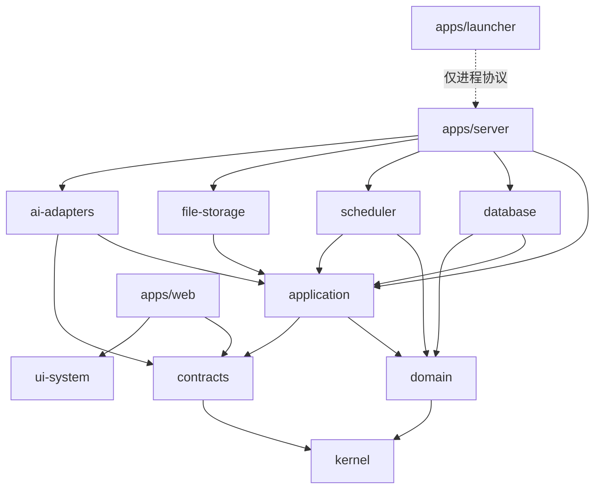
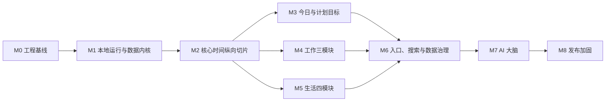

# 个人生活助手——项目工程结构与开发实施计划

> 文档状态：V1.0（第一版实施基线）  
> 上游文档：[产品需求与系统架构设计书](./产品需求与系统架构设计书.md)  
> 上游文档：[数据库与 API 详细设计书](./数据库与API详细设计书.md)  
> 目标：把产品和技术设计转化为可初始化、可拆分、可测试、可发布的工程计划

---

## 1. 文档目的

本文档定义第一版的：

1. 仓库与代码目录结构。
2. 应用、包和领域模块的职责边界。
3. 依赖方向、开发工具链和运行方式。
4. 数据库、API、前端、后台任务、AI 和 Windows 启动器的协作方式。
5. 分阶段实施顺序、任务拆分、依赖关系和退出标准。
6. 测试、质量门禁、发布、升级和故障恢复流程。

本文档不重新定义产品需求和数据库字段；发生冲突时，产品行为以上游 PRD 为准，数据与 API 契约以《数据库与 API 详细设计书》为准。

---

## 2. 第一版工程目标

### 2.1 可交付形态

第一版最终交付一个 Windows 本地应用目录和桌面快捷方式：

- 双击快捷方式启动后台服务。
- 后台服务自动选择可用本地端口并打开 Chrome 或 Edge。
- 浏览器关闭后后台服务继续运行。
- 托盘入口可重新打开页面、查看状态、重启或退出服务。
- 应用不要求用户安装 Node.js、数据库或其他开发环境。
- 所有业务数据和附件保存在用户选择的数据目录。

### 2.2 工程原则

- 本地优先：除模型调用和节假日更新外，不依赖云端服务。
- 离线完整：没有 API Key 时，核心产品仍可长期使用。
- 单一事实来源：页面、AI 工具和后台任务使用同一应用服务。
- 领域优先：业务规则不写在路由、React 页面或数据库触发器中。
- 契约优先：API、SSE 和 AI 工具参数由共享 Schema 生成。
- 可恢复优先：迁移、更新和高风险操作必须有备份或撤销路径。
- 小步可验收：每个里程碑交付可运行的纵向切片，不长期维护不可运行的“大分支”。

### 2.3 明确不进入第一版

- 手机端页面和移动端离线同步。
- Windows 桌面容器封装。
- 多用户、账号登录和云端数据库。
- 外部日历、邮箱、健康设备及内容平台接入。
- 语义搜索、附件正文解析、OCR、语音输入。
- 最终品牌视觉和复杂动效精修。

---

## 3. 技术方案总览

| 层级 | 选择 | 责任 |
|---|---|---|
| Web | React + TypeScript + Vite | 桌面工作台 UI |
| 路由 | TanStack Router | 类型安全路由与页面加载 |
| 服务端数据 | TanStack Query | 请求缓存、失效和并发状态 |
| 本地 UI 状态 | Zustand 或等价轻量库 | 仅保存界面瞬时状态 |
| 表单 | React Hook Form + Zod | 表单状态与共享验证 |
| 编辑器 | Tiptap/ProseMirror + Markdown AST | 富文本和 Markdown |
| 图表 | ECharts | 总览与统计图表 |
| 时间流 | Canvas 渲染适配层 | 今日动态时间流，视觉后续可替换 |
| Server | Node.js LTS + Fastify + TypeScript | 本地 API、SSE、静态 Web、后台任务 |
| 数据库 | SQLite WAL + Drizzle ORM | 本地权威数据源 |
| 搜索 | SQLite FTS5 | 关键词和字段搜索 |
| 日志 | Pino | 结构化本地日志 |
| AI | Provider Adapter + Tool Registry | 模型切换、工具调用与权限控制 |
| Windows 外壳 | 自包含 .NET WinForms 小程序 | 启动、托盘、进程守护、浏览器打开 |
| 单元/集成测试 | Vitest | 领域、应用、数据库与 API 测试 |
| 组件测试 | React Testing Library | 交互和无障碍语义 |
| 端到端测试 | Playwright | Chrome/Edge 完整流程 |
| 包管理 | pnpm workspace | Monorepo 依赖和脚本 |
| 任务编排 | Turborepo | 增量构建、测试和缓存 |

不在本文固定具体小版本。项目初始化时选择经过验证的稳定版本，使用 lockfile 固定，并通过依赖升级流程更新。

---

## 4. 仓库总体结构

```text
life-assistant/
├─ apps/
│  ├─ server/                         # 本地 Fastify 服务与后台常驻进程
│  │  ├─ src/
│  │  │  ├─ bootstrap/                # 启动、配置、数据目录、迁移
│  │  │  ├─ http/                     # Fastify、插件、错误、会话、OpenAPI
│  │  │  ├─ modules/                  # 按领域装配路由和应用服务
│  │  │  ├─ background/               # Job runner、事件分发、补跑
│  │  │  ├─ sse/                      # SSE 连接与事件缓冲
│  │  │  ├─ security/                 # 启动令牌、CSRF、Origin、凭据适配
│  │  │  ├─ observability/            # 日志、诊断、性能指标
│  │  │  ├─ app.ts                    # 创建应用，不监听端口
│  │  │  └─ main.ts                   # 生产入口
│  │  ├─ test/
│  │  └─ package.json
│  ├─ web/                            # React 桌面 Web App
│  │  ├─ src/
│  │  │  ├─ app/                      # Router、Provider、布局、启动
│  │  │  ├─ routes/                   # 路由页面，只负责组合
│  │  │  ├─ features/                 # 用户动作与功能切片
│  │  │  ├─ entities/                 # 前端领域展示模型
│  │  │  ├─ widgets/                  # 页面级组合区块
│  │  │  ├─ shared/                   # API 客户端、通用组件、工具
│  │  │  ├─ styles/                   # 基础令牌和全局样式
│  │  │  └─ main.tsx
│  │  ├─ public/
│  │  ├─ test/
│  │  └─ package.json
│  └─ launcher/                       # Windows 启动/托盘，无业务逻辑
│     ├─ LifeAssistant.Launcher/
│     ├─ LifeAssistant.Launcher.Tests/
│     └─ README.md
├─ packages/
│  ├─ kernel/                         # ID、时间、金额、枚举、Result、Clock
│  ├─ contracts/                      # Zod DTO、API、SSE、AI Tool Schema
│  ├─ domain/                         # 纯领域实体、值对象和不变量
│  ├─ application/                    # 用例、端口、事务与权限编排
│  ├─ database/                       # Drizzle Schema、迁移、仓储实现
│  ├─ scheduler/                      # 本地排程、压力指数、空闲时间
│  ├─ ai-adapters/                    # 模型适配器与上下文最小化
│  ├─ file-storage/                   # 附件、数据目录、校验与迁移
│  ├─ ui-system/                      # 设计令牌、基础组件、交互规范
│  └─ test-support/                   # 工厂、Fixture、临时数据库、Mock Clock
├─ docs/
│  ├─ adr/                            # 架构决策记录
│  ├─ api/                            # 生成的 OpenAPI 与说明
│  ├─ database/                       # ER 图、迁移说明
│  ├─ operations/                     # 启动、备份、恢复、诊断手册
│  └─ testing/                        # 测试策略与验收用例
├─ fixtures/
│  ├─ demo/                           # 首次启动演示数据
│  ├─ performance/                    # 10 万记录基准数据生成配置
│  └─ backups/                        # 合法/损坏/旧版本备份样本
├─ scripts/
│  ├─ dev/                            # 开发启动与环境检查
│  ├─ database/                       # 迁移、检查、重建投影
│  ├─ contracts/                      # OpenAPI、客户端和工具 Schema 生成
│  ├─ release/                        # 组装便携发布包
│  └─ verify/                         # 一键质量验证
├─ distribution/
│  ├─ runtime/                        # 发布时复制的私有 Node runtime
│  ├─ app/                            # Server 与 Web 构建产物
│  └─ launcher/                       # 自包含 launcher.exe
├─ .github/workflows/                 # CI；无 GitHub 时可保留为未来入口
├─ pnpm-workspace.yaml
├─ turbo.json
├─ tsconfig.base.json
├─ eslint.config.js
├─ prettier.config.js
├─ vitest.workspace.ts
├─ playwright.config.ts
├─ package.json
└─ pnpm-lock.yaml
```

---

## 5. 包依赖方向



依赖规则：

- `kernel` 不依赖任何业务包或框架。
- `domain` 不依赖 Fastify、React、Drizzle、文件系统或模型 SDK。
- `application` 只依赖端口接口，不直接依赖 SQLite、Windows 凭据或模型 SDK。
- `database`、`file-storage`、`scheduler`、`ai-adapters` 实现应用层端口。
- `apps/server` 只负责装配和传输层，不承载业务规则。
- `apps/web` 通过生成的 API Client 访问服务端，不导入 `database` 或服务端实现。
- `apps/launcher` 只了解启动协议、健康检查和进程 ID，不了解业务 API。
- AI 工具调用应用层用例，不允许直接调用仓储或 SQL。

通过 ESLint 边界规则和包 `exports` 限制非法依赖。

---

## 6. 核心包职责

### 6.1 `packages/kernel`

包含：

- `EntityId` / ULID 生成接口。
- `Instant`、`LocalDate`、`LocalTime`、`TimeZone`。
- `Money`、`DurationMinutes`、`Percentage`。
- 工作/生活、状态、优先级等稳定枚举。
- `Result<T, E>`、领域错误基类。
- `Clock`、`IdGenerator`、`TransactionContext` 端口。

不得包含业务实体和基础设施实现。

### 6.2 `packages/contracts`

包含：

- 请求、响应和分页 Zod Schema。
- Problem Details 错误 Schema。
- SSE 事件 Schema。
- AI 工具 JSON Schema。
- OpenAPI 注册元数据。
- 自动生成的 TypeScript Client 类型。

契约必须明确 `null`、缺省字段和枚举语义。禁止从数据库 Schema 自动暴露全部字段。

### 6.3 `packages/domain`

按领域组织：

```text
src/
├─ goals-plans/
├─ tasks/
├─ events/
├─ recurrence/
├─ routines/
├─ work/
│  ├─ self-media/
│  ├─ development/
│  └─ learning/
├─ life/
│  ├─ shopping/
│  ├─ diet/
│  ├─ fitness/
│  └─ entertainment/
├─ content/
├─ notifications/
└─ history/
```

包含实体、值对象、状态机、领域服务和领域事件。所有不变量必须在这里或应用层用例中显式表达并测试。

### 6.4 `packages/application`

每个用例采用明确命名，例如：

- `CreateTask`
- `CompleteTask`
- `AddTaskDependency`
- `CreateRecurringEvent`
- `RequestReschedule`
- `PurchaseShoppingItem`
- `ApplyAiChangePlan`
- `SoftDeleteEntity`
- `RestoreChangeSet`

应用层负责：权限/风险判断、事务边界、仓储调用、版本历史、变更集和领域事件，不处理 HTTP 细节。

### 6.5 `packages/database`

包含：

- 按领域拆分的 Drizzle Schema。
- 编号迁移文件与校验。
- SQLite 连接和 PRAGMA。
- 仓储实现。
- 幂等记录、Outbox/领域事件、后台 Job 仓储。
- FTS 投影和重建。
- 备份前的数据库检查。

不得包含 UI DTO 或 AI Prompt。

### 6.6 `packages/scheduler`

包含三个独立但共享输入的能力：

1. 空闲时间计算。
2. 确定性自动排程。
3. 压力指数 V1。

排程输入和输出均为纯数据结构，算法不读取数据库。应用层加载输入、调用算法、再原子保存结果。使用固定 `Clock` 和种子可完全重放测试。

### 6.7 `packages/ai-adapters`

包含：

- `ModelProvider` 统一端口。
- OpenAI、Anthropic、Google 和 OpenAI Compatible 适配器。
- 能力检测：聊天、流式、工具调用、原生联网。
- 最小上下文构建器。
- Tool Registry 与参数校验桥接。
- 使用量、超时、取消和错误标准化。

不保存 API Key，不直接访问数据库，不解析附件正文。

### 6.8 `packages/file-storage`

包含：数据目录、附件复制、SHA-256、临时文件、原子移动、受控路径、备份包、恢复预检、目录迁移和物理清理。

任何绝对路径都只能在此包和 Server 装配层存在，API DTO 不返回绝对路径。

### 6.9 `packages/ui-system`

第一版只建立基础设计系统：

- 色彩、间距、圆角、排版、层级和动效令牌。
- Button、Input、Select、Dialog、Drawer、Panel、Table、Tabs 等基础组件。
- 状态颜色同时提供图标和文字，不只依赖颜色。
- 桌面和未来移动尺寸令牌分开定义。
- 不把业务数据获取或路由逻辑放入组件库。

---

## 7. Server 工程结构

每个 Server 模块统一采用：

```text
modules/tasks/
├─ tasks.routes.ts          # 路由与 OpenAPI 装配
├─ tasks.handlers.ts        # HTTP ↔ Application DTO
├─ tasks.presenter.ts       # 响应映射与 ETag
├─ tasks.module.ts          # 依赖装配
└─ tasks.integration.test.ts
```

全局插件顺序：

1. Request ID 与结构化日志。
2. 本地会话、Origin 和 CSRF。
3. JSON/body/file 大小限制。
4. Zod 校验与错误映射。
5. 幂等处理中间件。
6. 路由模块。
7. Problem Details 错误处理。
8. SSE 与静态 Web 回退。

HTTP Handler 不得开启 SQL 事务、直接写表或包含状态机逻辑。

---

## 8. Web 工程结构

### 8.1 页面路由

```text
routes/
├─ __root.tsx
├─ today.tsx
├─ work/
│  ├─ index.tsx
│  ├─ self-media.tsx
│  ├─ development.tsx
│  └─ learning.tsx
├─ life/
│  ├─ index.tsx
│  ├─ shopping.tsx
│  ├─ diet.tsx
│  ├─ fitness.tsx
│  └─ entertainment.tsx
├─ plans-goals.tsx
├─ assistant/
│  ├─ index.tsx
│  └─ $chatId.tsx
└─ settings/
   ├─ index.tsx
   ├─ data.tsx
   ├─ routines.tsx
   ├─ ai.tsx
   └─ backups.tsx
```

### 8.2 前端切片

`features` 按用户动作命名，而不是按技术类型：

- `quick-capture`
- `task-editor`
- `event-editor`
- `goal-progress`
- `schedule-details`
- `global-search`
- `notification-center`
- `ai-chat`
- `change-preview`
- `backup-restore`

每个功能包含 UI、Query/Mutation、Schema 映射和测试。页面只编排功能与 Widget。

### 8.3 数据访问规则

- 所有请求通过生成的 API Client。
- Query Key 由 `shared/api/query-keys.ts` 统一定义。
- Mutation 成功后优先使用服务端返回版本更新缓存，再按 SSE 失效相关 Query。
- 412 版本冲突显示对比，不自动覆盖。
- 离线时只禁用 AI 与联网操作，本地 API 仍正常使用。
- 不在 Zustand 中复制 Server 数据。

### 8.4 今日时间流

时间流定义抽象接口：

```ts
interface TimelineRenderer {
  mount(container: HTMLElement): void;
  render(model: TimelineVisualModel): void;
  resize(width: number, height: number): void;
  setReducedMotion(enabled: boolean): void;
  destroy(): void;
}
```

业务页面只提供 24 小时时间块和视觉语义，不依赖具体 Canvas 实现。第二版可替换视觉渲染器而不修改今日数据接口。

---

## 9. Windows 启动器与发布运行时

### 9.1 为什么使用薄 .NET 启动器

核心业务保持 TypeScript；但 Windows 托盘、隐藏进程、快捷方式、单实例和自包含发布由极薄的 .NET WinForms 程序实现更稳定。该程序不嵌入网页、不读数据库、不调用业务用例，未来可被桌面容器替换。

### 9.2 启动协议

1. 获取单实例互斥锁。
2. 读取安装目录 `runtime.json`。
3. 检查已有 Server 健康状态。
4. 无实例时启动私有 `node.exe server/main.js`，隐藏窗口。
5. 等待 `/health/ready`，超时显示可理解错误。
6. 请求一次性 launch token。
7. 打开浏览器并交换本地会话。
8. 驻留托盘并监控子进程。

### 9.3 发布目录

```text
LifeAssistant/
├─ LifeAssistant.Launcher.exe
├─ runtime/
│  └─ node.exe
├─ app/
│  ├─ server/
│  ├─ web/
│  └─ package-manifest.json
├─ assets/
└─ runtime.json
```

发布包不得包含开发依赖、源码映射中的绝对源码路径、测试数据或 API Key。

---

## 10. 配置与秘密管理

### 10.1 配置分层

优先级从高到低：

1. 仅开发环境变量。
2. 运行时 `runtime.json`：端口策略、应用版本和安装目录信息。
3. 数据库 `settings`：用户可编辑设置。
4. 代码默认值。

生产使用不要求用户设置环境变量。

### 10.2 开发环境变量

建议只允许：

- `LIFE_ASSISTANT_DATA_DIR`
- `LIFE_ASSISTANT_PORT`
- `LIFE_ASSISTANT_LOG_LEVEL`
- `LIFE_ASSISTANT_DISABLE_BROWSER_OPEN`
- `LIFE_ASSISTANT_TEST_CLOCK`

禁止通过 `.env` 长期保存真实个人 API Key。开发测试使用模拟 Provider 或临时 CI Secret。

### 10.3 API Key

- Launcher/Server 通过 Windows 凭据适配器读写。
- 数据库只保存 `credential_ref`。
- API Key 不进入数据库和备份，也不得被演示数据、诊断包或迁移脚本复制。
- 日志脱敏器识别常见密钥前缀和 Authorization Header。
- 测试必须证明数据库、备份、日志和 API 响应不包含密钥。

---

## 11. 数据目录与运行数据

开发环境默认使用仓库外临时目录，不把个人数据写入 Git 工作区。生产目录遵循上游设计：

```text
LifeAssistantData/
├─ database/
├─ attachments/
├─ backups/
├─ logs/
├─ cache/
└─ metadata.json
```

约束：

- `cache` 和搜索投影可重建，不进入关键恢复判断。
- 数据库和附件是权威数据，迁移时必须一起校验。
- 日志按大小和数量轮换。
- 开发测试的临时数据目录在测试结束后安全清理。
- 清理脚本只接受经过解析并验证位于测试根目录下的绝对路径。

---

## 12. 工程脚本与常用命令

根目录统一提供：

| 命令 | 作用 |
|---|---|
| `pnpm dev` | 并行启动 Server 与 Web 开发环境 |
| `pnpm dev:launcher` | 启动 Launcher 调试模式 |
| `pnpm build` | 构建全部包和应用 |
| `pnpm typecheck` | 全仓严格类型检查 |
| `pnpm lint` | ESLint 与边界规则 |
| `pnpm format:check` | 格式检查 |
| `pnpm test` | 单元和常规集成测试 |
| `pnpm test:integration` | SQLite/API/文件集成测试 |
| `pnpm test:e2e` | Playwright 端到端测试 |
| `pnpm test:performance` | 基准数据性能验证 |
| `pnpm db:generate` | 根据 Drizzle Schema 生成候选迁移 |
| `pnpm db:migrate:test` | 在空库和升级样本上执行迁移 |
| `pnpm db:check` | SQLite integrity/foreign key 检查 |
| `pnpm contracts:generate` | 生成 OpenAPI、客户端和 AI Tool Schema |
| `pnpm contracts:check` | 检查生成物是否与源码一致 |
| `pnpm fixtures:demo` | 生成确定性的演示数据 |
| `pnpm release:portable` | 组装 Windows 便携发布目录 |
| `pnpm verify` | 交付前完整质量门禁 |

脚本不得依赖交互式输入；需要路径时通过明确参数或测试配置传入。

---

## 13. TypeScript 与代码规范

### 13.1 编译规范

- `strict: true`。
- 启用 `noUncheckedIndexedAccess`、`exactOptionalPropertyTypes`、`noImplicitOverride`。
- 禁止隐式 `any`；边界处未知数据使用 `unknown` 并校验。
- ESM 作为统一模块格式。
- 包只通过 `exports` 暴露公共入口。

### 13.2 业务代码规则

- 时间一律通过 `Clock`，禁止业务代码直接调用 `Date.now()`。
- ID 一律通过 `IdGenerator`。
- 金额使用 `Money`，禁止浮点元直接入库。
- API Handler 不写业务条件分支。
- React 组件不计算压力、进度或排程规则。
- 数据库仓储不决定风险等级或 AI 权限。
- 领域错误使用稳定错误码，不依赖英文异常字符串。
- 所有高风险操作必须走统一确认服务。

### 13.3 文件与命名

- 文件名使用 kebab-case。
- 类型、类和组件使用 PascalCase。
- 函数、变量和 JSON 字段使用 camelCase。
- 数据库表和列使用 snake_case。
- 用例使用动词开头，例如 `CompleteTask`。
- 领域事件使用过去式，例如 `TaskCompleted`。

---

## 14. 数据库开发工作流

1. 在领域模型中明确不变量。
2. 修改 Drizzle Schema。
3. 生成候选迁移并人工审阅 SQL。
4. 补充空库迁移测试和旧版本升级测试。
5. 更新仓储、DTO 映射和 OpenAPI。
6. 使用真实事务集成测试。
7. 检查索引与 `EXPLAIN QUERY PLAN`。
8. 更新数据库设计书对应章节。

禁止修改已发布迁移；修复通过新迁移完成。复杂迁移必须先创建备份并提供失败恢复测试。

---

## 15. API 契约开发工作流

所有产生副作用的 `POST` 必须携带 `Idempotency-Key`；所有已有聚合的更新、删除意图和恢复必须携带 `If-Match`。这两项由 Server 通用插件执行，不允许各模块自行选择是否启用。

1. 在 `contracts` 中编写请求、响应和错误 Schema。
2. 在 `application` 中实现用例，不依赖 HTTP。
3. 在 Server 添加薄路由和 Presenter。
4. 生成 OpenAPI 和 TypeScript Client。
5. 运行契约快照检查。
6. 为幂等、If-Match、确认流程和错误码添加集成测试。
7. Web 只使用生成 Client 接入。
8. AI 工具复用同一用例与 Schema。

任何契约变化都要评估 `/api/v1` 兼容性和未来移动端影响。

---

## 16. 架构决策记录

项目启动时至少创建：

| ADR | 决策 |
|---|---|
| ADR-001 | 使用 pnpm Monorepo 与模块化单体 |
| ADR-002 | SQLite WAL 为本地权威数据源 |
| ADR-003 | Zod 契约生成 OpenAPI 与 AI Tool Schema |
| ADR-004 | 领域层不依赖框架和基础设施 |
| ADR-005 | 基于 SQLite 的持久化 Job/Outbox，不引入 Redis |
| ADR-006 | Windows 启动器使用薄 .NET 自包含程序 |
| ADR-007 | API Key 使用 Windows 凭据管理器 |
| ADR-008 | 今日时间流使用可替换 Canvas Renderer |
| ADR-009 | 高风险操作统一预览—确认—执行 |
| ADR-010 | AI 工具调用应用层，不直接访问数据库 |

ADR 记录背景、选择、备选方案、后果和未来重新评估条件。

---

## 17. 里程碑与依赖关系



关键路径：`M0 → M1 → M2 → M3/M4/M5 → M6 → M7 → M8`。

M4 与 M5 在 M2 稳定后可以并行实施，但共享表、统计口径和 UI 组件必须先通过契约评审。本文不按自然周承诺工期；实际周期取决于参与人数、UI 设计完成度和自动化测试投入。

任务规模使用：

- S：单一模块、边界明确。
- M：跨两层或包含集成测试。
- L：跨领域、包含迁移或完整纵向流程。
- XL：必须拆成多个可独立验收子任务，不允许直接进入开发。

---

## 18. M0——工程基线

### 18.1 目标

建立所有后续功能共用的可构建、可测试、可生成契约的工程底座。

### 18.2 任务

| ID | 任务 | 规模 | 依赖 |
|---|---|---:|---|
| M0-001 | 初始化 pnpm workspace、Turborepo 和根脚本 | S | 无 |
| M0-002 | 建立 TypeScript 严格配置和包边界规则 | M | M0-001 |
| M0-003 | 配置 ESLint、Prettier、Vitest、Playwright | M | M0-001 |
| M0-004 | 创建 `kernel/contracts/domain/application` 包骨架 | M | M0-002 |
| M0-005 | 建立 Fastify App Factory 与健康接口 | M | M0-004 |
| M0-006 | 建立 React/Vite、Router、Query 和基础布局 | M | M0-004 |
| M0-007 | 建立 OpenAPI 和 TypeScript Client 生成管线 | M | M0-004, M0-005 |
| M0-008 | 建立临时数据目录与测试清理安全守卫 | M | M0-005 |
| M0-009 | 创建 ADR、代码审查和文档更新模板 | S | 无 |
| M0-010 | 建立 `pnpm verify` 初始门禁 | M | M0-003, M0-007 |

### 18.3 交付物

- 空业务但可启动的 Server 与 Web。
- `/health/live`、`/health/ready`。
- 生成的最小 OpenAPI 与 Client。
- 一个跨包示例用例和测试，证明依赖方向正确。
- CI/本地验证命令在干净环境通过。

### 18.4 退出标准

- 全仓构建、类型、Lint、单元测试通过。
- 非法包依赖会使 Lint 失败。
- OpenAPI 生成物变化可被检测。
- 测试不会写入真实用户目录。

### 18.5 实施记录

M0 已于 2026-08-11 完成。M0-001 至 M0-010 均已落地；`pnpm verify`、9 个单元/集成测试和基于最新版 Chrome 的 Playwright 主路径测试通过。界面仅采用中性工程基线，最终视觉语言按既定范围留待第二版设计。

---

## 19. M1——本地运行与数据内核

### 19.1 目标

建立可长期运行的本地服务、数据目录、SQLite 内核、设置与基础数据安全能力。

### 19.2 任务

| ID | 任务 | 规模 | 依赖 |
|---|---|---:|---|
| M1-001 | 数据目录选择、验证和 `metadata.json` | L | M0 |
| M1-002 | SQLite 连接、PRAGMA、事务和关闭流程 | M | M1-001 |
| M1-003 | Schema 迁移框架与迁移校验 | L | M1-002 |
| M1-004 | `entity_index`、设置、分类和标签 Schema | L | M1-003 |
| M1-005 | 版本历史、变更集、领域事件和幂等表 | L | M1-003 |
| M1-006 | 持久化后台 Job Runner 与启动补跑 | L | M1-005 |
| M1-007 | 本地 launch token、Cookie、CSRF 与 Origin 防护 | L | M0-005 |
| M1-008 | 设置、分类、标签 API 与 Web 页面 | L | M1-004, M1-007 |
| M1-009 | 附件存储最小内核与受控路径 | L | M1-001, M1-005 |
| M1-010 | 手动数据库备份原型和完整性检查 | L | M1-002, M1-006 |
| M1-011 | Windows Launcher 最小启动、单实例和托盘 | L | M0-005, M1-007 |
| M1-012 | 首次启动向导骨架 | M | M1-001, M1-008 |

### 19.3 关键测试

- WAL 崩溃恢复。
- 外键和事务回滚。
- 幂等键重放与误用冲突。
- 后台任务锁租约和进程重启补跑。
- 非应用 Origin 无法写入。
- 附件路径穿越被拒绝。
- Launcher 重复启动只有一个 Server。

### 19.4 退出标准

- 双击 Launcher 可启动服务并打开浏览器。
- 用户可以选择数据目录并保存普通设置。
- 浏览器关闭后服务继续运行。
- 空库迁移和从上一迁移升级均通过。
- 手动备份能生成可校验数据库副本。

### 19.5 实施记录

M1 已于 2026-08-11 完成。M1-001 至 M1-012 均已落地：数据目录及元数据、SQLite WAL/外键/迁移、共享设置与七个默认分类、版本与幂等基础表、持久化 Job Runner、本地会话安全、受控附件、可校验备份、首次启动向导和 Windows 单实例托盘 Launcher 已形成可运行闭环。

验收证据包括 20 项单元/集成测试（含独立进程异常退出后的 WAL 恢复）、最新版 Chromium 首次启动与设置管理 E2E、浏览器关闭后健康检查、Launcher 二次启动零新增服务实例，以及生产构建产物的真实启动验证。M2 已具备进入条件。

---

## 20. M2——核心时间系统纵向切片

### 20.1 目标

打通产品最重要的可运行链路：创建目标/计划/任务或日程 → 本地排程 → 今日显示 → 完成/逾期 → 自动重排与历史。

### 20.2 M2A：行动模型

| ID | 任务 | 规模 | 依赖 |
|---|---|---:|---|
| M2-001 | 目标、指标和进度领域模型/Schema | L | M1 |
| M2-002 | 计划、里程碑领域模型/Schema | L | M2-001 |
| M2-003 | 任务、状态机、预计时长和优先级 | L | M1 |
| M2-004 | 一层子任务和依赖无环校验 | L | M2-003 |
| M2-005 | 固定日程、不可移动和冲突检测 | L | M1 |
| M2-006 | 目标、计划、任务、日程 API | L | M2-001~005 |
| M2-007 | 通用任务/日程编辑器与详情面板 | L | M2-006 |
| M2-008 | ETag、If-Match 和版本冲突 UI | M | M2-006, M1-005 |

### 20.3 M2B：重复与作息

| ID | 任务 | 规模 | 依赖 |
|---|---|---:|---|
| M2-009 | RFC 5545 子集解析和周期模板 | L | M2-003, M2-005 |
| M2-010 | 周期实例幂等生成与单次例外 | L | M2-009, M1-006 |
| M2-011 | “本次及以后”规则切分 | L | M2-010 |
| M2-012 | 工作日/周末/节假日作息模板 | L | M1-008 |
| M2-013 | 日期覆盖和跨午夜睡眠片段 | M | M2-012 |
| M2-014 | 节假日存储、手动覆盖和更新适配端口 | L | M2-012, M1-006 |

节假日联网 Provider 首先实现可替换接口和本地 Fixture；真实来源接入在 M8 前完成并验证。

### 20.4 M2C：确定性排程

| ID | 任务 | 规模 | 依赖 |
|---|---|---:|---|
| M2-015 | 24 小时占用与空闲时间计算 | L | M2-005, M2-012 |
| M2-016 | 任务排序评分与约束检查 | L | M2-003, M2-004 |
| M2-017 | 不可拆分任务连续时段排程 | L | M2-015, M2-016 |
| M2-018 | 可拆分任务最小 30 分钟排程 | L | M2-017 |
| M2-019 | 稳定性策略：保留已有合法安排 | L | M2-017 |
| M2-020 | 跨工作/生活时段警告和无法排入警告 | M | M2-017 |
| M2-021 | 完成释放、逾期重排和排程历史 | L | M2-017, M1-005 |
| M2-022 | 排程 API、SSE 事件与并发版本 | L | M2-017~021 |

### 20.5 纵向验收场景

1. 设置工作日作息与睡眠。
2. 创建固定会议和两个弹性任务。
3. 系统按 15 分钟网格自动排程且不覆盖睡眠/会议。
4. 把高优先任务排在普通任务之前。
5. 完成一个任务后释放时间并更新目标进度。
6. 另一个任务逾期后自动重排并保留历史。
7. 全流程不配置 AI Key 仍正常工作。

### 20.6 退出标准

- 核心领域不变量测试全部通过。
- 排程算法在固定输入和 Clock 下结果可重放。
- 10,000 个待排任务基准用例无死循环和重叠。
- 纵向验收场景通过 API 和浏览器 E2E。

### 20.7 完成记录

M2 已于 2026-08-11 完成。数据库迁移版本升级至 3，目标—计划—任务、固定日程、重复规则、作息模板、节假日覆盖、确定性排程、警告、版本并发与历史记录形成无 AI Key 可运行的纵向闭环。Web 端已接通今日任务/日程录入、24 小时时间安排、任务详情编辑、完成与重排、目标树和作息模板编辑；完整今日视觉流、压力指数和计划多视图仍按原范围进入 M3。

验收证据包括 30 项单元/集成测试、固定 Clock 可重放排程、10,000 任务基准、Chrome 无 AI Key 纵向 E2E、生产构建、Windows Launcher 构建与二次启动单实例回归。节假日 M2 提供可替换 Provider 端口和本地 Fixture，真实联网来源仍按计划在 M8 接入。

---

## 21. M3——今日、计划与目标体验

### 21.1 任务

| ID | 任务 | 规模 | 依赖 |
|---|---|---:|---|
| M3-001 | 今日聚合查询和 `serverNow` | L | M2 |
| M3-002 | 睡眠/工作/生活/空闲统计 | M | M3-001 |
| M3-003 | 压力指数 V1 纯算法与解释因素 | L | M2-015, M2-016 |
| M3-004 | 今日页面框架和计划列表 | L | M3-001 |
| M3-005 | 可替换 Canvas 时间流 Renderer | L | M3-001 |
| M3-006 | 当前东八区时刻指针 | S | M3-005 |
| M3-007 | 时间块详情面板与修改跳转 | M | M3-004, M2-007 |
| M3-008 | 计划看板视图 | L | M2-006 |
| M3-009 | 计划日历视图 | L | M2-006 |
| M3-010 | 计划时间轴视图 | L | M2-006 |
| M3-011 | 目标树视图 | L | M2-006 |
| M3-012 | 手动目标进度与自动进度切换 | M | M2-001 |

### 21.2 退出标准

- 今日页准确覆盖完整 24 小时。
- 四类时间合计恰好为 1,440 分钟。
- 压力指数范围、等级和贡献因素可解释。
- 完成任务后时间流移除该任务并释放为空闲。
- 四个计划视图使用同一份数据，修改后同步更新。
- 时间流在目标 Chrome/Edge 保持流畅，并支持减少动态效果。

### 21.3 实施记录

M3 功能开发已于 2026-08-11 完成。今日驾驶舱现由单一聚合接口提供 `serverNow`、24 小时时间块、今日计划、连续空闲时段、四类分钟统计和 `pressure-v1` 解释因素；四类时间按 15 分钟网格归一化，合计严格为 1,440 分钟。Web 端已接入可替换 Canvas Renderer、东八区实时指针、时间块详情、今日工作筛选，以及计划看板、日历、时间轴、目标树和目标/计划的自动—手动进度切换。

验收证据包括 33 项单元/集成测试、M1→M3 无 AI Key Chrome 纵向 E2E、完整 `pnpm verify`、生产构建与 Launcher 构建。视觉复核覆盖今日完整页和目标树状态，减少动态效果由 Renderer 接口与 `prefers-reduced-motion` 共同支持。2026-08-11 已通过专用 CDP 通道连接本机 Microsoft Edge 116.0.1938.76，使用隔离浏览器配置完成 M3 实机回归：任务创建、自动排程、编辑与完成，1,440 分钟聚合与压力指数重算，目标/计划创建，四视图数据同步，以及手动—自动进度切换均通过。

---

## 22. M4——工作三模块

### 22.1 自媒体

| ID | 任务 | 规模 |
|---|---|---:|
| M4-SM-001 | 内容生命周期领域模型与 API | L |
| M4-SM-002 | 选题、脚本笔记和素材关联 | L |
| M4-SM-003 | 内容日历和发布时间关联 | M |
| M4-SM-004 | 制作状态流转 | M |
| M4-SM-005 | 手动数据表现录入与趋势 | L |
| M4-SM-006 | 自媒体页面与完整 E2E | L |

### 22.2 开发项目

| ID | 任务 | 规模 |
|---|---|---:|
| M4-DEV-001 | 项目概览与状态 | M |
| M4-DEV-002 | 功能清单、任务和里程碑关联 | L |
| M4-DEV-003 | 缺陷状态、严重程度和修复任务 | L |
| M4-DEV-004 | 技术文档笔记关联 | M |
| M4-DEV-005 | 仓库链接保存与安全打开 | S |
| M4-DEV-006 | 开发项目页面与完整 E2E | L |

### 22.3 学习

| ID | 任务 | 规模 |
|---|---|---:|
| M4-LRN-001 | 课程/书籍/资料领域模型 | L |
| M4-LRN-002 | 学习计划与资源关联 | M |
| M4-LRN-003 | 学习时长与进度记录 | L |
| M4-LRN-004 | 知识笔记和附件关联 | M |
| M4-LRN-005 | 学习统计与页面 E2E | L |

### 22.4 工作总览

在三个模块完成后实现统一时间范围服务、工作任务完成率、自媒体表现、项目进度、学习时长和近期里程碑。统计必须从结构化原始记录计算，并允许进入明细。

### 22.5 退出标准

- 三个模块均具备新增、详情、修改、筛选、软删除和统计。
- 领域记录可关联共享任务、计划、目标、笔记和附件。
- 仓库 URL 不触发任何抓取。
- 工作总览支持周、月、季度、年和自定义范围。

### 22.6 实施记录

M4 已于 2026-08-11 完成。第一批纵向切片建立了自媒体内容与表现指标、开发项目/功能/缺陷/仓库链接、学习资源与学习记录，以及共享 Zod/OpenAPI 契约、Fastify API 和三个工作页面；第二批将数据库迁移版本升级至 5，补齐通用工作笔记、附件关联、开发里程碑和自媒体趋势聚合。脚本、技术文档和知识笔记均可按角色关联到工作对象，附件上传后进入受控数据目录并建立共享关联；共享任务、计划与目标继续复用 M2 的实体关系，其中目标通过所属计划形成可追溯关联。仓库链接仅校验并保存 HTTP/HTTPS URL，服务端不发起抓取。

Web 端现已具备三模块新增、详情、修改、筛选、软删除和统计闭环：自媒体提供状态/平台筛选、制作管线、发布日历和表现趋势；开发项目提供项目状态、里程碑、功能、缺陷和仓库维护；学习提供资源状态、进度、时长记录与统计。工作总览支持周、月、季度、年及自定义日期范围，并可进入对应明细。M6 仍会把本批 Markdown 笔记输入增强为完整编辑器，但不再阻塞 M4 的结构化笔记与附件关联能力。

退出验收覆盖数据库 v1→v5 迁移与校验、趋势/里程碑/笔记/附件 API 集成、版本并发与软删除、M1→M4 无 AI Key Chrome 纵向 E2E、五类统计范围切换，以及工作三模块桌面与窄屏视觉复核。最终验证结果为 20 个测试文件、37 项单元/集成测试全部通过，完整 `pnpm verify`（含契约漂移、生产构建和 Windows Launcher 构建）与浏览器 E2E 均通过。

---

## 23. M5——生活四模块

### 23.0 实施记录

M5 第一批纵向切片于 2026-08-12 开始实施。数据库迁移版本升级至 6，首批完成生活总览基础、统一预算与支出结构、购物待购项、购买记录和“完成购买并记账”的单事务闭环；共享 Zod/OpenAPI 契约、Fastify API、生活总览与购物页面同步接通。饮食、健身和娱乐已进入生活导航与总览信息架构，结构化业务能力将在后续 M5 批次完成，因此当前不将 M5 标记为完整完成。

M5 第二批继续完成饮食纵向切片：数据库迁移升级至 7，加入食谱、餐食计划、实吃与基础营养、饮水、饮食偏好/忌口，以及餐饮支出；“完成餐食计划”在单事务内生成实吃记录、同步计划状态，并按需写入餐饮消费。共享契约、OpenAPI、Fastify API、饮食页面、生活总览聚合和无 AI Key E2E 同步接通。体重/身体指标将与健身批次统一实现；健身与娱乐仍待后续批次，因此 M5 仍未整体完成。

M5 第三批完成健身纵向切片：数据库迁移升级至 8，加入动作库、训练计划、实际训练与动作组、身体指标、个人纪录和恢复状态；共享契约、OpenAPI、Fastify API、健身页面、生活总览的频次/时长/热量/体重/恢复聚合与无 AI Key E2E 同步接通。训练计划保留目标关联、训练记录保留任务关联，但不会未经用户明确操作自动创建目标或任务。娱乐模块仍待下一批，因此 M5 尚未整体完成。

M5 第四批完成娱乐纵向切片：数据库迁移升级至 9，加入想看/想玩/想去清单、影视/书籍/漫画/游戏/活动/旅行类型、进度与评分、娱乐时间、活动旅行详情和可重复娱乐支出；共享契约、OpenAPI、Fastify API、娱乐页面与生活总览聚合同步接通。随后按 M5 退出标准执行四模块结构、统计、并发/事务、无 AI Key 浏览器流程和桌面/窄屏视觉验收；验收通过后 M5 标记为完整完成。

M5 退出验收确认：购物、饮食、健身、娱乐均使用独立结构化表和业务 API；购物完成与支出写入保持单事务一致，营养统计同时报告已记录与缺失餐次，身体指标作为饮食和健身共享来源，生活总览支持周/月/季度/年/自定义范围。四模块无 AI Key 浏览器主流程、桌面双栏与 1024px 单栏响应式页面均已覆盖，因此 M5 状态更新为完整完成。

### 23.1 购物

| ID | 任务 | 规模 |
|---|---|---:|
| M5-SHP-001 | 待购清单、分类、预算和优先级 | L |
| M5-SHP-002 | 购买事务：记录、消费和状态同步 | L |
| M5-SHP-003 | 计划/实际价格差异与历史 | M |
| M5-SHP-004 | 购物页面和完整 E2E | L |

### 23.2 饮食

| ID | 任务 | 规模 |
|---|---|---:|
| M5-DIET-001 | 食谱、食材和说明笔记 | L |
| M5-DIET-002 | 用餐计划、任务/日程关联 | L |
| M5-DIET-003 | 餐食和基础营养记录 | L |
| M5-DIET-004 | 饮水、偏好、忌口和体重关联 | L |
| M5-DIET-005 | 餐饮支出和营养统计 | L |
| M5-DIET-006 | 饮食页面和完整 E2E | L |

### 23.3 健身

| ID | 任务 | 规模 |
|---|---|---:|
| M5-FIT-001 | 动作库和训练计划 | L |
| M5-FIT-002 | 训练记录、动作组和时长 | L |
| M5-FIT-003 | 身体指标与个人纪录 | L |
| M5-FIT-004 | 恢复状态与目标进度关联 | M |
| M5-FIT-005 | 健身统计与页面 E2E | L |

### 23.4 娱乐

| ID | 任务 | 规模 |
|---|---|---:|
| M5-ENT-001 | 想看/想玩/想去与类型模型 | L |
| M5-ENT-002 | 进度与娱乐时长 | M |
| M5-ENT-003 | 活动/旅行详情和日程关联 | L |
| M5-ENT-004 | 娱乐支出和统计 | M |
| M5-ENT-005 | 娱乐页面和完整 E2E | L |

### 23.5 生活总览

实现跨购物、饮食、娱乐的消费汇总、总预算和分类预算，以及饮食、健身、身体指标、习惯和时间趋势。模块写入仍通过各自 API，生活总览只读聚合。

### 23.6 退出标准

- 四个模块均为真实结构化能力，不使用单一 JSON 表代替。
- 购物完成和消费写入保持原子一致。
- 未记录营养值保持缺失，不被统计为零。
- 身体指标能同时服务饮食和健身目标。
- 生活总览支持全部已确认时间范围。

---

## 24. M6——统一入口、搜索与数据治理

### 24.0 实施记录

M6 第一批纵向切片于 2026-08-13 开始实施。数据库迁移升级至 10，完成全局快速记录按钮与 `Ctrl + Shift + Space` 快捷键、`INBOX_ONLY` 原文收集、收集箱筛选与详情、手动拆分为任务/购物项、处理结果实体关联和归档。一次手动处理在同一 SQLite 事务中创建全部目标实体并记录来源关联；请求 `AI_PROCESS` 但未配置 AI 时返回明确的 `503 AI_UNAVAILABLE`，不会静默改存。共享 Zod/OpenAPI 契约、Fastify API、Web 工作台和无 AI Key 自动化验收同步接通。M6-004 的默认路径设置、笔记/草稿、搜索、历史/回收站与备份治理仍待后续批次，因此 M6 尚未整体完成。

M6 第二批继续完成 M6-004 至 M6-008：快速记录弹层读取设置中的默认路径，并保留每次记录单独切换；数据库迁移升级至 11，加入稳定键草稿表与读取、自动保存、清理 API；工作模块笔记接入 Tiptap 富文本和 Markdown 双模式编辑、转换预览及风险提示，正式保存后清理草稿；既有受控附件上传、SHA-256 存储和对象关联界面补齐受控打开入口。搜索、历史/撤销、回收站及备份治理仍待后续批次，M6 仍未整体完成。

M6 第三批完成 M6-009、M6-010、M6-011、M6-013 与 M6-014 的可独立验收切片：数据库迁移升级至 12，加入可重建的 `search_documents` 与 FTS5 外部内容索引；全局 `Ctrl + K` 搜索覆盖目标、计划、任务、日程、笔记、工作专属模块、生活专属模块和收集箱，支持对象类型筛选、结果摘要与目标模块跳转，中文查询采用稳定的 Unicode `LIKE` 召回以规避 FTS5 中文分词缺口；对象版本历史和最近变更集提供只读 API 与数据管理界面；回收站支持按版本恢复，永久删除统一使用一次性、十分钟有效的两阶段确认协议。M6-011 的任意历史版本恢复与 M6-012 的通用撤销/重做预览尚待下一批补强，M6-015 至 M6-021 的备份、演示数据和首次启动治理仍未开始，因此 M6 尚未整体完成。

M6 第四批补齐 M6-011 与 M6-012：历史服务可按“创建快照 + 后续字段补丁”重放目标、计划、任务、笔记、开发项目和购物项六类关键对象，指定版本恢复始终生成新版本，不覆盖或删除后续历史；最近操作标识可撤销性，只允许撤销对象当前最新的一次变更，防止覆盖后续编辑，并支持在状态仍可行时重做。版本恢复、撤销和重做都先返回字段差异预览，再经统一一次性确认令牌执行；新恢复记录写入完整前后态和 `change_operations`。数据管理页加入对象版本抽屉、恢复、撤销和重做入口。M6-015 至 M6-021 的备份、演示数据和首次启动治理仍待后续批次，M6 尚未整体完成。

M6 第五批完成 M6-015 至 M6-018：备份服务基于 SQLite 一致性备份生成完整 ZIP 包，收录数据库、受控附件及非敏感设置，并使用 SHA-256 清单逐项校验；按每日/每周策略登记后台备份任务，保留数量超过阈值时仅轮换已成功的定时备份，手动备份与恢复前备份不会被误删。设置页可查看最近备份、执行恢复预检，并使用一次性确认令牌执行恢复。恢复先在缓存目录解压并校验归档与数据库完整性，随后仅在切换期关闭数据服务、原子替换数据库和附件目录；任何切换失败都会还原原目录，且恢复前自动生成可回退备份。既有数据目录迁移沿用预检、暂存复制、校验和原目录回退语义。M6-019 至 M6-021 的演示数据和首次启动治理仍待后续批次，M6 尚未整体完成。

M6 第六批完成 M6-019 至 M6-021，并使 M6 全部完成：首次启动向导现包含本地运行说明、数据目录、七模块演示数据选择、自动备份频率与保留份数、快速记录默认处理方式；AI 仍可按产品约束在后续配置。演示数据使用固定批次标识与固定内容，覆盖自媒体、开发、学习、购物、饮食、健身、娱乐七个模块，以及示例目标、计划和任务。设置页显示演示数据状态，清空操作先预检并使用一次性确认令牌；清理仅按演示批次级联删除虚构业务记录，保留默认分类、设置和用户真实数据。测试夹具可显式选择空白空间，避免既有业务验收受演示数据影响。

### 24.1 快速记录和收集箱

| ID | 任务 | 规模 | 依赖 |
|---|---|---:|---|
| M6-001 | 全局快捷键和快速记录弹层 | M | M3 |
| M6-002 | `INBOX_ONLY` 收集箱流程 | M | M1 |
| M6-003 | 手动拆分和处理结果关联 | L | M2, M4, M5 |
| M6-004 | 默认路径设置与单次切换 | S | M6-001 |

### 24.2 笔记、草稿和附件

| ID | 任务 | 规模 | 依赖 |
|---|---|---:|---|
| M6-005 | Tiptap 富文本编辑器 | L | M1-009 |
| M6-006 | Markdown 编辑器与安全转换预览 | L | M6-005 |
| M6-007 | 表单草稿自动保存和恢复 | M | M1 |
| M6-008 | 附件上传、打开、关联和引用计数 | L | M1-009 |

### 24.3 搜索、历史和回收站

| ID | 任务 | 规模 | 依赖 |
|---|---|---:|---|
| M6-009 | 搜索投影、FTS5 和重建任务 | L | M4, M5 |
| M6-010 | 全局搜索 UI、筛选和高亮 | L | M6-009 |
| M6-011 | 对象版本历史和版本恢复 | L | M1-005 |
| M6-012 | 最近操作、变更集撤销和预览 | L | M1-005 |
| M6-013 | 回收站恢复和 30 天清理 | L | M1-006, M6-011 |
| M6-014 | 高风险统一确认 UI 与服务 | L | M1-005 |

### 24.4 备份、演示数据和初始化

| ID | 任务 | 规模 | 依赖 |
|---|---|---:|---|
| M6-015 | 自动备份策略、轮换和后台任务 | L | M1-010 |
| M6-016 | 完整备份包与 SHA-256 清单 | L | M6-015 |
| M6-017 | 恢复预检、维护模式和失败回滚 | L | M6-016 |
| M6-018 | 数据目录原子迁移 | L | M6-016 |
| M6-019 | 确定性演示数据生成 | M | M4, M5 |
| M6-020 | 一键清空演示数据 | M | M6-019, M6-014 |
| M6-021 | 完成首次启动向导 | L | M6-015, M6-019 |

### 24.5 退出标准

- 没有 AI 时可快速记录到收集箱并手动完成归类。
- 关键词搜索覆盖已确认对象，不索引附件正文。
- 关键对象可以查看历史并恢复为新版本。
- 删除进入回收站，30 天任务可幂等清理。
- 备份/恢复/目录迁移在故障注入下不破坏当前数据。
- 演示数据一键清空后没有虚构业务记录。

---

## 25. M7——AI 大脑

### 25.1 Provider 与凭据

| ID | 任务 | 规模 | 依赖 |
|---|---|---:|---|
| M7-001 | `ModelProvider` 端口和标准错误 | L | M0 |
| M7-002 | Windows 凭据适配器 | L | M1-011 |
| M7-003 | 首个原生工具调用 Provider | L | M7-001, M7-002 |
| M7-004 | 第二 Provider 或 OpenAI Compatible | L | M7-003 |
| M7-005 | 能力检测和设置 UI | M | M7-003 |

#### M7-002 / M7-003 验收实现记录

| 任务 | 本地自动化验收状态 | 证据 | 备注 |
|---|---|---|---|
| M7-002 | READY | Windows 平台集成测试覆盖真实凭据管理器的写入、跨实例读取、存在性、删除与清理；密钥含中文、长文本和特殊字符 | 不改变业务数据模型 |
| M7-003 | READY（本地自动化验收） | Mock Responses API Provider contract test 覆盖 `用户消息 → function_call → Tool Runtime → function_call_output → 最终回答`；另有 streaming、错误映射、能力检测与 OpenAPI 测试 | 未将 mock 表述为真实 OpenAI 验证；可选手工 smoke test 需要用户自行提供有效 Key/余额 |

可选真实服务 smoke test：设置 `OPENAI_API_KEY`（必要时同时设置 `HTTP_PROXY` 和 `HTTPS_PROXY`）后运行 `pnpm test:openai-smoke`。未提供 Key 或余额不足时，该测试跳过，不阻塞本地自动化验收。

### 25.2 会话与流式运行

| ID | 任务 | 规模 | 依赖 |
|---|---|---:|---|
| M7-006 | 会话、消息、运行和来源仓储 | L | M1 |
| M7-007 | SSE 流式文本、取消和断线状态 | L | M7-006 |
| M7-008 | 多会话、搜索、归档和继续对话 | L | M7-006, M6-009 |
| M7-009 | AI 聊天桌面 UI | L | M7-007 |

### 25.3 工具与权限

| ID | 任务 | 规模 | 依赖 |
|---|---|---:|---|
| M7-010 | Tool Registry 和 JSON Schema 严格校验 | L | M7-003, M6 |
| M7-011 | 只读工具全集 | L | M7-010 |
| M7-012 | 低影响创建/更新工具 | L | M7-010 |
| M7-013 | 多对象原子变更计划 | L | M7-012, M1-005 |
| M7-014 | 高风险等待确认和执行 | L | M7-010, M6-014 |
| M7-015 | 操作结果卡片、详情和撤销 | L | M7-013, M6-012 |
| M7-016 | `userIntentReference` 强制校验 | M | M7-012 |

#### M7-013 验收实现记录

`apply_change_plan` 使用严格 Schema 接收 2～20 个任务/日程创建操作，通过单一 SQLite 事务执行并共享一个来源为 `AI` 的 `change_set_id`。每个对象生成顺序化 `change_operations` 与版本历史；任一参数、领域规则或日程冲突失败时整批回滚。工具结果返回共享 `changeSetId` 和各对象最小结果 DTO。真实 SQLite 集成测试覆盖跨对象成功、共享变更集、操作顺序和冲突回滚。

#### M7-014 验收实现记录

高风险 `replace_long_term_goal` 工具不会直接写入目标；它只创建十分钟有效的统一确认记录、持久化 AI 待确认动作和字段级预览。模型结果只包含动作 ID、预览和到期时间，不会暴露确认令牌。用户通过本地 `GET /api/v1/ai/actions/{id}` 查看预览，并以 `POST /api/v1/ai/actions/{id}:confirm` 显式执行，或以 `:cancel` 取消；执行前仍校验原始请求散列、操作类型、有效期和对象版本。集成测试覆盖待确认不写入、确认后执行、令牌不出现在 API 响应以及取消不执行。

#### M7-015 验收实现记录

`apply_change_plan` 的真实工具结果中的 `changeSetId` 会被持久化到对应助理消息内容，聊天页面据此展示操作结果卡片，并提供变更详情与撤销入口。`GET /api/v1/ai/change-sets/{id}` 返回操作顺序、对象和状态；`POST /api/v1/ai/change-sets/{id}:undo` 仅撤销已成功执行的 AI 创建型原子计划，按逆序将对象软删除并将变更集标记为 `REVERTED`。更新、删除和其他非创建操作不会被此端点进行不可靠的通用回滚，继续使用其专属恢复流程。真实 SQLite/API 集成测试覆盖详情、撤销状态与对象不可见性。

#### M7-016 验收实现记录

每次对话运行都会向模型提供当前用户消息的不可猜测 `userIntentReference`，并在每个含该字段的工具调用执行前校验它是否精确指向本次运行创建的、已完成的用户消息。引用缺失、格式错误或指向其他会话/历史消息时，工具不会执行，运行以稳定的 `AI_INVALID_RESPONSE` 失败。集成测试覆盖伪造引用被拒绝且无任务写入。

#### M7-017 / M7-018 验收实现记录

模型运行上下文仅由同一会话中已完成的用户/助理文本消息和本次用户意图引用组成；领域数据必须通过受控只读工具按需返回最小 DTO，不会预先拼接进提示词。附件不会加入模型上下文：即使附件已关联用户消息，文件名、存储键、描述与任何正文都不读取或发送。集成测试覆盖已关联附件的聊天上下文隔离。

#### M7-019 验收实现记录

已验证具备原生联网能力的 Provider 会在流式和非流式调用路径接收 `nativeWebSearch` 开关。模型实际引用的来源以最小标题、URL 与检索时间持久化到 `ai_web_sources`，并随助理消息接口返回；不会保存搜索页面正文。集成测试覆盖联网能力透传、来源落库和会话读取。

#### M7-020 验收实现记录

长期记忆使用独立 `ai_memories` 表保存稳定偏好和约束；模型只能通过携带当前用户意图引用的受控工具提取记忆，且置信度不得低于 0.7。前 20 条合格内容作为系统上下文注入，被注入的记忆会更新 `last_used_at`；设置页 API 采用一次性、计数绑定的确认流程清空全部记忆。集成测试覆盖记忆注入、最近使用时间和确认前后清空边界。

#### M7-021 验收实现记录

主动分析只检查已持久化的逾期未完成任务，并生成 `AI_SUGGESTION` 通知卡片；不会直接创建、修改或完成业务对象。建议创建和分析端点均使用严格的请求/响应契约。集成测试验证分析后业务任务数量不变。

#### M7-022 验收实现记录

`process_inbox_item` 工具仅允许处理捕获模式为 `AI_PROCESS` 的收集箱项目，并要求当前对话的用户意图引用。拆分在单一事务中创建结果、回填处理变更集和状态；AI 拆分的变更集与收集箱版本历史均标记为 `AI`，不会误记为用户操作。集成测试覆盖受控工具执行、结果回填和审计来源。

### 25.4 上下文、联网与记忆

| ID | 任务 | 规模 | 依赖 |
|---|---|---:|---|
| M7-017 | 按工具构建最小上下文 DTO | L | M7-011 |
| M7-018 | 附件元数据白名单和正文隔离测试 | M | M7-017 |
| M7-019 | 原生联网能力调用与来源记录 | L | M7-003 |
| M7-020 | 长期记忆提取和清空全部 | L | M7-006, M7-014 |
| M7-021 | 主动分析建议，只读写建议卡片 | L | M7-017 |
| M7-022 | 快速记录 `AI_PROCESS` 拆分流程 | L | M6-001, M7-013 |

### 25.5 关键安全场景

- “帮我添加三个任务”直接执行并返回真实工具卡片。
- “把长期目标换成另一个”进入确认，不可直接写入。
- 主动发现过载只生成建议，不能创建任务。
- 工具调用失败不允许用自然语言声称成功。
- 多对象创建任一校验失败时全部回滚。
- 模型只看附件名、类型、归属和说明。
- 不支持联网的 Provider 明确返回能力不可用。
- 联网回答保存实际使用的来源和检索时间。

### 25.6 退出标准

- 至少两种适配路径通过契约测试。
- 无 API Key 时整个非 AI 回归套件仍通过。
- AI 安全测试全部通过。
- 数据库、日志、备份和响应中均找不到测试密钥。
- 一句自然语言拆分多个跨模块对象并原子写入成功。

---

## 26. M8——发布加固与候选版本

### 26.1 功能收口

| ID | 任务 | 规模 |
|---|---|---:|
| M8-001 | 设置页全量能力和后台状态（已完） | L |
| M8-002 | 应用内提醒中心和稍后提醒（已完） | L |
| M8-003 | 节假日真实更新 Provider 与手动覆盖（已完） | L |
| M8-004 | 所有空状态、错误状态和恢复路径（已完） | L |
| M8-005 | 简体中文术语与日期格式统一（已完） | M |
| M8-006 | Chrome/Edge 键盘和基础无障碍检查（已完，Edge 通道并入 M8-016） | L |

### 26.2 性能与可靠性

| ID | 任务 | 规模 |
|---|---|---:|
| M8-007 | 10 万记录、5 万消息基准数据 | M |
| M8-008 | 页面、查询、搜索和时间流基准 | L |
| M8-009 | 崩溃、断电模拟和 WAL 恢复 | L |
| M8-010 | 备份恢复、目录迁移和升级演练 | L |
| M8-011 | 日志轮换、诊断包和隐私检查 | M |
| M8-012 | 后台任务长时间运行和补跑测试 | L |

### 26.3 便携发布

| ID | 任务 | 规模 |
|---|---|---:|
| M8-013 | 构建私有 Node runtime 发布目录 | L |
| M8-014 | 自包含 Launcher 发布和快捷方式 | L |
| M8-015 | 发布清单、哈希和版本信息 | M |
| M8-016 | 干净 Windows 环境安装/启动验收 | L |
| M8-017 | 使用说明、备份恢复和故障处理文档 | M |

### 26.4 退出标准

- 完整产品验收清单通过。
- Chrome 与 Edge 分别完成核心 E2E。
- 干净 Windows 环境无需开发工具即可启动。
- 旧版数据可自动备份并迁移到候选版本。
- 备份恢复演练成功，恢复失败用例能回滚。
- 发布包不含开发密钥、测试个人数据或绝对源码路径。

---

### 26.5 实施记录（M8 接管审计与 M8-001~010）

> 本节记录 M8 阶段接管审计结论、已完成任务与过程中发现的问题及决策，供后续会话直接接续。更新时间：2026-08-15。

**Git 基线**

- M7 之前仓库无任何提交历史（`No commits yet`），全部 M1–M7 成果为未跟踪文件。
- 已建立基线提交 `M7-final: complete M1-M7 milestone baseline`（aba32b5，206 文件 / 89711 行），作为 M8 可回滚节点。

**已完成任务（本地自动化验收通过）**

| ID | 任务 | 验收证据 |
|---|---|---|
| M8-001 | 设置页全量能力和后台状态 | `SystemStatus` 契约新增后台任务/磁盘空间（向后兼容）；备份目录设置键 `backup.destination`；AI 记忆清空 UI；`SystemStatusPanel` 挂载设置页。集成+组件测试通过 |
| M8-002 | 应用内提醒中心和稍后提醒 | `reminders` CRUD、通知已读/全部已读/稍后提醒、提醒到期投递后台任务（10 秒周期）；提醒中心页面 + 任务详情提醒编辑器（提前/固定时间两种模式）；`detail-panel` 补滚动。集成+组件测试通过 |
| M8-003 | 节假日真实更新 Provider 与手动覆盖 | `HttpHolidayProvider`（可配置来源+离线降级）、`POST /holidays:update`、`DELETE /holidays/{date}/override`、系统更新不覆盖 `USER_OVERRIDE`；设置页节假日管理 UI。Provider+集成测试通过 |
| M8-004 | 所有空状态、错误状态和恢复路径 | 新建共享 `ErrorState`/`EmptyState` 组件（简体中文+恢复建议+图标，不依赖颜色）；life/assistant/inbox/data-management/planning-views/search/reminders 页面补齐状态。组件测试通过 |
| M8-005 | 简体中文术语与日期格式统一 | 全部英文状态/枚举改为中文映射；新建 `formatDateTime`/`formatDate`（固定东八区）替换各页面依赖系统时区的显示。format 边界测试通过 |
| M8-006 | Chrome/Edge 键盘和基础无障碍检查 | 新建 `useDialogA11y`（焦点移入/Tab 陷阱/Escape/焦点恢复）接入 4 个对话框；既有 Ctrl+Shift+Space / Ctrl+K / Escape 快捷键确认。组件测试通过 |
| M8-007 | 10 万记录、5 万消息基准数据 | 新建 `fixtures/performance/benchmark.config.json` 与 `BenchmarkDataGenerator`（固定种子+固定时钟确定性生成，覆盖任务/目标/计划/日程/笔记/七专属模块/收集箱/聊天会话与消息/运行记录，生成后重建 FTS 搜索投影）；`pnpm fixtures:benchmark` CLI 生成全量基准库（10 万任务、5 万消息，118.9 MB，quick_check ok、外键 0 违反、搜索投影 107,900 条）；生成器 4 项测试通过（计数精确匹配/完整性/确定性/独立建库） |
| M8-008 | 页面、查询、搜索和时间流基准 | 在 10 万记录基准库上修复 5 类超时路径并建立可重复基准：搜索改为 `syncChangedSearchDocuments` 增量同步投影（17.3s→0.9s）；规划视图按需加载任务且 calendar/goal-tree 改为 Map 分组（calendar 33.9s→80ms、goal-tree 3.6s→98ms）；今日压力改 SQL 索引 COUNT + 仅加载今日排程任务（今日页 587ms→55ms）；保存交互的自动排程窗口缩至 3 天并限量处理（POST /tasks 8s→211ms）；任务列表支持 ids/范围/limit 过滤（850ms→92ms）。新增 `apps/server/test/performance.bench.test.ts`（`RUN_PERFORMANCE=1` 门控 + 根脚本 `pnpm test:performance`）断言 §22.2 目标：页面 ≤2s、查询/保存 ≤300ms、搜索 ≤1s，实测全部达标 |
| M8-009 | 崩溃、断电模拟和 WAL 恢复 | 新增 `apps/server/test/m8-009-crash-recovery.drill.test.ts` 六项故障注入演练（独立子进程 + `taskkill /F` 强制击杀）：①未提交事务在硬杀后整体回滚且 quick_check ok；②无 checkpoint 情况下 10 轮硬杀，已提交写入全部存活、外键零违反；③断电式快照（主库+WAL+SHM 同时拷贝）完整恢复，仅主库（WAL 丢失）仍为有效数据库；④迁移中途崩溃 5 轮，schema 始终一致（16 或 18），重新迁移可干净补完；⑤完整 Runtime 硬杀后重启：数据保留、schema 17、分类与设置完好、仍可写入；⑥在线备份中被杀：源库 20 万行完整、quick_check ok、后续备份成功。演练同时修复两处真实缺陷：`SqliteDatabase` 构造函数在非法库上 pragma 失败时释放句柄；`LocalRuntime.open()` 迁移失败时关闭新建句柄（否则 Windows 上恢复回滚的 `rm` 会 EBUSY） |
| M8-010 | 备份恢复、目录迁移和升级演练 | 新增 `apps/server/test/m8-010-reliability.drill.test.ts` 九项演练：①篡改备份包校验和 → restore-preview 拒绝、当前数据不受影响；②载荷非法（垃圾字节但校验一致）→ 切换前拒绝、原数据完好；③恢复切换后迁移器拒绝打开（schema_migrations 校验值被篡改）→ 自动回滚到原数据目录且应用可写；④备份失败：目录级失败无记录但应用完好，注入 `database.backup` 失败留下 FAILED 记录，恢复后备份成功可验证；⑤迁移目标非空/父级为文件/相同或嵌套 → 全部拒绝且原目录保持活动；⑥迁移成功：目标目录活动、原目录保留为可校验回退副本；⑦旧 v11 升级 v17：自动生成 `pre-migration-*.db` 升级前备份（含旧任务数据）、数据保留、完整性通过；⑧旧 v16 升级 v17 数据保留；⑨旧版本备份跨版本恢复到当前版本并迁移到 v17 |
| M8-011 | 日志轮换、诊断包和隐私检查 | 新增 `apps/server/src/log-manager.ts`（JSON 行日志、Pino/Fastify 兼容流、启动/数据库/后台/AI/备份/错误类别、按大小轮换默认 5 MB×5、`redactSensitiveText` 脱敏器掩码 `sk-`/Bearer/Authorization/x-api-key/api_key/credential_ref）；`LocalRuntime` 接入 `logs/` 目录并在打开/迁移/自动备份处写类别日志；`main.ts` 将 Fastify logger 指向脱敏文件流。新增诊断契约 `DiagnosticInfo`（版本、Schema、数据目录 ID、后台任务、磁盘、日志文件清单、脱敏日志尾部）与 `GET /api/v1/system/diagnostics`、`POST /api/v1/system/diagnostics:export`（脱敏诊断+日志 ZIP 存于缓存目录）；设置页新增 `DiagnosticsPanel`（复制诊断信息、导出诊断包、折叠查看脱敏日志尾部）。隐私检查：测试证明密钥与 Bearer 不出现在日志文件、备份 ZIP、诊断包、诊断响应、数据库文件与 Provider API 响应中。新增 6 项服务端集成测试 + 1 项组件测试（130 → 137 项） |
| M8-012 | 后台任务长时间运行和补跑测试 | 修复两处真实缺陷：①`JobRunner` 执行期间按租约 1/3 周期续租（新增 `JobRepository.renewLease`），运行超过默认 60s 租约的长任务（如大备份）不再被其他实例/重启进程重复领取；②`LocalRuntime.open()` 全部 handler 注册与启动任务入队完成后再 `jobRunner.start()`，避免启动时领取到尚无处理器的任务造成虚假失败重试。单元测试 4 项新增（长任务续租防抢、失败重试至 maxAttempts 后 FAILED、重试延迟生效、双实例互斥只执行一次）；新增 `apps/server/test/m8-012-background-jobs.drill.test.ts` 4 项运行时演练（进程崩溃遗留 RUNNING 任务重启补跑成功、未启动任务跨重启保留并完成、幂等键去重、启动任务跨重启不重复）。新增 8 项测试（137 → 145 项） |
| M8-013 | 构建私有 Node runtime 发布目录 | 新增 `scripts/release/build-portable.mjs` 与根脚本 `pnpm release:portable`（pnpm build → launcher:publish → 组装）。发布目录 `distribution/LifeAssistant-0.1.0/`：自包含 `LifeAssistant.exe`（排除 .pdb）、`runtime/node.exe`（当前运行 Node）、`app/server/main.cjs`（剥离 sourceMappingURL 注释）、`app/server/node_modules/better-sqlite3`（lib+全平台 prebuilds+包元数据）、`app/web` 静态资源、`assets/`、`runtime.json`。Server 构建改为 CJS（tsup `format:cjs` + `shims:true`，输出 `main.cjs`）：@fastify/* 等 CJS 插件含动态 require，ESM 打包在 `__commonJS` 包装下失败；`main.ts` 顶层 await 包入 async main；全量打包仅保留 better-sqlite3 外部依赖，发布只需随附该原生包。Web 构建 `sourcemap:false`（发布不含源码映射与源码内容）。Launcher 服务入口候选新增 `app/server/main.cjs` |
| M8-014 | 自包含 Launcher 发布和快捷方式 | Launcher 发布单文件 `LifeAssistant.exe`（153 MB，win-x64 self-contained）随发布目录交付；`Program.cs` 优先使用 `runtime/node.exe`（便携模式），支持 `LIFE_ASSISTANT_NODE_PATH` 覆盖；首次运行自动创建桌面快捷方式 `知雪的生活助手.lnk`（WScript.Shell，幂等，失败不阻塞），托盘菜单新增“创建桌面快捷方式”手动入口。实机冒烟：发布目录 exe 启动 → 通过 `runtime/node.exe` 拉起服务 → `/health/ready` 响应 → 桌面快捷方式自动生成 |
| M8-015 | 发布清单、哈希和版本信息 | `app/package-manifest.json`（formatVersion 1）：应用版本、Git commit、Schema 版本（从迁移源码提取，当前 17）、OpenAPI 契约 SHA-256、构建时间、全部发布文件相对路径 + SHA-256 + 大小；`runtime.json`（appVersion/schemaVersion/gitCommit/builtAt/portPolicy）。`scripts/release/verify-portable.mjs`（`pnpm release:verify`）：结构完整性、逐文件哈希核对、无绝对源码路径/密钥/源码映射扫描、用发布自带 node.exe 实际启动并核对服务版本。新增 `apps/server/test/m8-013-release-core.test.ts` 4 项单元测试（Schema 版本提取、文件收集、清单构建与哈希、安全扫描）。发布实况：46 文件 / 272.4 MB，验证全部通过 |
| M8-016 | 干净 Windows 环境安装/启动验收 | 新增 `scripts/verify/clean-install-check.mjs`（`pnpm release:clean-check`）：将发布目录复制到仓库外临时位置模拟干净安装 → 自包含扫描（无仓库绝对路径/符号链接）→ 私有 node.exe 启动 → 首次初始化 → 分类/任务/手动备份/无 AI Key 本地功能/诊断信息/诊断包导出/静态页 → Launcher 启动服务 + 二次启动单实例（进程数=1）。全部通过。浏览器通道：本机 Chrome 常态通过；发现本机 Edge 实际安装于非标准路径 `C:\Program Files\Edge\App\msedge.exe`（116.0.1938.76），`--dump-dom` 与 Playwright launch 均不可用，改用 CDP（`--remote-debugging-port` + `/json` 端点）实测 Edge 加载工作台页面标题「个人生活助手」通过；Launcher `FindSupportedBrowser` 新增 `Edge\App\msedge.exe` 非标准路径候选（Chrome → Edge → 系统默认回退逻辑完整）。M8-006 的 Edge 通道由此并入完成 |
| M8-017 | 使用说明、备份恢复和故障处理文档 | 新建 `docs/operations/` 运维手册：`README.md`（索引）、`使用说明.md`（安装/启动/首次设置/发布与数据目录结构/日常要点/升级/卸载）、`备份与恢复.md`（自动/手动备份、恢复预检与执行、目录迁移、升级前备份、故障注入保障）、`故障处理.md`（常见问题速查、诊断信息与诊断包、日志位置与轮换、崩溃与恢复、隐私与安全）。至此 M8 全部 17 项任务完成，进入候选版本收尾 |

**自动化测试状态**：基线 86 项 → 111 项（M8-001~006 后）→ 115 项（M8-007 后）→ 130 项（M8-009 新增 6 项、M8-010 新增 9 项后）→ 137 项（M8-011 新增 6 项服务端 + 1 项组件测试后）→ 145 项（M8-012 新增 4 项单元 + 4 项演练测试后）→ 149 项（M8-013~015 新增 4 项发布核心单元测试后；M8-008 未新增常规测试，性能基准以 `RUN_PERFORMANCE=1` 门控单独运行；1 项 OpenAI smoke 跳过，无 Key 属预期）；`pnpm verify` 全绿（格式/Lint/类型/测试/契约一致性/构建/Launcher 构建）；`pnpm test:performance` 在 10 万记录基准库上断言 §22.2 目标全部达标；Chrome E2E 通过（覆盖 M1–M8 纵向流程）。

**接管审计发现的问题与决策（不修改上游设计，仅记录）**

| # | 问题 | 决策/处理 |
|---|---|---|
| 1 | 设计书 §19.1 定义 `GET /events` 为全局 SSE，而 §20.5 定义 `GET /events` 为日程列表（设计书内部路径冲突） | 接受现状：`/api/v1/events` 保持日程 CRUD，`/api/v1/events/stream` 为 SSE；M8 收尾时同步文档消除歧义 |
| 2 | 设计书 §14.1 的 `backup_policies` 表未建 | 不新增表，沿用 settings 键方案（`backup.frequency` / `backup.retention_count` / `backup.destination`） |
| 3 | 实现与计划结构偏差（server 扁平 `m1~m8-routes.ts` vs 计划 §7 modules/；web `features/` vs 计划 §8 routes/；`scripts/` 仅 2 个脚本；`fixtures/`、`distribution/`、`docs/operations/` 缺失；根脚本 `db:*`/`release:portable` 等缺失） | 不重构现有代码；缺失目录/脚本按 M8 任务需要最小补齐（M8-007 建 fixtures 生成器、M8-013 建 distribution 与 release 脚本、M8-017 建 docs/operations） |
| 4 | `pnpm test:e2e` 受 `HTTP_PROXY=http://127.0.0.1:22307` 环境变量干扰，Playwright webServer 探测超时（120s） | 运行 E2E 前置：设置 `NO_PROXY=127.0.0.1,localhost`（含小写 `no_proxy`）。此为本机沙箱环境问题，非代码缺陷；验证脚本见 `test-results/health-check.ps1`（原始 TCP 探测，绕开代理） |
| 5 | 本机 Edge 安装在非标准路径 `C:\Program Files\Edge\App\msedge.exe`（116.0.1938.76），`--dump-dom` 与 Playwright launch 均不可用 | M8-016 已用 CDP 通道实测 Edge 加载工作台页面通过；Launcher `FindSupportedBrowser` 已加入该非标准路径候选（Chrome→Edge→系统默认） |
| 6 | 运行 E2E 时不得用 `Get-Process node | Stop-Process` 清理（会杀掉 agent/GUI 运行时导致会话卡死） | 清理只针对自己启动的 PID（`taskkill /PID <pid> /T /F`），见 `test-results/health-check.ps1` |
| 7 | 提醒中心"查看详情"跳转入口（`/?entity=...`）已就绪，对象详情页联动属 M8-004 页面交互收口范畴 | 入口已实现，联动待 M8 收尾审计时确认 |

**下一步（按计划顺序）**：候选版本 0.1.0-rc1 收尾完成（Chrome E2E、性能基准、发布隐私扫描、干净安装验收全部通过），剩余为部署侧事项：干净 Windows 虚拟机最终验收（含 Edge 完整 Playwright E2E）与正式发布。

### 26.6 候选版本 0.1.0-rc1 快照（2026-08-15 冻结）

- **版本**：0.1.0-rc1；Schema 17；发布目录 `distribution/LifeAssistant-0.1.0`（46 文件 / 272.4 MB）。
- **Git 基线**：`6223e73`（M8-016/017）起，含收尾修复（性能测试 content-type、E2E 区域无关化、基准库路径迁移）。
- **验收结论**（详见 `docs/operations/候选版本验收-0.1.0-rc1.md`）：
  - Chrome 全量 E2E 通过（M1–M8 纵向，无 AI Key）；性能基准全部达标（页面 ≤2s、查询/保存 ≤300ms、搜索 ≤1s）。
  - 149 项单元/集成测试通过，`pnpm verify` 全绿；`release:verify` 隐私扫描 + `release:clean-check` 干净安装验收通过。
  - Edge 通道：本机 Edge（自定义路径构建）经 CDP 实测加载通过；完整 Edge Playwright E2E 列入干净 Windows 虚拟机最终验收。
  - AI 真实服务商端到端为可选验证（需用户 API Key，`pnpm test:openai-smoke`），不阻塞候选版本。
- **收尾修复记录**：①性能测试 `app.inject` POST 补 `content-type: application/json`（字符串 payload 原触发 415→500）；②E2E 弹性任务改 LIFE 区域（周末作息无 WORK 时段导致任务排到下个工作日、与运行日期耦合）；③性能基准库从 `test-results/benchmark/` 迁移至 `fixtures/performance/`（Playwright 运行清理 outputDir 会误删）。
- **冻结规则**：本文档此快照后进入 rc 阶段；后续变更进入 rc2/正式版流程。

---

## 27. 第一版功能优先级

### P0：不可缺少

- 本地启动、数据目录、数据库与迁移。
- 目标、计划、任务、日程、重复、作息和自动排程。
- 今日页、工作/生活总览及七个专属模块。
- 收集箱、快速记录、搜索、提醒、历史、回收站。
- 附件、备份、恢复、演示数据和首次启动。
- AI 多会话、统一适配、工具权限、操作卡片和联网来源。
- Windows Launcher、Chrome/Edge 验收。

### P1：可以在第一版后期降级但不能消失

- 今日水流视觉先使用基础 Canvas 版本，第二版再做最终艺术方向。
- 统计图表先覆盖已确认核心指标，不增加额外洞察。
- 富文本与 Markdown 转换对无法无损转换的结构允许保留双版本并提示。
- AI 长期记忆第一版无逐条管理 UI，仅支持清空全部。

### P2：未来版本

- 移动端 UI、远程访问和同步。
- 桌面容器封装。
- 第三方个人服务连接。
- 语义搜索、附件正文理解和语音。
- 可自定义总览布局和压力算法。

P0 需求不得因技术困难静默降为 P1/P2；需要范围调整时必须更新上游 PRD并取得明确决策。

---

## 28. 测试金字塔

### 28.1 单元测试

重点覆盖：

- 值对象和状态机。
- 任务依赖环检测。
- 周期规则展开。
- 排程排序、空闲计算和稳定性。
- 压力指数边界和解释因素。
- 预算、营养缺失值和目标进度。
- 风险分级与 AI 写入意图判断。

纯领域与算法目标为高覆盖，分支覆盖建议不低于 90%；覆盖率不是替代场景测试的唯一指标。

### 28.2 集成测试

- 每个仓储对真实临时 SQLite 运行。
- 每个 API 模块测试成功、校验、版本冲突和错误映射。
- 文件上传、备份、恢复使用临时真实文件系统。
- Windows 凭据使用接口契约测试和独立平台测试。
- Provider 使用录制的脱敏 Fixture 或模拟服务，不在普通测试调用真实付费 API。

### 28.3 端到端测试

核心路径：

1. 首次启动和清空演示数据。
2. 设置作息并创建任务/日程。
3. 今日自动排程、完成与重排。
4. 创建目标、计划并查看四种视图。
5. 七个专属模块各一条主路径。
6. 快速记录、收集箱、搜索和提醒。
7. 删除、回收站、版本恢复和撤销。
8. 手动/自动备份与恢复。
9. AI 普通写入、高风险确认、主动建议和联网来源。
10. 浏览器关闭、后台继续运行并重新打开。

### 28.4 故障注入

- 数据库写入中断。
- 附件复制中断。
- 迁移失败。
- 备份空间不足。
- 恢复包损坏。
- AI 超时、限流和无效工具参数。
- 后台任务执行中进程退出。
- SSE 断线和事件窗口过期。

---

## 29. Definition of Done

一个任务只有同时满足下列条件才可标记完成：

- 需求与边界明确，并引用上游章节或 ADR。
- 实现遵守包依赖方向。
- 数据变化有迁移、约束和回滚/恢复考虑。
- API 有 Zod Schema、OpenAPI 和稳定错误码。
- 单元与必要集成测试通过。
- 用户可见功能有空、加载、成功、错误状态。
- 敏感信息和个人数据不进入日志。
- 相关文档已同步。
- `pnpm verify` 通过。
- 关键路径在 Chrome 或 Edge 实际验证。

仅“页面能打开”或“接口返回 200”不构成完成。

---

## 30. 质量门禁与 CI

### 30.1 每次变更

1. 格式检查。
2. ESLint 与包边界。
3. TypeScript 类型检查。
4. 受影响包单元测试。
5. 契约生成物一致性。
6. 数据库 Schema 与迁移一致性。

### 30.2 合并前

- 全量单元/集成测试。
- OpenAPI 兼容性检查。
- 迁移从空库运行。
- 核心浏览器冒烟测试。
- 构建 Server/Web/Launcher。

### 30.3 发布候选

- 全量 Playwright Chrome/Edge。
- 性能基准与基线比较。
- 旧版本迁移和备份恢复演练。
- 发布目录隐私扫描。
- 干净 Windows 虚拟机启动测试。

CI 即使暂不使用 GitHub，也应以普通脚本实现，避免质量流程依赖特定托管平台。

---

## 31. 版本、发布与升级

### 31.1 版本号

使用语义化版本：

- 主版本：数据库/API 或用户数据语义不兼容变化。
- 次版本：向后兼容功能增加。
- 修订版本：兼容修复。

开发阶段使用 `0.x.y`，首个可长期使用版本发布为 `1.0.0`。

### 31.2 发布构建

发布构建必须可重现并生成：

- 应用版本。
- Git commit 标识（存在 Git 时）。
- Schema 版本。
- OpenAPI 契约哈希。
- 各文件 SHA-256 清单。

### 31.3 升级

1. Launcher 检测新版本目录。
2. Server 安全停止写入。
3. 创建升级前备份。
4. 运行迁移和完整性检查。
5. 成功后启动新版本。
6. 失败则恢复旧数据并重新启动旧版本。

第一版不必实现在线自动更新，但发布结构要支持未来并存旧/新版本和回滚。

---

## 32. 风险登记

| 风险 | 影响 | 缓解措施 | 最晚验证点 |
|---|---|---|---|
| 七个专属模块导致范围过大 | 延期、质量分散 | 共享核心能力，按纵向模块逐个完成 | M4/M5 开始前 |
| SQLite 长时间写事务阻塞 | UI 卡顿、任务失败 | 短事务、文件/网络移出事务、写队列 | M1 |
| 周期和排程边界复杂 | 重复实例、时间冲突 | 纯算法、固定 Clock、属性测试 | M2 |
| 中文 FTS 召回不足 | 搜索体验差 | 基准语料，必要时增加二元分词投影 | M6 |
| 富文本/Markdown 无损转换困难 | 内容丢失 | 转换预览、保留原文、明确降级 | M6 |
| AI Provider 能力差异 | 工具/联网行为不一致 | 能力声明、适配器契约测试、明确降级 | M7 |
| AI 越权写入 | 用户数据被错误修改 | userIntent、风险分级、确认、撤销 | M7 |
| API Key 泄漏 | 安全风险 | Windows 凭据、日志脱敏、发布扫描 | M7/M8 |
| 便携 Node 原生依赖不兼容 | Windows 无法启动 | 固定 runtime、干净 VM 验证 | M8 |
| 备份恢复只在理想路径可用 | 数据丢失 | 故障注入、损坏包、空间不足测试 | M6/M8 |
| 时间流动效消耗过高 | 页面卡顿 | Renderer 抽象、降级模式、可见时渲染 | M3 |
| 需求第二版视觉变化 | 大量 UI 返工 | UI System、业务与渲染分离 | 全程 |

---

## 33. 进度管理方式

### 33.1 工作项状态

- `BACKLOG`
- `READY`
- `IN_PROGRESS`
- `BLOCKED`
- `IN_REVIEW`
- `DONE`

每个工作项记录：ID、目标、依赖、验收场景、涉及包、数据库迁移、API 变化、测试证据和文档变化。

### 33.2 里程碑评审

每个里程碑结束时输出：

1. 可运行演示路径。
2. 自动测试结果。
3. 尚未解决的缺陷和风险。
4. 数据库/API 契约变化。
5. 下一里程碑是否具备进入条件。

### 33.3 缺陷优先级

- P0：数据丢失、密钥泄漏、无法启动、备份恢复破坏数据。
- P1：核心流程不可用、排程违反锁定/睡眠、AI 越权写入。
- P2：部分功能错误但有绕过方式、统计错误、明显性能问题。
- P3：非阻断视觉、文案和低频问题。

P0/P1 未清零不得进入发布候选。

---

## 34. 上游需求追踪

| 上游能力 | 工程包/应用 | 实施里程碑 |
|---|---|---|
| 本地双击启动与后台常驻 | `apps/launcher`、`apps/server` | M1、M8 |
| 本地数据、迁移、备份 | `database`、`file-storage` | M1、M6 |
| 目标—计划—任务 | `domain`、`application`、Web features | M2、M3 |
| 固定日程、重复和作息 | `domain`、`scheduler` | M2 |
| 无 AI 自动排程 | `scheduler` | M2 |
| 今日时间流与压力 | `scheduler`、Web Renderer | M3 |
| 工作三模块 | Work Domain + Server/Web | M4 |
| 生活四模块 | Life Domain + Server/Web | M5 |
| 快速记录与收集箱 | `inbox` 用例、Web feature | M6 |
| 关键词搜索 | Database FTS + Search feature | M6 |
| 历史、撤销、回收站 | Application/Database + UI | M6 |
| AI 统一适配和工具 | `ai-adapters`、Tool Registry | M7 |
| AI 权限与确认 | Application risk policy | M6、M7 |
| API Key 安全 | Launcher/Server credential adapter | M7 |
| 未来移动端出口 | `contracts`、OpenAPI、UI System | M0 起持续 |

---

## 35. 项目启动清单

正式开始编码时按以下顺序执行：

- [x] 将三份设计书纳入仓库 `docs/product` 并建立相互链接。
- [x] 初始化 Git、pnpm workspace 和根脚本。
- [x] 创建 ADR-001 至 ADR-010 草案并确认。
- [x] 建立 `kernel`、`contracts`、`domain`、`application` 包边界。
- [x] 建立 Server/Web 最小可运行应用。
- [x] 完成 OpenAPI 生成和 TypeScript Client 闭环。
- [x] 建立临时 SQLite 和数据目录测试工具。
- [x] 建立 `pnpm verify`。
- [x] 完成 M1 数据内核，不提前铺设七个空页面。
- [x] M2 首先交付“任务 → 排程 → 今日 → 完成”的纵向切片。

---

## 36. 文档维护规则

- 工作项完成时同步勾选对应里程碑任务，不把实现状态写回 PRD。
- 工程结构变化必须更新依赖图、ADR 和相关脚本。
- 调整里程碑范围时必须说明对关键路径和验收的影响。
- 数据库或 API 改动优先更新详细设计书，再更新本计划的任务依赖。
- 发现新产品需求时先更新 PRD，不直接以“工程需要”为由扩大产品范围。
- 每个发布候选版本冻结本文档的快照，后续变更进入下一版本。
